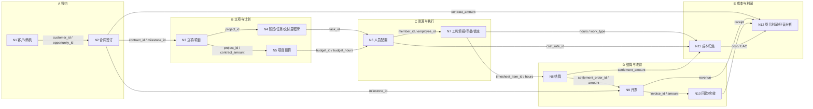
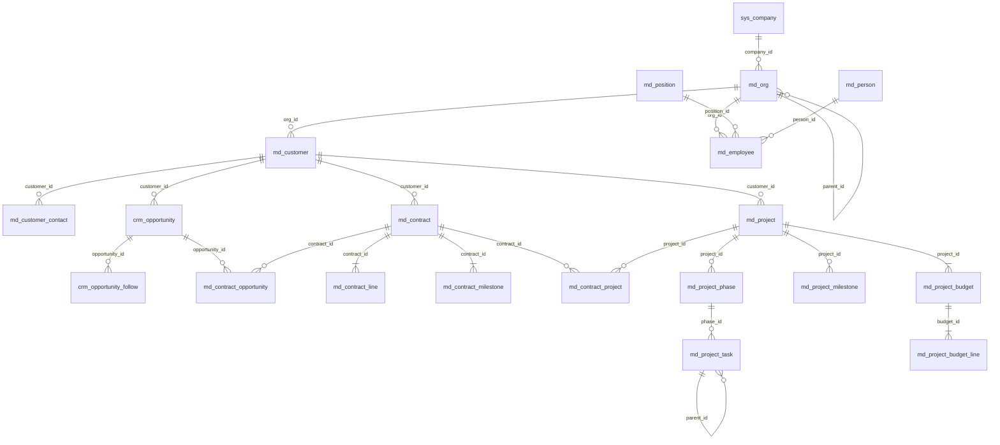
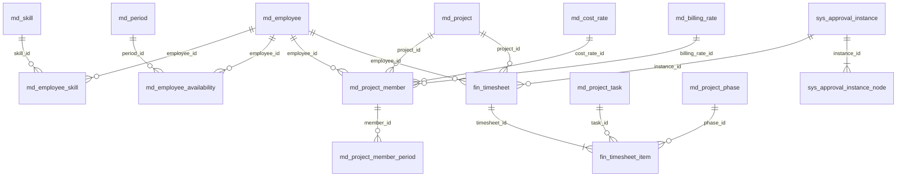
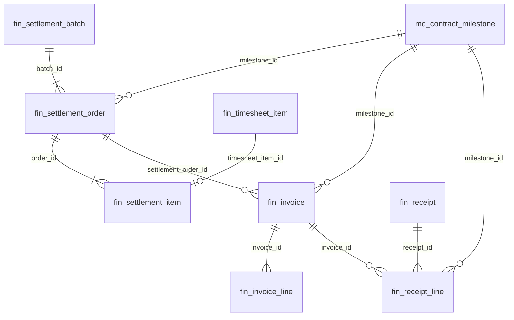
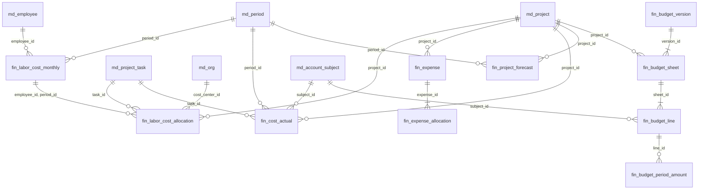

# 链路 1：从客户签约到项目交付（延伸到项目利润）
## 主数据表 · 节点数据 · 表关联图谱

> **范围**：链路 1，共 12 个节点、5 个阶段，终点到“项目利润/经营分析”。
> **口径**：只列**目标表**（统一后的 `md_/crm_/fin_/sys_`），不列四套旧系统表。
> **粒度**：表级 + 关键字段（PK/FK/UK/BK/状态/金额/数量/时间），不展开全字段。
> **关联**：完整 DDL 见上一版《主数据模型》，本文件聚焦“节点—表—数据—关联”。

---

## 0. 阅读说明

### 0.1 符号

| 符号 | 含义 |
|---|---|
| `PK` | 主键 |
| `FK` | 外键 |
| `UK` | 唯一键 |
| `BK` | 业务编码（人可读、对外使用） |
| `ENUM` | 状态/类型枚举 |
| `AMT` | 金额 |
| `QTY` | 数量/工时/天数 |
| `DT` | 日期/时间 |
| `W` | 该节点主写 |
| `R` | 该节点引用/只读 |
| `D` | 该节点派生/视图计算 |

### 0.2 12 节点 / 5 阶段

| 阶段          | 节点             | 业务动作                    |
| ----------- | -------------- | ----------------------- |
| **A 签约**    | N1 客户/商机       | 客户建档、商机推进               |
| A           | N2 合同签订        | 合同头/行/收款里程碑/付款条件        |
| **B 立项与计划** | N3 立项/项目       | 合同转项目、项目经理、合同-项目关联      |
| B           | N4 阶段/任务/交付里程碑 | 拆阶段、WBS、交付物、验收节点        |
| B           | N5 项目预算        | 人力/采购/费用/外包预算、预算工时      |
| **C 资源与执行** | N6 人员配置        | 技能匹配、可用工时、成员/期间、成本/结算单价 |
| C           | N7 工时填报/审批/锁定  | 按项目/任务/工时类型填报、审批、锁定     |
| **D 结算与收款** | N8 结算          | 可结算工时→结算批次/结算单/金额       |
| D           | N9 开票          | 按里程碑/结算单开票              |
| D           | N10 回款/应收      | 收款登记、核销、应收余额            |
| **E 成本与利润** | N11 成本归集       | 人工成本分摊、费用/采购、成本实际、EAC   |
| E           | N12 项目利润/经营分析  | 收入−成本−EAC，项目/组织/客户维度    |

### 0.3 读图顺序

1. 先看 **1.2 节点流图**：理解业务顺序和交接物。
2. 再看 **2. 表清单**：知道每张表是什么、关键字段是什么。
3. 再看 **3. 节点卡**：知道每个节点读写哪些表、用什么数据、有什么规则。
4. 再看 **4. ER 图**：知道表之间怎么关联。
5. 再看 **5. 节点-表矩阵**：检查是否有漏写/多写。
6. 最后看 **6. 主键传播 / 7. 校验规则 / 8. 断点清单**：知道哪里会断、怎么补。

---

## 1. 链路总览

### 1.1 主键主线

```
customer_id → contract_id → project_id → task_id → employee_id
            → timesheet_item_id → settlement_order_id → invoice_id → receipt_id
            → period_id / subject_id → 项目利润
```

### 1.2 节点流图



### 1.3 五个交接物

| 交接 | 交接物 | 主键 | 业务含义 |
|---|---|---|---|
| N1→N2 | 合同签订交接单 | `customer_id`、`opportunity_id` | 客户/商机转合同 |
| N2→N3 | 立项交接单 | `contract_id`、`milestone_id` | 合同转项目 |
| N3→N4/N5 | 项目计划包 | `project_id` | 项目拆阶段/任务/预算 |
| N4/N5→N6 | 资源需求单 | `task_id`、`budget_hours` | 按任务/预算配人 |
| N6→N7 | 成员/期间 | `member_id`、`employee_id` | 谁在什么时间投入 |
| N7→N8 | 结算交接单 | `timesheet_item_id` | 工时转结算 |
| N8→N9 | 开票交接单 | `settlement_order_id` | 结算转开票 |
| N9→N10 | 回款核销单 | `invoice_id` | 开票转回款 |
| N7/N8→N11 | 成本归集包 | `timesheet_item_id`、`settlement_order_id` | 工时/结算转成本 |
| N2/N9/N10/N11→N12 | 经营分析包 | 全部主键 | 收入/成本/EAC 转利润 |

---

## 2. 表清单（按域）

### 2.1 基础维度

| 表                    | 作用          | 关键字段                                                                                                                              | 字段说明（中文名）                                                                                                                                                              | 主要关联                                                                                                     |
| -------------------- | ----------- | --------------------------------------------------------------------------------------------------------------------------------- | ---------------------------------------------------------------------------------------------------------------------------------------------------------------------- | -------------------------------------------------------------------------------------------------------- |
| `sys_company`        | 法人主体        | `company_id PK`、`company_code UK/BK`、`currency_code`、`fiscal_year_start_month`                                                    | `company_id`（法人ID）、`company_code`（法人编码）、`currency_code`（本位币）、`fiscal_year_start_month`（财年起始月）                                                                          | 所有表 `company_id`                                                                                         |
| `md_org`             | 组织/产品线/成本中心 | `org_id PK`、`company_id FK`、`parent_id FK`、`org_code UK/BK`、`org_type ENUM`、`dimension_role ENUM`、`path`、`manager_employee_id FK` | `org_id`（组织ID）、`company_id`（法人ID）、`parent_id`（上级组织ID）、`org_code`（组织编码）、`org_type`（组织类型）、`dimension_role`（维度角色：管理/产品线/成本中心）、`path`（组织路径）、`manager_employee_id`（负责人员工ID） | `md_customer.org_id`、`md_employee.org_id`、`md_project.org_id`、`fin_labor_cost_allocation.cost_center_id` |
| `md_position`        | 岗位/职级       | `position_id PK`、`position_code UK/BK`、`position_name`、`level_code`、`job_family`                                                  | `position_id`（岗位ID）、`position_code`（岗位编码）、`position_name`（岗位名称）、`level_code`（职级）、`job_family`（岗位序列）                                                                    | `md_employee.position_id`                                                                                |
| `md_person`          | 自然人         | `person_id PK`、`person_no UK/BK`、`full_name`、`id_type`、`id_no_hash UK`、`mobile`、`email`                                           | `person_id`（人员ID）、`person_no`（人员编号）、`full_name`（姓名）、`id_type`（证件类型）、`id_no_hash`（证件号哈希）、`mobile`（手机号）、`email`（邮箱）                                                      | `md_employee.person_id`                                                                                  |
| `md_fiscal_year`     | 财年          | `fiscal_year_id PK`、`company_id FK`、`fiscal_year`、`start_date`、`end_date`                                                         | `fiscal_year_id`（财年ID）、`company_id`（法人ID）、`fiscal_year`（财年）、`start_date`（开始日期）、`end_date`（结束日期）                                                                        | `md_period.fiscal_year_id`                                                                               |
| `md_period`          | 会计期间        | `period_id PK`、`fiscal_year_id FK`、`period_code`、`period_type`、`start_date`、`end_date`                                            | `period_id`（期间ID）、`fiscal_year_id`（财年ID）、`period_code`（期间编码）、`period_type`（期间类型：月/季/年）、`start_date`（开始日期）、`end_date`（结束日期）                                             | `fin_budget_period_amount`、`fin_labor_cost_monthly`、`fin_project_forecast`                               |
| `md_account_subject` | 统一科目        | `subject_id PK`、`company_id FK`、`subject_code UK/BK`、`subject_name`、`subject_type ENUM`、`parent_id FK`                            | `subject_id`（科目ID）、`company_id`（法人ID）、`subject_code`（科目编码）、`subject_name`（科目名称）、`subject_type`（科目类型）、`parent_id`（上级科目ID）                                               | `fin_budget_line`、`fin_cost_actual`、`md_project_budget_line`                                             |
| `sys_document`       | 统一附件        | `doc_id PK`、`biz_type ENUM`、`biz_id`、`file_name`、`file_url`、`file_hash`、`file_size`                                               | `doc_id`（附件ID）、`biz_type`（业务类型）、`biz_id`（业务ID）、`file_name`（文件名）、`file_url`（文件地址）、`file_hash`（文件哈希）、`file_size`（文件大小）                                                   | 多态引用合同/任务/发票                                                                                             |
| `sys_sequence`       | 单据序列        | `id PK`、`seq_type`、`scope_key`、`seq_date`、`current_no`、`prefix_template`、`pad_length`                                             | `id`（序列ID）、`seq_type`（序列类型）、`scope_key`（作用域）、`seq_date`（序列日期）、`current_no`（当前序号）、`prefix_template`（前缀模板）、`pad_length`（补零位数）                                            | 合同/项目/工时/结算/发票/收款编号                                                                                      |

### 2.2 客户与商机

| 表 | 作用 | 关键字段 | 字段说明（中文名） | 主要关联 |
|---|---|---|---|---|
| `md_customer` | 客户主数据 | `customer_id PK`、`company_id FK`、`customer_code UK/BK`、`customer_name`、`tax_number UK`、`customer_status ENUM`、`owner_employee_id FK`、`org_id FK`、`parent_customer_id FK` | `customer_id`（客户ID）、`company_id`（法人ID）、`customer_code`（客户编码）、`customer_name`（客户名称）、`tax_number`（税号）、`customer_status`（客户状态）、`owner_employee_id`（负责人员工ID）、`org_id`（归属组织ID）、`parent_customer_id`（上级客户ID） | `md_contract.customer_id`、`crm_opportunity.customer_id`、`fin_invoice.customer_id`、`fin_receipt.customer_id` |
| `md_customer_contact` | 联系人 | `contact_id PK`、`customer_id FK`、`contact_name`、`mobile`、`email`、`is_primary`、`is_decision_maker` | `contact_id`（联系人ID）、`customer_id`（客户ID）、`contact_name`（联系人姓名）、`mobile`（手机号）、`email`（邮箱）、`is_primary`（是否主联系人）、`is_decision_maker`（是否决策人） | `md_customer` |
| `crm_opportunity` | 商机 | `opportunity_id PK`、`company_id FK`、`opportunity_no UK/BK`、`customer_id FK`、`opportunity_name`、`stage ENUM`、`probability`、`expected_amount AMT`、`expected_sign_date DT`、`owner_employee_id FK` | `opportunity_id`（商机ID）、`company_id`（法人ID）、`opportunity_no`（商机编号）、`customer_id`（客户ID）、`opportunity_name`（商机名称）、`stage`（商机阶段）、`probability`（成交概率）、`expected_amount`（预计金额）、`expected_sign_date`（预计签约日期）、`owner_employee_id`（负责人员工ID） | `md_contract_opportunity` |
| `crm_opportunity_follow` | 商机跟进 | `follow_id PK`、`opportunity_id FK`、`follow_time DT`、`content`、`plan_status ENUM` | `follow_id`（跟进ID）、`opportunity_id`（商机ID）、`follow_time`（跟进时间）、`content`（跟进内容）、`plan_status`（计划状态） | `crm_opportunity` |

### 2.3 合同

| 表 | 作用 | 关键字段 | 字段说明（中文名） | 主要关联 |
|---|---|---|---|---|
| `md_contract` | 合同主表 | `contract_id PK`、`company_id FK`、`contract_no UK/BK`、`sub_contract_no UK`、`contract_type ENUM`、`parent_contract_id FK`、`customer_id FK`、`org_id FK`、`product_line_id FK`、`amount_excl_tax AMT`、`tax_rate`、`tax_amount AMT`、`amount_incl_tax AMT`、`sign_date DT`、`payment_terms`、`contract_status ENUM` | `contract_id`（合同ID）、`company_id`（法人ID）、`contract_no`（合同号）、`sub_contract_no`（子合同号）、`contract_type`（合同类型）、`parent_contract_id`（父合同ID）、`customer_id`（客户ID）、`org_id`（归属组织ID）、`product_line_id`（产品线ID）、`amount_excl_tax`（不含税金额）、`tax_rate`（税率）、`tax_amount`（税额）、`amount_incl_tax`（含税金额）、`sign_date`（签约日期）、`payment_terms`（付款条件）、`contract_status`（合同状态） | `md_contract_line`、`md_contract_milestone`、`md_contract_project`、`md_project.primary_contract_id`、`fin_invoice.contract_id`、`fin_budget_sheet.contract_id` |
| `md_contract_line` | 合同行 | `contract_line_id PK`、`contract_id FK`、`line_no`、`item_type ENUM`、`item_name`、`quantity QTY`、`unit_price AMT`、`amount_incl_tax AMT`、`settlement_method ENUM` | `contract_line_id`（合同行ID）、`contract_id`（合同ID）、`line_no`（行号）、`item_type`（行类型）、`item_name`（行名称）、`quantity`（数量）、`unit_price`（单价）、`amount_incl_tax`（含税金额）、`settlement_method`（结算方式） | `md_contract` |
| `md_contract_milestone` | 收款/开票里程碑 | `contract_milestone_id PK`、`contract_id FK`、`milestone_code UK`、`milestone_name`、`milestone_type ENUM`、`payment_ratio`、`amount_incl_tax AMT`、`plan_invoice_date DT`、`actual_invoice_date DT`、`plan_payment_date DT`、`actual_payment_date DT`、`invoice_status ENUM`、`payment_status ENUM` | `contract_milestone_id`（合同里程碑ID）、`contract_id`（合同ID）、`milestone_code`（里程碑编码）、`milestone_name`（里程碑名称）、`milestone_type`（里程碑类型）、`payment_ratio`（收款比例）、`amount_incl_tax`（含税金额）、`plan_invoice_date`（计划开票日期）、`actual_invoice_date`（实际开票日期）、`plan_payment_date`（计划回款日期）、`actual_payment_date`（实际回款日期）、`invoice_status`（开票状态）、`payment_status`（回款状态） | `fin_invoice.milestone_id`、`fin_receipt_line.milestone_id`、`fin_settlement_order.milestone_id` |
| `md_contract_project` | 合同-项目关联 | `id PK`、`contract_id FK`、`project_id FK`、`relation_type ENUM`、`allocation_ratio`、`is_primary` | `id`（关联ID）、`contract_id`（合同ID）、`project_id`（项目ID）、`relation_type`（关系类型：主/子/变更）、`allocation_ratio`（分摊比例）、`is_primary`（是否主合同） | `md_contract`、`md_project` |
| `md_contract_opportunity` | 合同-商机关联 | `id PK`、`contract_id FK`、`opportunity_id FK` | `id`（关联ID）、`contract_id`（合同ID）、`opportunity_id`（商机ID） | `md_contract`、`crm_opportunity` |

### 2.4 项目与交付

| 表 | 作用 | 关键字段 | 字段说明（中文名） | 主要关联 |
|---|---|---|---|---|
| `md_project` | 项目主表 | `project_id PK`、`company_id FK`、`project_code UK/BK`、`project_name`、`customer_id FK`、`primary_contract_id FK`、`org_id FK`、`product_line_id FK`、`pm_employee_id FK`、`project_status ENUM`、`planned_start_date DT`、`planned_end_date DT`、`percent_complete` | `project_id`（项目ID）、`company_id`（法人ID）、`project_code`（项目编码）、`project_name`（项目名称）、`customer_id`（客户ID）、`primary_contract_id`（主合同ID）、`org_id`（归属组织ID）、`product_line_id`（产品线ID）、`pm_employee_id`（项目经理员工ID）、`project_status`（项目状态）、`planned_start_date`（计划开始日期）、`planned_end_date`（计划结束日期）、`percent_complete`（完工百分比） | `md_contract_project`、`md_project_phase`、`md_project_member`、`fin_timesheet`、`fin_settlement_batch`、`fin_cost_actual`、`fin_project_forecast` |
| `md_project_phase` | 项目阶段 | `phase_id PK`、`project_id FK`、`phase_code UK`、`phase_name`、`seq_no`、`planned_start_date DT`、`planned_end_date DT`、`status ENUM`、`percent_complete` | `phase_id`（阶段ID）、`project_id`（项目ID）、`phase_code`（阶段编码）、`phase_name`（阶段名称）、`seq_no`（排序号）、`planned_start_date`（计划开始日期）、`planned_end_date`（计划结束日期）、`status`（阶段状态）、`percent_complete`（完工百分比） | `md_project_task`、`fin_timesheet_item.phase_id` |
| `md_project_task` | 任务/WBS | `task_id PK`、`project_id FK`、`phase_id FK`、`parent_id FK`、`task_code UK`、`task_name`、`assignee_employee_id FK`、`planned_hours QTY`、`actual_hours QTY`、`status ENUM`、`percent_complete`、`milestone_id FK` | `task_id`（任务ID）、`project_id`（项目ID）、`phase_id`（阶段ID）、`parent_id`（父任务ID）、`task_code`（任务编码）、`task_name`（任务名称）、`assignee_employee_id`（负责人员工ID）、`planned_hours`（计划工时）、`actual_hours`（实际工时）、`status`（任务状态）、`percent_complete`（完工百分比）、`milestone_id`（交付里程碑ID） | `fin_timesheet_item.task_id`、`fin_cost_actual.task_id`、`md_project_budget_line.task_id` |
| `md_project_milestone` | 交付里程碑 | `project_milestone_id PK`、`project_id FK`、`contract_milestone_id FK`、`milestone_code UK`、`milestone_name`、`milestone_type ENUM`、`planned_date DT`、`actual_date DT`、`status ENUM`、`deliverable_doc_id FK` | `project_milestone_id`（交付里程碑ID）、`project_id`（项目ID）、`contract_milestone_id`（合同里程碑ID）、`milestone_code`（里程碑编码）、`milestone_name`（里程碑名称）、`milestone_type`（里程碑类型）、`planned_date`（计划日期）、`actual_date`（实际日期）、`status`（状态）、`deliverable_doc_id`（交付物附件ID） | `md_contract_milestone`（可选关联）、`sys_document` |
| `md_project_budget` | 项目预算头 | `project_budget_id PK`、`company_id FK`、`project_id FK`、`budget_version`、`budget_status ENUM`、`total_budget AMT`、`total_hours QTY`、`start_date DT`、`end_date DT`、`approval_instance_id FK` | `project_budget_id`（项目预算ID）、`company_id`（法人ID）、`project_id`（项目ID）、`budget_version`（预算版本）、`budget_status`（预算状态）、`total_budget`（预算总额）、`total_hours`（预算总工时）、`start_date`（开始日期）、`end_date`（结束日期）、`approval_instance_id`（审批实例ID） | `md_project_budget_line` |
| `md_project_budget_line` | 项目预算行 | `budget_line_id PK`、`budget_id FK`、`subject_id FK`、`phase_id FK`、`task_id FK`、`period_id FK`、`cost_type ENUM`、`budget_amount AMT`、`budget_hours QTY` | `budget_line_id`（预算行ID）、`budget_id`（预算ID）、`subject_id`（科目ID）、`phase_id`（阶段ID）、`task_id`（任务ID）、`period_id`（期间ID）、`cost_type`（成本类型）、`budget_amount`（预算金额）、`budget_hours`（预算工时） | `md_project_budget`、`md_account_subject`、`md_period`、`fin_budget_line`（年度约束） |

### 2.5 资源与技能

| 表 | 作用 | 关键字段 | 字段说明（中文名） | 主要关联 |
|---|---|---|---|---|
| `md_skill` | 技能字典 | `skill_id PK`、`company_id FK`、`skill_code UK/BK`、`skill_name`、`skill_category ENUM`、`parent_id FK` | `skill_id`（技能ID）、`company_id`（法人ID）、`skill_code`（技能编码）、`skill_name`（技能名称）、`skill_category`（技能分类）、`parent_id`（上级技能ID） | `md_employee_skill.skill_id` |
| `md_employee_skill` | 员工技能 | `id PK`、`employee_id FK`、`skill_id FK`、`skill_level`、`years`、`is_primary`、`certified`、`last_used_date` | `id`（记录ID）、`employee_id`（员工ID）、`skill_id`（技能ID）、`skill_level`（技能等级）、`years`（年限）、`is_primary`（是否主技能）、`certified`（是否认证）、`last_used_date`（最近使用日期） | `md_employee`、`md_skill` |
| `md_employee_availability` | 可用工时 | `id PK`、`employee_id FK`、`period_id FK`、`standard_hours QTY`、`leave_hours QTY`、`available_hours QTY`、`allocated_hours QTY`、`billable_hours QTY`、`internal_hours QTY`、`idle_hours QTY`、`utilization_rate`、`snapshot_date DT` | `id`（记录ID）、`employee_id`（员工ID）、`period_id`（期间ID）、`standard_hours`（标准工时）、`leave_hours`（请假工时）、`available_hours`（可用工时）、`allocated_hours`（已分配工时）、`billable_hours`（可计费工时）、`internal_hours`（内部工时）、`idle_hours`（闲置工时）、`utilization_rate`（利用率）、`snapshot_date`（快照日期） | `md_employee`、`md_period`、`v_employee_utilization` |
| `md_project_member` | 项目成员 | `member_id PK`、`project_id FK`、`employee_id FK`、`person_id FK`、`role_in_project`、`work_nature ENUM`、`cost_rate_id FK`、`billing_rate_id FK`、`planned_hours QTY`、`status` | `member_id`（成员ID）、`project_id`（项目ID）、`employee_id`（员工ID）、`person_id`（人员ID）、`role_in_project`（项目角色）、`work_nature`（工时性质：可结算/不可结算）、`cost_rate_id`（成本单价ID）、`billing_rate_id`（结算单价ID）、`planned_hours`（计划工时）、`status`（状态） | `md_project_member_period`、`fin_timesheet`、`fin_settlement_order` |
| `md_project_member_period` | 成员期间 | `member_period_id PK`、`member_id FK`、`seq_no`、`planned_join_date DT`、`planned_leave_date DT`、`actual_join_date DT`、`actual_leave_date DT`、`workload_ratio`、`planned_hours QTY`、`is_active` | `member_period_id`（成员期间ID）、`member_id`（成员ID）、`seq_no`（序号）、`planned_join_date`（计划进场日期）、`planned_leave_date`（计划离场日期）、`actual_join_date`（实际进场日期）、`actual_leave_date`（实际离场日期）、`workload_ratio`（投入比例）、`planned_hours`（计划工时）、`is_active`（是否有效） | `md_project_member` |
| `md_cost_rate` | 成本单价 | `cost_rate_id PK`、`company_id FK`、`rate_type ENUM`、`scope_type ENUM`、`scope_id`、`level_code`、`effective_from DT`、`effective_to DT`、`daily_cost AMT`、`hourly_cost AMT` | `cost_rate_id`（成本单价ID）、`company_id`（法人ID）、`rate_type`（单价类型：标准/实际）、`scope_type`（作用域类型：人/岗位/职级/项目）、`scope_id`（作用域ID）、`level_code`（职级）、`effective_from`（生效日期）、`effective_to`（失效日期）、`daily_cost`（日成本）、`hourly_cost`（小时成本） | `md_project_member.cost_rate_id`、`fin_labor_cost_allocation` |
| `md_billing_rate` | 结算单价 | `billing_rate_id PK`、`company_id FK`、`contract_id FK`、`project_id FK`、`role_code`、`level_code`、`effective_from DT`、`effective_to DT`、`daily_rate AMT`、`hourly_rate AMT` | `billing_rate_id`（结算单价ID）、`company_id`（法人ID）、`contract_id`（合同ID）、`project_id`（项目ID）、`role_code`（角色编码）、`level_code`（职级）、`effective_from`（生效日期）、`effective_to`（失效日期）、`daily_rate`（日单价）、`hourly_rate`（小时单价） | `md_project_member.billing_rate_id`、`fin_settlement_order.unit_price` |
| `md_work_calendar` | 工作日历 | `id PK`、`company_id FK`、`cal_date DT`、`day_type ENUM`、`standard_hours QTY`、`holiday_name` | `id`（记录ID）、`company_id`（法人ID）、`cal_date`（日期）、`day_type`（日期类型：工作日/周末/节假日/调休）、`standard_hours`（标准工时）、`holiday_name`（节假日名称） | `md_employee_availability`、`fin_timesheet_item` |

### 2.6 工时与审批

| 表 | 作用 | 关键字段 | 字段说明（中文名） | 主要关联 |
|---|---|---|---|---|
| `fin_timesheet` | 工时单 | `timesheet_id PK`、`company_id FK`、`timesheet_no UK/BK`、`employee_id FK`、`project_id FK`、`week_start_date DT`、`week_end_date DT`、`total_hours QTY`、`status ENUM`、`locked`、`instance_id FK` | `timesheet_id`（工时单ID）、`company_id`（法人ID）、`timesheet_no`（工时单号）、`employee_id`（员工ID）、`project_id`（项目ID）、`week_start_date`（周开始日期）、`week_end_date`（周结束日期）、`total_hours`（总工时）、`status`（状态）、`locked`（是否锁定）、`instance_id`（审批实例ID） | `fin_timesheet_item`、`sys_approval_instance` |
| `fin_timesheet_item` | 工时明细 | `timesheet_item_id PK`、`timesheet_id FK`、`company_id FK`、`employee_id FK`、`project_id FK`、`phase_id FK`、`task_id FK`、`work_date DT`、`work_hours QTY`、`work_type ENUM`、`is_billable`、`settlement_status ENUM`、`settlement_batch_no` | `timesheet_item_id`（工时明细ID）、`timesheet_id`（工时单ID）、`company_id`（法人ID）、`employee_id`（员工ID）、`project_id`（项目ID）、`phase_id`（阶段ID）、`task_id`（任务ID）、`work_date`（工作日期）、`work_hours`（工时）、`work_type`（工时类型）、`is_billable`（是否可计费）、`settlement_status`（结算状态）、`settlement_batch_no`（结算批次号） | `fin_settlement_item`、`fin_labor_cost_allocation`、`fin_cost_actual` |
| `sys_approval_instance` | 审批实例 | `instance_id PK`、`business_type`、`business_id`、`business_no`、`status ENUM`、`current_node_order`、`applicant_id FK`、`submit_time DT`、`finish_time DT` | `instance_id`（审批实例ID）、`business_type`（业务类型）、`business_id`（业务ID）、`business_no`（业务单号）、`status`（审批状态）、`current_node_order`（当前节点序号）、`applicant_id`（申请人ID）、`submit_time`（提交时间）、`finish_time`（完成时间） | `fin_timesheet.instance_id`、`md_project_budget.approval_instance_id` |
| `sys_approval_instance_node` | 审批节点实例 | `node_id PK`、`instance_id FK`、`node_order`、`node_name`、`approver_type`、`approver_id FK`、`sign_type`、`status ENUM`、`action_time DT` | `node_id`（审批节点ID）、`instance_id`（审批实例ID）、`node_order`（节点序号）、`node_name`（节点名称）、`approver_type`（审批人类型）、`approver_id`（审批人ID）、`sign_type`（会签/或签）、`status`（节点状态）、`action_time`（处理时间） | `sys_approval_instance` |

### 2.7 结算

| 表 | 作用 | 关键字段 | 字段说明（中文名） | 主要关联 |
|---|---|---|---|---|
| `fin_settlement_batch` | 结算批次 | `batch_id PK`、`company_id FK`、`batch_no UK/BK`、`batch_type ENUM`、`settlement_month`、`customer_id FK`、`project_id FK`、`contract_id FK`、`start_date DT`、`end_date DT`、`total_days QTY`、`total_amount AMT`、`status ENUM` | `batch_id`（结算批次ID）、`company_id`（法人ID）、`batch_no`（批次号）、`batch_type`（批次类型：客户/供应商）、`settlement_month`（结算月份）、`customer_id`（客户ID）、`project_id`（项目ID）、`contract_id`（合同ID）、`start_date`（开始日期）、`end_date`（结束日期）、`total_days`（总天数）、`total_amount`（总金额）、`status`（状态） | `fin_settlement_order` |
| `fin_settlement_order` | 结算单 | `order_id PK`、`company_id FK`、`order_no UK/BK`、`batch_id FK`、`settlement_type ENUM`、`customer_id FK`、`project_id FK`、`contract_id FK`、`milestone_id FK`、`employee_id FK`、`work_nature`、`work_month`、`unit_price AMT`、`days QTY`、`amount AMT`、`invoice_id FK`、`status ENUM` | `order_id`（结算单ID）、`company_id`（法人ID）、`order_no`（结算单号）、`batch_id`（结算批次ID）、`settlement_type`（结算类型）、`customer_id`（客户ID）、`project_id`（项目ID）、`contract_id`（合同ID）、`milestone_id`（合同里程碑ID）、`employee_id`（员工ID）、`work_nature`（工时性质）、`work_month`（工作月份）、`unit_price`（单价）、`days`（天数）、`amount`（金额）、`invoice_id`（发票ID）、`status`（状态） | `fin_settlement_item`、`fin_invoice` |
| `fin_settlement_item` | 结算明细 | `settlement_item_id PK`、`order_id FK`、`timesheet_item_id FK`、`work_date DT`、`work_hours QTY`、`work_days QTY`、`settlement_days QTY`、`amount AMT` | `settlement_item_id`（结算明细ID）、`order_id`（结算单ID）、`timesheet_item_id`（工时明细ID）、`work_date`（工作日期）、`work_hours`（工时）、`work_days`（工天）、`settlement_days`（结算天数）、`amount`（金额） | `fin_timesheet_item` |

### 2.8 开票与回款

| 表 | 作用 | 关键字段 | 字段说明（中文名） | 主要关联 |
|---|---|---|---|---|
| `fin_invoice` | 发票 | `invoice_id PK`、`company_id FK`、`invoice_no UK/BK`、`invoice_code`、`invoice_type ENUM`、`contract_id FK`、`project_id FK`、`customer_id FK`、`milestone_id FK`、`settlement_order_id FK`、`invoice_date DT`、`amount_excl_tax AMT`、`tax_rate`、`tax_amount AMT`、`amount_incl_tax AMT`、`status ENUM`、`red_flush_of FK` | `invoice_id`（发票ID）、`company_id`（法人ID）、`invoice_no`（发票号）、`invoice_code`（发票代码）、`invoice_type`（发票类型）、`contract_id`（合同ID）、`project_id`（项目ID）、`customer_id`（客户ID）、`milestone_id`（合同里程碑ID）、`settlement_order_id`（结算单ID）、`invoice_date`（开票日期）、`amount_excl_tax`（不含税金额）、`tax_rate`（税率）、`tax_amount`（税额）、`amount_incl_tax`（含税金额）、`status`（发票状态）、`red_flush_of`（红冲原发票ID） | `fin_invoice_line`、`fin_receipt_line` |
| `fin_invoice_line` | 发票行 | `invoice_line_id PK`、`invoice_id FK`、`line_no`、`item_name`、`quantity QTY`、`unit_price AMT`、`amount_excl_tax AMT`、`tax_rate`、`tax_amount AMT`、`amount_incl_tax AMT`、`milestone_id FK`、`settlement_order_id FK` | `invoice_line_id`（发票行ID）、`invoice_id`（发票ID）、`line_no`（行号）、`item_name`（项目名称）、`quantity`（数量）、`unit_price`（单价）、`amount_excl_tax`（不含税金额）、`tax_rate`（税率）、`tax_amount`（税额）、`amount_incl_tax`（含税金额）、`milestone_id`（合同里程碑ID）、`settlement_order_id`（结算单ID） | `fin_invoice` |
| `fin_receipt` | 收款 | `receipt_id PK`、`company_id FK`、`receipt_no UK/BK`、`customer_id FK`、`contract_id FK`、`project_id FK`、`receipt_date DT`、`amount AMT`、`currency_code`、`payment_method`、`status ENUM` | `receipt_id`（收款ID）、`company_id`（法人ID）、`receipt_no`（收款单号）、`customer_id`（客户ID）、`contract_id`（合同ID）、`project_id`（项目ID）、`receipt_date`（收款日期）、`amount`（收款金额）、`currency_code`（币种）、`payment_method`（收款方式）、`status`（状态） | `fin_receipt_line` |
| `fin_receipt_line` | 收款核销 | `receipt_line_id PK`、`receipt_id FK`、`invoice_id FK`、`milestone_id FK`、`write_off_amount AMT` | `receipt_line_id`（核销行ID）、`receipt_id`（收款ID）、`invoice_id`（发票ID）、`milestone_id`（合同里程碑ID）、`write_off_amount`（核销金额） | `fin_invoice`、`md_contract_milestone` |
| `v_ar_balance` | 应收视图 | `invoice_id`、`customer_id`、`contract_id`、`project_id`、`invoice_amount`、`write_off_amount`、`balance`、`overdue_days` | `invoice_id`（发票ID）、`customer_id`（客户ID）、`contract_id`（合同ID）、`project_id`（项目ID）、`invoice_amount`（开票金额）、`write_off_amount`（已核销金额）、`balance`（应收余额）、`overdue_days`（逾期天数） | `fin_invoice`、`fin_receipt_line` |

### 2.9 成本与费用

| 表 | 作用 | 关键字段 | 字段说明（中文名） | 主要关联 |
|---|---|---|---|---|
| `md_labor_cost_policy` | 用工成本政策 | `id PK`、`company_id FK`、`effective_from DT`、`cost_component ENUM`、`calc_method ENUM`、`rate`、`applies_to` | `id`（政策ID）、`company_id`（法人ID）、`effective_from`（生效日期）、`cost_component`（成本组成）、`calc_method`（计算方式）、`rate`（费率/金额）、`applies_to`（适用范围） | `fin_labor_cost_monthly` |
| `fin_labor_cost_monthly` | 月度完整用工成本 | `id PK`、`company_id FK`、`employee_id FK`、`period_id FK`、`base_salary AMT`、`social_security_company AMT`、`housing_fund_company AMT`、`bonus AMT`、`benefit AMT`、`recruit_alloc AMT`、`training_alloc AMT`、`other_cost AMT`、`total_cost AMT`、`standard_hours QTY`、`available_hours QTY`、`hourly_cost_standard AMT`、`hourly_cost_available AMT` | `id`（记录ID）、`company_id`（法人ID）、`employee_id`（员工ID）、`period_id`（期间ID）、`base_salary`（基本工资）、`social_security_company`（社保公司部分）、`housing_fund_company`（公积金公司部分）、`bonus`（奖金）、`benefit`（福利）、`recruit_alloc`（招聘分摊）、`training_alloc`（培训分摊）、`other_cost`（其他成本）、`total_cost`（完整用工成本）、`standard_hours`（标准工时）、`available_hours`（可用工时）、`hourly_cost_standard`（标准小时成本）、`hourly_cost_available`（可用小时成本） | `fin_labor_cost_allocation` |
| `fin_labor_cost_allocation` | 人力成本分摊 | `id PK`、`company_id FK`、`employee_id FK`、`period_id FK`、`project_id FK`、`task_id FK`、`cost_center_id FK`、`work_type ENUM`、`hours QTY`、`allocated_cost AMT`、`allocation_method` | `id`（分摊ID）、`company_id`（法人ID）、`employee_id`（员工ID）、`period_id`（期间ID）、`project_id`（项目ID）、`task_id`（任务ID）、`cost_center_id`（成本中心ID）、`work_type`（工时类型）、`hours`（分摊工时）、`allocated_cost`（分摊成本）、`allocation_method`（分摊方式） | `fin_labor_cost_monthly`、`md_project`、`md_project_task`、`md_org` |
| `fin_expense` | 费用/采购支出 | `expense_id PK`、`company_id FK`、`expense_no UK/BK`、`employee_id FK`、`project_id FK`、`task_id FK`、`cost_center_id FK`、`expense_type ENUM`、`payee_type`、`payee_id`、`payee_name`、`expense_date DT`、`period_id FK`、`amount AMT`、`tax_amount AMT`、`invoice_id FK`、`status ENUM` | `expense_id`（费用ID）、`company_id`（法人ID）、`expense_no`（费用单号）、`employee_id`（员工ID）、`project_id`（项目ID）、`task_id`（任务ID）、`cost_center_id`（成本中心ID）、`expense_type`（费用类型）、`payee_type`（收款方类型）、`payee_id`（收款方ID）、`payee_name`（收款方名称）、`expense_date`（费用日期）、`period_id`（期间ID）、`amount`（金额）、`tax_amount`（税额）、`invoice_id`（发票ID）、`status`（状态） | `fin_expense_allocation`、`fin_cost_actual` |
| `fin_expense_allocation` | 费用分摊 | `id PK`、`expense_id FK`、`project_id FK`、`cost_center_id FK`、`allocation_ratio`、`allocated_amount AMT` | `id`（分摊ID）、`expense_id`（费用ID）、`project_id`（项目ID）、`cost_center_id`（成本中心ID）、`allocation_ratio`（分摊比例）、`allocated_amount`（分摊金额） | `fin_expense` |
| `fin_cost_actual` | 成本实际 | `cost_id PK`、`company_id FK`、`cost_no UK/BK`、`project_id FK`、`contract_id FK`、`task_id FK`、`subject_id FK`、`cost_type ENUM`、`cost_date DT`、`period_id FK`、`amount AMT`、`currency_code`、`source_type ENUM`、`source_id`、`employee_id FK`、`status ENUM` | `cost_id`（成本ID）、`company_id`（法人ID）、`cost_no`（成本单号）、`project_id`（项目ID）、`contract_id`（合同ID）、`task_id`（任务ID）、`subject_id`（科目ID）、`cost_type`（成本类型）、`cost_date`（成本日期）、`period_id`（期间ID）、`amount`（金额）、`currency_code`（币种）、`source_type`（来源类型）、`source_id`（来源ID）、`employee_id`（员工ID）、`status`（状态） | `md_project`、`md_project_task`、`md_account_subject`、`md_period` |
| `fin_project_forecast` | 项目 EAC/预测 | `forecast_id PK`、`company_id FK`、`project_id FK`、`period_id FK`、`forecast_version`、`percent_complete`、`revenue_recognized AMT`、`cost_to_date AMT`、`estimate_to_complete AMT`、`estimate_at_completion AMT`、`forecast_revenue AMT`、`forecast_profit AMT`、`forecast_margin`、`method ENUM` | `forecast_id`（预测ID）、`company_id`（法人ID）、`project_id`（项目ID）、`period_id`（期间ID）、`forecast_version`（预测版本）、`percent_complete`（完工百分比）、`revenue_recognized`（已确认收入）、`cost_to_date`（已发生成本）、`estimate_to_complete`（预计剩余成本 ETC）、`estimate_at_completion`（预计总成本 EAC）、`forecast_revenue`（预计收入）、`forecast_profit`（预计利润）、`forecast_margin`（预计毛利率）、`method`（预测方法） | `v_project_pnl` |

### 2.10 预算

| 表 | 作用 | 关键字段 | 字段说明（中文名） | 主要关联 |
|---|---|---|---|---|
| `fin_budget_version` | 年度预算版本 | `version_id PK`、`company_id FK`、`fiscal_year`、`version_code UK/BK`、`version_name`、`budget_scene ENUM`、`is_active`、`is_locked`、`is_finalized` | `version_id`（预算版本ID）、`company_id`（法人ID）、`fiscal_year`（财年）、`version_code`（版本编码）、`version_name`（版本名称）、`budget_scene`（预算场景）、`is_active`（是否启用）、`is_locked`（是否锁定）、`is_finalized`（是否定稿） | `fin_budget_sheet` |
| `fin_budget_sheet` | 预算表 | `sheet_id PK`、`company_id FK`、`fiscal_year`、`version_id FK`、`subject_id FK`、`org_id FK`、`product_line_id FK`、`project_id FK`、`contract_id FK`、`total_amount AMT`、`approval_status ENUM` | `sheet_id`（预算表ID）、`company_id`（法人ID）、`fiscal_year`（财年）、`version_id`（预算版本ID）、`subject_id`（科目ID）、`org_id`（组织ID）、`product_line_id`（产品线ID）、`project_id`（项目ID）、`contract_id`（合同ID）、`total_amount`（预算总额）、`approval_status`（审批状态） | `fin_budget_line` |
| `fin_budget_line` | 预算行 | `line_id PK`、`sheet_id FK`、`company_id FK`、`fiscal_year`、`version_id FK`、`subject_id FK`、`project_id FK`、`contract_id FK`、`milestone_id FK`、`line_amount AMT`、`calc_formula` | `line_id`（预算行ID）、`sheet_id`（预算表ID）、`company_id`（法人ID）、`fiscal_year`（财年）、`version_id`（预算版本ID）、`subject_id`（科目ID）、`project_id`（项目ID）、`contract_id`（合同ID）、`milestone_id`（合同里程碑ID）、`line_amount`（行金额）、`calc_formula`（计算公式） | `fin_budget_period_amount` |
| `fin_budget_period_amount` | 预算期间金额 | `id PK`、`line_id FK`、`company_id FK`、`fiscal_year`、`version_id FK`、`period_id FK`、`project_id FK`、`subject_id FK`、`budget_amount AMT`、`actual_amount AMT`、`forecast_amount AMT` | `id`（记录ID）、`line_id`（预算行ID）、`company_id`（法人ID）、`fiscal_year`（财年）、`version_id`（预算版本ID）、`period_id`（期间ID）、`project_id`（项目ID）、`subject_id`（科目ID）、`budget_amount`（预算金额）、`actual_amount`（实际金额）、`forecast_amount`（预测金额） | `v_project_budget_vs_actual` |

### 2.11 视图

| 视图 | 作用 | 输出字段 | 字段说明（中文名） | 数据源 |
|---|---|---|---|---|
| `v_project_pnl` | 项目利润 | `project_id`、`period_id`、`contract_amount`、`revenue`、`budget_cost`、`actual_cost`、`eac`、`etc`、`forecast_profit`、`forecast_margin` | `project_id`（项目ID）、`period_id`（期间ID）、`contract_amount`（合同金额）、`revenue`（收入）、`budget_cost`（预算成本）、`actual_cost`（实际成本）、`eac`（预计总成本）、`etc`（预计剩余成本）、`forecast_profit`（预计利润）、`forecast_margin`（预计毛利率） | `md_contract`、`fin_invoice`、`fin_cost_actual`、`fin_project_forecast` |
| `v_project_labor_cost` | 项目人工成本 | `project_id`、`employee_id`、`period_id`、`hours`、`labor_cost` | `project_id`（项目ID）、`employee_id`（员工ID）、`period_id`（期间ID）、`hours`（工时）、`labor_cost`（人工成本） | `fin_timesheet_item`、`fin_labor_cost_allocation` |
| `v_project_budget_vs_actual` | 预算 vs 实际 | `project_id`、`subject_id`、`budget_amount`、`actual_amount`、`variance` | `project_id`（项目ID）、`subject_id`（科目ID）、`budget_amount`（预算金额）、`actual_amount`（实际金额）、`variance`（差异） | `md_project_budget_line`、`fin_cost_actual`、`fin_budget_period_amount` |
| `v_employee_utilization` | 员工利用率 | `employee_id`、`period_id`、`available_hours`、`billable_hours`、`internal_hours`、`idle_hours`、`utilization_rate` | `employee_id`（员工ID）、`period_id`（期间ID）、`available_hours`（可用工时）、`billable_hours`（可计费工时）、`internal_hours`（内部工时）、`idle_hours`（闲置工时）、`utilization_rate`（利用率） | `md_employee_availability`、`fin_timesheet_item` |
| `v_org_utilization` | 组织效率 | `org_id`、`period_id`、`headcount`、`revenue`、`labor_cost`、`revenue_per_capita`、`profit_per_capita` | `org_id`（组织ID）、`period_id`（期间ID）、`headcount`（人数）、`revenue`（收入）、`labor_cost`（人工成本）、`revenue_per_capita`（人均收入）、`profit_per_capita`（人均利润） | `md_org`、`md_employee`、`fin_invoice`、`fin_labor_cost_monthly` |

---

## 3. 节点卡（N1–N12）

### N1 客户/商机

| 项        | 内容                                                                                                                                |
| -------- | --------------------------------------------------------------------------------------------------------------------------------- |
| **目标**   | 建立客户与商机主数据，为合同提供唯一 `customer_id` / `opportunity_id`                                                                               |
| **输入数据** | 客户名称/税号/行业/区域；商机名称/金额/阶段/概率/预计签约日；销售负责人                                                                                           |
| **输出数据** | `customer_id`、`customer_code`、`tax_number`、`opportunity_id`、`opportunity_no`、`expected_amount`、`probability`、`expected_sign_date` |
| **表**    | **W**：`md_customer`、`md_customer_contact`、`crm_opportunity`、`crm_opportunity_follow`；**R**：`md_org`、`md_employee`、`sys_sequence`  |
| **关键规则** | 客户编码唯一；税号唯一（允许多个 NULL）；商机编号唯一；阶段/概率映射；客户合并需人工复核                                                                                   |
| **校验**   | 客户必须有名称+负责人；商机必须有客户+金额+预计签约日；税号格式校验                                                                                               |
| **主责**   | 销售                                                                                                                                |

### N2 合同签订

| 项 | 内容 |
|---|---|
| **目标** | 把商机转成可执行合同，产出合同头/行/收款里程碑/付款条件 |
| **输入数据** | `customer_id`、`opportunity_id`、合同金额/税率、付款条件、交付周期、合同文件 |
| **输出数据** | `contract_id`、`contract_no`、`sub_contract_no`、`contract_milestone_id`、`amount_incl_tax`、`sign_date`、`contract_status` |
| **表** | **W**：`md_contract`、`md_contract_line`、`md_contract_milestone`、`md_contract_opportunity`、`sys_document`；**R**：`md_customer`、`crm_opportunity`、`md_org`、`sys_sequence` |
| **关键规则** | 合同号唯一；含税=不含税+税额；里程碑比例合计=100%；未签约必须有预计签约日；签约后才能立项；合同状态机 |
| **校验** | 客户存在；金额>0；里程碑日期在合同期内；付款条件非空；合同文件已上传 |
| **主责** | 销售/法务 |

### N3 立项/项目

| 项        | 内容                                                                                                               |
| -------- | ---------------------------------------------------------------------------------------------------------------- |
| **目标**   | 合同转项目，建立项目主数据与合同-项目关系                                                                                            |
| **输入数据** | `contract_id`、`customer_id`、合同额、交付周期、项目经理                                                                        |
| **输出数据** | `project_id`、`project_code`、`primary_contract_id`、`pm_employee_id`、计划起止日期                                        |
| **表**    | **W**：`md_project`、`md_contract_project`；**R**：`md_contract`、`md_customer`、`md_org`、`md_employee`、`sys_sequence` |
| **关键规则** | 项目编码唯一；一个合同可多项目；一个项目可多合同；`is_primary` 唯一；项目必须有客户和PM                                                              |
| **校验**   | 合同状态=SIGNED/IN_PROGRESS；PM在职；计划日期在合同期内；分配比例合计=1                                                                  |
| **主责**   | PMO                                                                                                              |

### N4 阶段/任务/交付里程碑

| 项        | 内容                                                                                                                          |
| -------- | --------------------------------------------------------------------------------------------------------------------------- |
| **目标**   | 把项目拆成阶段/任务/交付里程碑，形成可执行 WBS                                                                                                  |
| **输入数据** | `project_id`、合同范围、交付周期、PM、交付物清单                                                                                             |
| **输出数据** | `phase_id`、`task_id`、`project_milestone_id`、计划工时/日期、任务负责人                                                                   |
| **表**    | **W**：`md_project_phase`、`md_project_task`、`md_project_milestone`、`sys_document`；**R**：`md_project`、`md_contract_milestone` |
| **关键规则** | 阶段/任务编码项目内唯一；任务父级同项目；任务日期在项目期内；交付里程碑可关联收款里程碑；计划工时合计 ≤ 项目预算工时（软）                                                             |
| **校验**   | 每个项目至少 1 个阶段；任务必须有负责人/计划工时；里程碑必须有日期                                                                                         |
| **主责**   | PM                                                                                                                          |

### N5 项目预算

| 项 | 内容 |
|---|---|
| **目标** | 把合同额/范围转成项目预算（人力/采购/费用/外包） |
| **输入数据** | `contract_id`、`project_id`、合同额、WBS、历史人效、年度预算 |
| **输出数据** | `project_budget_id`、`budget_line_id`、预算金额/工时（按科目/阶段/任务/期间） |
| **表** | **W**：`md_project_budget`、`md_project_budget_line`；**R**：`md_contract`、`md_project`、`md_account_subject`、`md_period`、`fin_budget_sheet`、`fin_budget_line`；**W/R**：`sys_approval_instance`（预算审批） |
| **关键规则** | 预算版本；行合计=头合计；人工预算=预算工时×成本单价；项目预算 ≤ 年度预算（软校验）；审批后锁定 |
| **校验** | 预算>0；科目必填；预算工时与 WBS 匹配；超年度预算需说明 |
| **主责** | PM/财务 |

### N6 人员配置

| 项 | 内容 |
|---|---|
| **目标** | 按技能/可用性/成本配置项目成员，形成成员期间与单价 |
| **输入数据** | `project_id`、`task_id`、预算工时、所需技能/角色、员工可用工时、成本/结算单价 |
| **输出数据** | `member_id`、`employee_id`、`role_in_project`、`work_nature`、`member_period`、`planned_hours`、`cost_rate_id`、`billing_rate_id` |
| **表** | **W**：`md_project_member`、`md_project_member_period`；**R**：`md_employee`、`md_person`、`md_position`、`md_skill`、`md_employee_skill`、`md_employee_availability`、`md_cost_rate`、`md_billing_rate`、`md_project_task`、`md_project_budget_line` |
| **关键规则** | 项目+员工唯一；期间不重叠；投入比例≤100%；可用工时≥计划工时；只有 `work_nature=SETTLE` 的成员可结算；成员必须有效 |
| **校验** | 成员必须有角色/期间；技能匹配；成本/结算单价有效期覆盖项目期 |
| **主责** | PM/HR/PMO |

### N7 工时填报/审批/锁定

| 项 | 内容 |
|---|---|
| **目标** | 员工按项目/任务/工时类型填报，审批后锁定 |
| **输入数据** | `project_id`、`task_id`、`employee_id`、周、工时、工时类型、工作内容 |
| **输出数据** | `timesheet_id`、`timesheet_no`、`total_hours`、`status`、`locked`、`timesheet_item_id`、`work_date`、`work_hours`、`work_type`、`is_billable` |
| **表** | **W**：`fin_timesheet`、`fin_timesheet_item`；**R**：`md_project_member`、`md_project_task`、`md_project_phase`、`md_work_calendar`、`md_employee_availability`；**W/R**：`sys_approval_instance`、`sys_approval_instance_node`；**R**：`sys_sequence` |
| **关键规则** | 员工+项目+周唯一；总工时≤可用工时；日工时≤24；任务/项目与成员期匹配；审批通过后锁定；锁定后不可改 |
| **校验** | 必须有成员关系；任务必须属于项目；非客户工时必须有成本中心；周起始日必须为周一 |
| **主责** | 员工/PM |

### N8 结算

| 项 | 内容 |
|---|---|
| **目标** | 把锁定且可结算的工时转成结算批次/结算单/金额 |
| **输入数据** | `timesheet_item_id`、`work_hours`、`work_nature`、`billing_rate`、`contract/milestone` |
| **输出数据** | `batch_id`、`batch_no`、`order_id`、`order_no`、`unit_price`、`days`、`amount`、`settlement_item_id` |
| **表** | **W**：`fin_settlement_batch`、`fin_settlement_order`、`fin_settlement_item`；**R**：`fin_timesheet_item`、`md_project_member`、`md_billing_rate`、`md_contract_milestone`、`md_project`、`sys_sequence` |
| **关键规则** | 只结算 `locked=1 + unsettled + work_nature=SETTLE`；一条工时明细只结算一次；金额=天数×单价；结算单=明细合计；批次=订单合计；批次类型 `CUSTOMER/SUPPLIER` |
| **校验** | 单价有效期；结算期间与工时期间匹配；金额>0；批次状态机 |
| **主责** | 财务/PMO |

### N9 开票

| 项 | 内容 |
|---|---|
| **目标** | 按合同里程碑或结算单开票 |
| **输入数据** | `milestone_id`/`settlement_order_id`、`customer_id`、金额、税率、发票号 |
| **输出数据** | `invoice_id`、`invoice_no`、`invoice_date`、`amount_excl_tax`、`tax_amount`、`amount_incl_tax`、`status` |
| **表** | **W**：`fin_invoice`、`fin_invoice_line`、`sys_document`；**R**：`md_contract_milestone`、`fin_settlement_order`、`md_customer`、`md_contract`、`md_project`、`sys_sequence` |
| **关键规则** | 发票号唯一；行合计=头合计；开票金额≤里程碑/结算金额；支持部分开票；红冲必须关联原发票 |
| **校验** | 合同/客户一致；税率有效；发票日期≥合同起始；开票状态机 |
| **主责** | 财务 |

### N10 回款/应收

| 项 | 内容 |
|---|---|
| **目标** | 登记收款并核销发票/里程碑，形成应收余额 |
| **输入数据** | `invoice_id`/`milestone_id`、收款金额、收款日期、银行流水 |
| **输出数据** | `receipt_id`、`receipt_no`、`amount`、`write_off_amount`、`ar_balance` |
| **表** | **W**：`fin_receipt`、`fin_receipt_line`；**R**：`fin_invoice`、`md_contract_milestone`、`md_customer`、`sys_sequence`；**D**：`v_ar_balance` |
| **关键规则** | 核销≤发票金额；一笔收款可核销多张发票；应收=开票−核销；逾期按到期日 |
| **校验** | 客户一致；收款日期≥开票日期；核销金额>0；币种一致 |
| **主责** | 财务 |

### N11 成本归集

| 项 | 内容 |
|---|---|
| **目标** | 归集人工/费用/采购/外包成本，计算项目实际成本与 EAC |
| **输入数据** | 工时、月度完整用工成本、费用/采购、预算、结算 |
| **输出数据** | `labor_cost_allocation`、`cost_actual`、`expense_allocation`、`EAC/ETC` |
| **表** | **W**：`fin_labor_cost_monthly`、`fin_labor_cost_allocation`、`fin_cost_actual`、`fin_expense`、`fin_expense_allocation`、`fin_project_forecast`；**R**：`md_employee`、`md_employee_availability`、`md_cost_rate`、`md_labor_cost_policy`、`md_project`、`md_project_task`、`md_account_subject`、`md_period`、`fin_timesheet_item` |
| **关键规则** | 分摊工时=工时明细；分摊成本=月度成本；费用分摊合计=费用金额；成本类型；EAC=AC+ETC；人工成本按可用小时成本 |
| **校验** | 成本归属项目/任务必填；费用有发票/凭证；EAC 版本；成本期间 |
| **主责** | 财务/HR |

### N12 项目利润/经营分析

| 项 | 内容 |
|---|---|
| **目标** | 计算项目/组织/客户维度的收入、成本、EAC、利润、毛利率 |
| **输入数据** | 合同额、开票/收款、成本、EAC、预算 |
| **输出数据** | 项目毛利、毛利率、预算偏差、EAC 偏差、利用率、人均产出 |
| **表** | **D**：`v_project_pnl`、`v_project_labor_cost`、`v_project_budget_vs_actual`、`v_employee_utilization`、`v_org_utilization`、`v_ar_balance`；**R**：`fin_project_forecast`、`fin_invoice`、`fin_receipt`、`fin_cost_actual`、`fin_labor_cost_allocation`、`md_project`、`md_contract`、`md_customer`、`md_org` |
| **关键规则** | 收入按确认口径；成本含人工+费用+采购+外包；EAC 取最新版本；毛利率=EAC口径；预算偏差=实际−预算 |
| **校验** | 收入+成本+EAC 齐全；期间截止；多版本取最新；权限范围 |
| **主责** | COO/FP&A |

---

## 4. 表关联图（ER）

### 4.1 客户 / 合同 / 项目 / 任务



### 4.2 资源 / 工时 / 审批



### 4.3 结算 / 开票 / 回款



### 4.4 成本 / 预算 / 利润



---

## 5. 节点-表矩阵

> 读法：`W`=主写，`R`=引用，`D`=派生/视图，`·`=不涉及。
> 用途：检查每个节点是否写多了/写少了；每个表是否有明确归属。

### 5.1 基础/支撑

| 表                    | N1  | N2  | N3  | N4  | N5  | N6  | N7  | N8  | N9  | N10 | N11 | N12 |
| -------------------- | --- | --- | --- | --- | --- | --- | --- | --- | --- | --- | --- | --- |
| `sys_company`        | R   | R   | R   | R   | R   | R   | R   | R   | R   | R   | R   | R   |
| `md_org`             | R   | R   | R   | ·   | ·   | R   | ·   | ·   | ·   | ·   | R   | R   |
| `md_position`        | ·   | ·   | ·   | ·   | ·   | R   | ·   | ·   | ·   | ·   | ·   | ·   |
| `md_person`          | ·   | ·   | ·   | ·   | ·   | R   | ·   | ·   | ·   | ·   | R   | ·   |
| `md_fiscal_year`     | ·   | ·   | ·   | ·   | R   | ·   | ·   | ·   | ·   | ·   | ·   | R   |
| `md_period`          | ·   | ·   | ·   | ·   | R   | ·   | ·   | ·   | ·   | ·   | R   | R   |
| `md_account_subject` | ·   | ·   | ·   | ·   | R   | ·   | ·   | ·   | ·   | ·   | R   | R   |
| `sys_document`       | ·   | W   | ·   | W   | ·   | ·   | ·   | ·   | W   | ·   | ·   | R   |
| `sys_sequence`       | R   | R   | R   | ·   | ·   | ·   | R   | R   | R   | R   | ·   | ·   |

### 5.2 客户/合同

| 表                         | N1  | N2  | N3  | N4  | N5  | N6  | N7  | N8  | N9  | N10 | N11 | N12 |
| ------------------------- | --- | --- | --- | --- | --- | --- | --- | --- | --- | --- | --- | --- |
| `md_customer`             | W   | R   | R   | ·   | ·   | ·   | ·   | ·   | R   | R   | ·   | R   |
| `md_customer_contact`     | W   | R   | ·   | ·   | ·   | ·   | ·   | ·   | ·   | ·   | ·   | ·   |
| `crm_opportunity`         | W   | R   | ·   | ·   | ·   | ·   | ·   | ·   | ·   | ·   | ·   | ·   |
| `crm_opportunity_follow`  | W   | ·   | ·   | ·   | ·   | ·   | ·   | ·   | ·   | ·   | ·   | ·   |
| `md_contract`             | ·   | W   | R   | ·   | R   | ·   | ·   | R   | R   | R   | ·   | R   |
| `md_contract_line`        | ·   | W   | ·   | ·   | ·   | ·   | ·   | ·   | R   | ·   | ·   | R   |
| `md_contract_milestone`   | ·   | W   | ·   | R   | ·   | ·   | ·   | R   | R   | R   | ·   | R   |
| `md_contract_project`     | ·   | R   | W   | ·   | R   | ·   | ·   | ·   | ·   | ·   | ·   | R   |
| `md_contract_opportunity` | R   | W   | ·   | ·   | ·   | ·   | ·   | ·   | ·   | ·   | ·   | ·   |

### 5.3 项目/交付

| 表                        | N1  | N2  | N3  | N4  | N5  | N6  | N7  | N8  | N9  | N10 | N11 | N12 |
| ------------------------ | --- | --- | --- | --- | --- | --- | --- | --- | --- | --- | --- | --- |
| `md_project`             | ·   | ·   | W   | R   | R   | R   | R   | R   | R   | R   | R   | R   |
| `md_project_phase`       | ·   | ·   | ·   | W   | ·   | ·   | R   | ·   | ·   | ·   | R   | ·   |
| `md_project_task`        | ·   | ·   | ·   | W   | ·   | R   | R   | ·   | ·   | ·   | R   | ·   |
| `md_project_milestone`   | ·   | ·   | ·   | W   | ·   | ·   | ·   | ·   | R   | ·   | ·   | R   |
| `md_project_budget`      | ·   | ·   | ·   | ·   | W   | R   | ·   | ·   | ·   | ·   | R   | R   |
| `md_project_budget_line` | ·   | ·   | ·   | ·   | W   | R   | ·   | ·   | ·   | ·   | R   | R   |

### 5.4 资源/工时

| 表                            | N1  | N2  | N3  | N4  | N5  | N6  | N7  | N8  | N9  | N10 | N11 | N12 |
| ---------------------------- | --- | --- | --- | --- | --- | --- | --- | --- | --- | --- | --- | --- |
| `md_employee`                | R   | ·   | R   | ·   | ·   | R   | R   | ·   | ·   | ·   | R   | R   |
| `md_skill`                   | ·   | ·   | ·   | ·   | ·   | R   | ·   | ·   | ·   | ·   | ·   | ·   |
| `md_employee_skill`          | ·   | ·   | ·   | ·   | ·   | R   | ·   | ·   | ·   | ·   | ·   | ·   |
| `md_employee_availability`   | ·   | ·   | ·   | ·   | ·   | R   | R   | ·   | ·   | ·   | R   | R   |
| `md_project_member`          | ·   | ·   | ·   | ·   | ·   | W   | R   | R   | ·   | ·   | R   | ·   |
| `md_project_member_period`   | ·   | ·   | ·   | ·   | ·   | W   | R   | ·   | ·   | ·   | ·   | ·   |
| `md_cost_rate`               | ·   | ·   | ·   | ·   | ·   | R   | ·   | ·   | ·   | ·   | R   | ·   |
| `md_billing_rate`            | ·   | ·   | ·   | ·   | ·   | R   | ·   | R   | ·   | ·   | ·   | ·   |
| `md_work_calendar`           | ·   | ·   | ·   | ·   | ·   | R   | R   | ·   | ·   | ·   | R   | ·   |
| `fin_timesheet`              | ·   | ·   | ·   | ·   | ·   | ·   | W   | R   | ·   | ·   | R   | R   |
| `fin_timesheet_item`         | ·   | ·   | ·   | ·   | ·   | ·   | W   | R   | ·   | ·   | R   | R   |
| `sys_approval_instance`      | ·   | ·   | ·   | ·   | R   | ·   | W/R | ·   | ·   | ·   | ·   | ·   |
| `sys_approval_instance_node` | ·   | ·   | ·   | ·   | R   | ·   | R   | ·   | ·   | ·   | ·   | ·   |

### 5.5 结算/开票/回款

| 表 | N1 | N2 | N3 | N4 | N5 | N6 | N7 | N8 | N9 | N10 | N11 | N12 |
|---|---|---|---|---|---|---|---|---|---|---|---|---|
| `fin_settlement_batch` | · | · | · | · | · | · | · | W | R | · | R | R |
| `fin_settlement_order` | · | · | · | · | · | · | · | W | R | · | R | R |
| `fin_settlement_item` | · | · | · | · | · | · | · | W | · | · | R | · |
| `fin_invoice` | · | · | · | · | · | · | · | · | W | R | · | R |
| `fin_invoice_line` | · | · | · | · | · | · | · | · | W | R | · | R |
| `fin_receipt` | · | · | · | · | · | · | · | · | · | W | · | R |
| `fin_receipt_line` | · | · | · | · | · | · | · | · | · | W | · | R |
| `v_ar_balance` | · | · | · | · | · | · | · | · | · | D | · | D |

### 5.6 成本/预算/利润

| 表 | N1 | N2 | N3 | N4 | N5 | N6 | N7 | N8 | N9 | N10 | N11 | N12 |
|---|---|---|---|---|---|---|---|---|---|---|---|---|
| `md_labor_cost_policy` | · | · | · | · | · | · | · | · | · | · | R | · |
| `fin_labor_cost_monthly` | · | · | · | · | · | · | · | · | · | · | W | R |
| `fin_labor_cost_allocation` | · | · | · | · | · | · | · | · | · | · | W | R |
| `fin_expense` | · | · | · | · | · | · | · | · | · | · | W | R |
| `fin_expense_allocation` | · | · | · | · | · | · | · | · | · | · | W | R |
| `fin_cost_actual` | · | · | · | · | · | · | · | · | · | · | W | R |
| `fin_project_forecast` | · | · | · | · | · | · | · | · | · | · | W | R |
| `fin_budget_version` | · | · | · | · | R | · | · | · | · | · | · | R |
| `fin_budget_sheet` | · | · | · | · | R | · | · | · | · | · | · | R |
| `fin_budget_line` | · | · | · | · | R | · | · | · | · | · | · | R |
| `fin_budget_period_amount` | · | · | · | · | · | · | · | · | · | · | · | R |
| `v_project_pnl` | · | · | · | · | · | · | · | · | · | · | · | D |
| `v_project_labor_cost` | · | · | · | · | · | · | · | · | · | · | · | D |
| `v_project_budget_vs_actual` | · | · | · | · | · | · | · | · | · | · | · | D |
| `v_employee_utilization` | · | · | · | · | · | · | · | · | · | · | · | D |
| `v_org_utilization` | · | · | · | · | · | · | · | · | · | · | · | D |

---

## 6. 主键传播表

### 6.1 主键产生/传递/消解

| 主键 | 产生节点 | 出现表 | 传递到 | 消解节点 |
|---|---|---|---|---|
| `customer_id` | N1 `md_customer` | `md_contract`、`md_project`、`crm_opportunity`、`fin_invoice`、`fin_receipt` | N2/N3/N9/N10/N12 | 不消解 |
| `opportunity_id` | N1 `crm_opportunity` | `md_contract_opportunity` | N2 | N2（转合同后不再向下） |
| `contract_id` | N2 `md_contract` | `md_contract_line`、`md_contract_milestone`、`md_contract_project`、`md_project`、`fin_invoice`、`fin_budget_sheet` | N3/N5/N8/N9/N10/N12 | 不消解 |
| `contract_milestone_id` | N2 `md_contract_milestone` | `fin_invoice`、`fin_receipt_line`、`fin_settlement_order` | N8/N9/N10 | N10（核销后） |
| `project_id` | N3 `md_project` | `md_project_phase`、`md_project_task`、`md_project_member`、`fin_timesheet`、`fin_settlement_batch`、`fin_settlement_order`、`fin_invoice`、`fin_cost_actual`、`fin_project_forecast`、`md_project_budget` | N4/N5/N6/N7/N8/N9/N10/N11/N12 | 不消解 |
| `phase_id` | N4 `md_project_phase` | `md_project_task`、`fin_timesheet_item` | N6/N7 | N7（工时明细后） |
| `task_id` | N4 `md_project_task` | `md_project_member`、`fin_timesheet_item`、`fin_cost_actual`、`md_project_budget_line` | N5/N6/N7/N11 | N11（成本归集后） |
| `project_budget_id` | N5 `md_project_budget` | `md_project_budget_line` | N6/N11/N12 | N12（分析后） |
| `employee_id` | N6 `md_project_member` | `fin_timesheet`、`fin_timesheet_item`、`fin_labor_cost_monthly`、`fin_labor_cost_allocation`、`fin_settlement_order`、`fin_cost_actual` | N7/N8/N11/N12 | 不消解 |
| `timesheet_id` | N7 `fin_timesheet` | `fin_timesheet_item` | N8/N11 | N11（成本归集后） |
| `timesheet_item_id` | N7 `fin_timesheet_item` | `fin_settlement_item`、`fin_labor_cost_allocation` | N8/N11 | N8（结算后） |
| `settlement_order_id` | N8 `fin_settlement_order` | `fin_invoice` | N9 | N9（开票后） |
| `invoice_id` | N9 `fin_invoice` | `fin_receipt_line` | N10 | N10（核销后） |
| `receipt_id` | N10 `fin_receipt` | `fin_receipt_line` | N12 | N12（分析后） |
| `period_id` / `subject_id` | N5 | `fin_budget_period_amount`、`fin_labor_cost_monthly`、`fin_cost_actual`、`fin_project_forecast` | N11/N12 | N12（分析后） |

### 6.2 字段级血缘示例

**客户链：**
```
md_customer.customer_id
  → md_contract.customer_id
  → md_project.customer_id
  → fin_invoice.customer_id
  → fin_receipt.customer_id
  → v_customer_profitability.customer_id
```

**项目链：**
```
md_project.project_id
  → md_project_task.project_id
  → fin_timesheet.project_id
  → fin_timesheet_item.project_id
  → fin_settlement_item.timesheet_item_id
  → fin_settlement_order.project_id
  → fin_invoice.project_id
  → fin_cost_actual.project_id
  → fin_project_forecast.project_id
  → v_project_pnl.project_id
```

**钱链：**
```
md_contract.amount_incl_tax
  → md_contract_milestone.amount_incl_tax
  → fin_invoice.amount_incl_tax
  → fin_receipt_line.write_off_amount
  → v_ar_balance.balance

fin_timesheet_item.work_hours
  → fin_labor_cost_allocation.hours
  → fin_labor_cost_allocation.allocated_cost
  → fin_cost_actual.amount
  → v_project_pnl.actual_cost
```

---

## 7. 交接物与校验规则

| 交接        | 主键                                        | 必填校验                | 金额/数量校验                | 状态校验                                | 一致性校验            |
| --------- | ----------------------------------------- | ------------------- | ---------------------- | ----------------------------------- | ---------------- |
| N1→N2     | `customer_id`、`opportunity_id`            | 客户名称、负责人、商机金额、预计签约日 | 商机金额>0                 | 商机阶段允许转合同                           | 客户与商机客户一致        |
| N2→N3     | `contract_id`                             | 合同号、客户、金额、签约日/预计签约日 | 含税=不含税+税额；里程碑比例合计=100% | 合同状态=SIGNED/IN_PROGRESS             | 合同客户=项目客户        |
| N3→N4     | `project_id`                              | 项目编码、名称、客户、PM       | 计划日期在合同期内              | 项目状态=PREPARING/IN_PROGRESS          | WBS 合计不超过项目范围    |
| N3→N5     | `project_id`、`contract_id`                | 预算科目、预算金额/工时        | 行合计=头合计；项目预算≤年度预算（软）   | 预算状态=DRAFT→APPROVED                 | 预算科目与合同类型匹配      |
| N4→N6     | `task_id`、`project_id`                    | 任务、角色、成员、期间         | 计划工时≤预算工时              | 成员状态有效                              | 技能/岗位匹配；期间不重叠    |
| N5→N6     | `budget_id`、`budget_hours`                | 预算工时、成本单价           | 人工预算=工时×单价             | 预算已审批                               | 成本单价有效期覆盖项目期     |
| N6→N7     | `member_id`、`employee_id`                 | 成员、项目、周             | 总工时≤可用工时；日工时≤24        | 成员有效、项目进行中                          | 任务属于项目；工时类型合法    |
| N7→N8     | `timesheet_item_id`                       | 工时明细、工作日期           | 结算天数≤工时天数              | `locked=1`、未结算、`work_nature=SETTLE` | 结算期间与工时期间匹配；单价有效 |
| N8→N9     | `settlement_order_id`                     | 结算单、客户、金额           | 开票金额≤结算金额；行合计=头合计      | 结算单=CONFIRMED                       | 客户/合同/项目一致       |
| N2→N9     | `milestone_id`                            | 里程碑、客户、金额           | 开票金额≤里程碑金额             | 里程碑=可开票                             | 合同/客户一致          |
| N9→N10    | `invoice_id`                              | 发票、客户、金额            | 核销≤发票金额；应收=开票−核销       | 发票=ISSUED                           | 客户/币种一致          |
| N7/N8→N11 | `timesheet_item_id`、`settlement_order_id` | 项目、任务、成本类型          | 分摊工时=工时明细；分摊成本=月度成本    | 工时已锁定/结算已确认                         | 成本归属项目/任务一致      |
| N11→N12   | `project_id`、`period_id`                  | 收入、成本、EAC           | EAC=AC+ETC；毛利率=EAC口径   | 预测版本有效                              | 收入/成本期间截止一致      |

---

## 8. 断点/缺口清单

> 以下是“目标模型内部”需要明确的断点，不是旧系统表清单。

### 8.1 P0（不做就跑不通）

| # | 断点 | 影响 | 补法 |
|---|---|---|---|
| 1 | `md_contract_opportunity` 未在早期 DDL 中 | N1→N2 商机转合同断链 | 补关联表，`contract_id + opportunity_id` 唯一 |
| 2 | `md_contract_milestone` 与 `md_project_milestone` 两套里程碑 | 收款计划与交付验收混淆 | 明确“钱”和“事”两张表，`project_milestone.contract_milestone_id` 可选关联 |
| 3 | `fin_timesheet_item.task_id` 可空 | 任务级成本不完整 | 大项目强制 `task_id`；小项目允许项目级，但成本只能到项目 |
| 4 | `fin_settlement_order.invoice_id` 与 `fin_invoice.settlement_order_id` 双向引用 | 谁是权威不清 | 以 `fin_invoice.settlement_order_id` 为权威；`settlement_order.invoice_id` 为回填缓存 |
| 5 | `fin_receipt_line` 可核销发票或里程碑 | 可能重复核销 | 二选一：有发票必须核销发票；无发票才按里程碑核销 |
| 6 | `fin_labor_cost_allocation.hours` 与 `fin_timesheet_item.work_hours` 可能不一致 | 人工成本失真 | 月度对账：分摊工时合计=工时明细合计 |
| 7 | `fin_project_forecast` 多版本 | 利润口径不一致 | 每项目每期间只允许一个 `ACTIVE` 版本；历史版本保留 |
| 8 | `v_project_pnl` 收入确认口径未固化 | 收入/利润口径争议 | 视图增加 `recognition_method` 参数（INVOICE/MILESTONE/PERCENT） |
| 9 | `md_employee_availability` 快照时效 | 资源匹配用旧数据 | 每日/每周刷新任务；页面显示 `snapshot_date` |
| 10 | `sys_sequence` 并发 | 编号重复 | 数据库行锁 `SELECT ... FOR UPDATE`；多实例用号段 |

### 8.2 P1（一期可延后，但模型要留位）

| # | 缺口 | 影响 | 建议 |
|---|---|---|---|
| 1 | 供应商/采购单/应付 | 采购支出只能走费用报销 | 一期 `fin_expense.payee_type=SUPPLIER` + 文本；二期上 `md_supplier`/`fin_purchase_order` |
| 2 | 合同变更/补充协议 | 合同额变更无版本 | 一期用 `parent_contract_id` + `contract_type=CHANGE`；二期上 `contract_version` |
| 3 | 多币种 | 外币合同/发票无法折算 | 一期 `currency_code + exchange_rate`；报表按本位币；二期上汇率表 |
| 4 | 收入确认自动化 | 依赖手工/开票 | 一期按开票；二期按完工百分比 |
| 5 | 资源优化算法 | 只能规则匹配 | 一期规则引擎；二期再上优化 |
| 6 | 内部研发资本化 | 内部工时只进成本 | 一期 `work_type=INTERNAL_RND` 归集；二期再设计资本化 |

---

## 9. 状态枚举（统一）

| 对象 | 枚举 |
|---|---|
| 合同 `contract_status` | `DRAFT` / `UNSIGNED` / `SIGNED` / `IN_PROGRESS` / `COMPLETED` / `TERMINATED` |
| 项目 `project_status` | `PREPARING` / `IN_PROGRESS` / `PAUSED` / `COMPLETED` / `CANCELLED` |
| 阶段/任务 `status` | `NOT_STARTED` / `IN_PROGRESS` / `COMPLETED` / `BLOCKED` / `CANCELLED` |
| 工时单 `status` | `DRAFT` / `PENDING` / `APPROVED` / `REJECTED` / `LOCKED` |
| 结算 `status` | `DRAFT` / `PENDING` / `CONFIRMED` / `SETTLED` / `CANCELLED` |
| 发票 `status` | `DRAFT` / `ISSUED` / `VOID` / `RED_FLUSH` |
| 回款/应收 `payment_status` | `UNPAID` / `PARTIAL` / `PAID` / `OVERDUE` |
| 费用 `status` | `DRAFT` / `SUBMITTED` / `APPROVED` / `PAID` / `REJECTED` |
| 工时类型 `work_type` | `CUSTOMER_PROJECT` / `INTERNAL_RND` / `INTERNAL_ADMIN` / `TRAINING` / `LEAVE` / `IDLE` / `OTHER` |
| 工时性质 `work_nature` | `SETTLE` / `NON_SETTLE` |
| 预测方法 `method` | `EFFORT` / `COST` / `PERCENT_COMPLETE` |
| 批次类型 `batch_type` | `CUSTOMER` / `SUPPLIER` |

---

## 10. 附录：表-节点索引

| 表                            | 域   | 主要节点                   | 角色       |
| ---------------------------- | --- | ---------------------- | -------- |
| `sys_company`                | 基础  | 全部                     | 法人根      |
| `md_org`                     | 基础  | N1/N2/N3/N6/N11/N12    | 组织维度     |
| `md_position`                | 基础  | N6                     | 岗位维度     |
| `md_person`                  | 基础  | N6/N11                 | 自然人      |
| `md_fiscal_year`             | 基础  | N5/N12                 | 财年       |
| `md_period`                  | 基础  | N5/N11/N12             | 期间       |
| `md_account_subject`         | 基础  | N5/N11/N12             | 科目       |
| `sys_document`               | 支撑  | N2/N4/N9               | 附件       |
| `sys_sequence`               | 支撑  | N1/N2/N3/N7/N8/N9/N10  | 编号       |
| `md_customer`                | 客户  | N1/N2/N3/N9/N10/N12    | 客户主数据    |
| `md_customer_contact`        | 客户  | N1/N2                  | 联系人      |
| `crm_opportunity`            | 客户  | N1/N2                  | 商机       |
| `crm_opportunity_follow`     | 客户  | N1                     | 跟进       |
| `md_contract`                | 合同  | N2/N3/N5/N8/N9/N10/N12 | 合同主数据    |
| `md_contract_line`           | 合同  | N2/N9/N12              | 合同行      |
| `md_contract_milestone`      | 合同  | N2/N4/N8/N9/N10/N12    | 收款/开票里程碑 |
| `md_contract_project`        | 合同  | N2/N3/N5/N12           | 合同-项目    |
| `md_contract_opportunity`    | 合同  | N1/N2                  | 合同-商机    |
| `md_project`                 | 项目  | N3–N12                 | 项目主数据    |
| `md_project_phase`           | 项目  | N4/N7/N11              | 阶段       |
| `md_project_task`            | 项目  | N4/N6/N7/N11           | 任务/WBS   |
| `md_project_milestone`       | 项目  | N4/N9/N12              | 交付里程碑    |
| `md_project_budget`          | 项目  | N5/N6/N11/N12          | 项目预算头    |
| `md_project_budget_line`     | 项目  | N5/N6/N11/N12          | 项目预算行    |
| `md_skill`                   | 资源  | N6                     | 技能字典     |
| `md_employee_skill`          | 资源  | N6                     | 员工技能     |
| `md_employee_availability`   | 资源  | N6/N7/N11/N12          | 可用工时     |
| `md_project_member`          | 资源  | N6/N7/N8/N11           | 项目成员     |
| `md_project_member_period`   | 资源  | N6/N7                  | 成员期间     |
| `md_cost_rate`               | 资源  | N6/N11                 | 成本单价     |
| `md_billing_rate`            | 资源  | N6/N8                  | 结算单价     |
| `md_work_calendar`           | 资源  | N6/N7/N11              | 工作日历     |
| `fin_timesheet`              | 工时  | N7/N8/N11/N12          | 工时单      |
| `fin_timesheet_item`         | 工时  | N7/N8/N11/N12          | 工时明细     |
| `sys_approval_instance`      | 审批  | N5/N7                  | 审批实例     |
| `sys_approval_instance_node` | 审批  | N5/N7                  | 审批节点     |
| `fin_settlement_batch`       | 结算  | N8/N9/N11/N12          | 结算批次     |
| `fin_settlement_order`       | 结算  | N8/N9/N11/N12          | 结算单      |
| `fin_settlement_item`        | 结算  | N8/N11                 | 结算明细     |
| `fin_invoice`                | 开票  | N9/N10/N12             | 发票       |
| `fin_invoice_line`           | 开票  | N9/N10/N12             | 发票行      |
| `fin_receipt`                | 回款  | N10/N12                | 收款       |
| `fin_receipt_line`           | 回款  | N10/N12                | 核销       |
| `v_ar_balance`               | 回款  | N10/N12                | 应收视图     |
| `md_labor_cost_policy`       | 成本  | N11                    | 成本政策     |
| `fin_labor_cost_monthly`     | 成本  | N11/N12                | 月度完整成本   |
| `fin_labor_cost_allocation`  | 成本  | N11/N12                | 人力成本分摊   |
| `fin_expense`                | 成本  | N11/N12                | 费用/采购    |
| `fin_expense_allocation`     | 成本  | N11/N12                | 费用分摊     |
| `fin_cost_actual`            | 成本  | N11/N12                | 成本实际     |
| `fin_project_forecast`       | 成本  | N11/N12                | EAC/预测   |
| `fin_budget_version`         | 预算  | N5/N12                 | 预算版本     |
| `fin_budget_sheet`           | 预算  | N5/N12                 | 预算表      |
| `fin_budget_line`            | 预算  | N5/N12                 | 预算行      |
| `fin_budget_period_amount`   | 预算  | N12                    | 预算期间金额   |
| `v_project_pnl`              | 利润  | N12                    | 项目利润     |
| `v_project_labor_cost`       | 利润  | N12                    | 项目人工成本   |
| `v_project_budget_vs_actual` | 利润  | N12                    | 预算 vs 实际 |
| `v_employee_utilization`     | 利润  | N12                    | 员工利用率    |
| `v_org_utilization`          | 利润  | N12                    | 组织效率     |

---

**一句话读图：**
> 链路 1 的本质是 **6 个主键的接力**：`customer_id → contract_id → project_id → task_id → employee_id → timesheet_item_id → settlement_order_id → invoice_id → receipt_id`。每个节点只负责“产生/加工/传递”其中一段，表与表之间靠这些主键和 `period_id/subject_id` 两个财务维度串起来；断点就出在“该传的键没传、该写的金额没写、该有的状态没校验”这三类地方。
