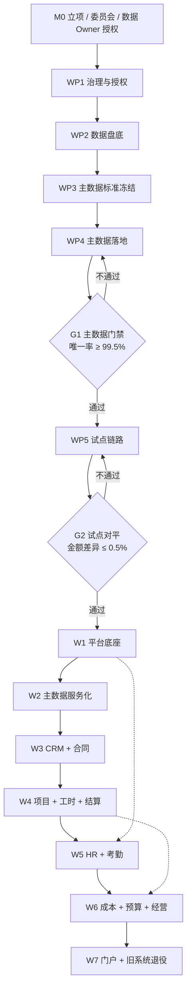

# 初步工作计划

> **依据**：《结论》——整合打底、重建收口
> **定位**：用于立项与启动的初版计划，明确"做什么、谁负责、交付什么、什么算通过"
> **边界**：本版不含排期承诺与预算报价；阶段二在通过 G2 门禁后细化到任务级

---

## 0. 一页纸摘要

| 项 | 内容 |
|---|---|
| 总体路线 | 阶段一「整合打底」→ 三道门禁 → 阶段二「重建收口」 |
| 阶段一工作包 | 6 个（治理、盘底、标准、落地、试点、门禁） |
| 阶段二波次 | 7 个（平台底座 → 主数据 → CRM/合同 → 项目/工时/结算 → HR/考勤 → 成本/预算/经营 → 门户/退役） |
| 关键路径 | 治理授权 → 数据盘底 → 主数据冻结 → 试点对平 → 平台底座 → 逐域重建 |
| 首个决策点 | M0：委员会成立 + 四个数据 Owner 书面授权 |
| 最大风险 | 主数据质量不达标、业务不配合、范围蔓延、大爆炸切换冲动 |
| 计划成功的标志 | 项目利润可算、合同到回款全链对平、四套旧系统退役 |

**本计划先解决三件事，其它一概靠后：**

1. 谁对主数据负责（人先到位，表后建）；
2. 数据到底有多脏（盘底结论决定后面所有动作）；
3. 一条真实合同能不能跑通（跑不通，重建就是空中楼阁）。

---

## 1. 目标与验收标准

### 1.1 总目标

建成一套一体化经营管理平台：一个门户、一套账号、一套主数据、一条业务链、一套审批、一套报表，最终四套旧系统只读并退役。

### 1.2 验收指标

| 维度 | 指标 | 验收人 |
|---|---|---|
| 主数据 | 组织、人员、客户、项目、合同唯一率 ≥ 99.5%，无新增重复 | 四位数据 Owner |
| 业务链 | 试点合同 100% 可追溯：客户 → 合同 → 项目 → 工时 → 结算 → 开票 → 回款 | PMO / CEO |
| 金额对平 | 合同 / 里程碑 / 结算 / 开票 / 回款差异 ≤ 0.5% | CFO |
| 利润 | 项目 P&L、毛利率、EAC 可出数，且与财务口径一致 | CFO |
| 审批 | 合同、立项、预算、工时、费用审批收口到一套引擎 | IT |
| 报表 | 销售、交付、人力、财务口径一致，报表对平 | CFO |
| 退役 | 四套旧系统全部只读并最终下线 | CEO |

---

## 2. 总体路线与依赖



> 说明：W1（平台底座）与 W2（主数据服务化）可并行推进；W3 与 W5 在资源允许时可部分并行，但 **W4→W6 的依赖不可跨越**——没有工时与结算，就没有成本；没有成本，就没有利润。

---

## 3. 阶段一：整合打底（立标准，不换系统）

### WP1 治理与授权

| 项 | 内容 |
|---|---|
| 目标 | 把"谁说了算、谁签字、怎么变更"定死 |
| 主责 | CEO |
| 前置 | 无 |
| 交付物 | 委员会章程、任命文件、RACI、会议机制 |
| 验收 | 首次委员会纪要签发；四份数据 Owner 授权书到位 |

- [ ] 成立整合委员会（CEO 任组长，CFO、HRD、销售负责人、交付负责人、IT 负责人）
- [ ] 任命项目总负责人与 PMO
- [ ] 指定四个数据 Owner：组织/人员（HRD）、客户/合同（销售）、项目/工时/结算（交付/PMO）、预算/经营（CFO）
- [ ] 发布项目范围、变更规则、决策权限
- [ ] 确定周会、月度指导委员会、Gate 评审机制

### WP2 数据盘底

| 项 | 内容 |
|---|---|
| 目标 | 用数据回答"能不能并、先并什么" |
| 主责 | IT + 四位数据 Owner |
| 前置 | WP1 |
| 交付物 | 《数据盘点报告》《问题清单》《试点候选清单》 |
| 验收 | 四套系统全覆盖；每个域有 Owner 签字；Top 20 问题有处置建议 |

- [ ] 四套系统表清单、数据量、增长趋势
- [ ] 编码冲突、重复率、空值率、孤儿数据
- [ ] 金额单位、比例口径、税率、状态枚举差异
- [ ] 写入口与接口清单（1164 条接口按域归类）
- [ ] 历史数据可信度评估（哪些能迁、哪些只能归档）
- [ ] 提出 2–3 个试点候选合同

### WP3 主数据标准冻结

| 项 | 内容 |
|---|---|
| 目标 | 把 24 项主数据的结构与规则一次定死 |
| 主责 | 架构组 + 四位数据 Owner |
| 前置 | WP2 |
| 交付物 | 《主数据标准 V1》、DDL、编码规则、质量规则 |
| 验收 | 四位 Owner 会签；委员会备案；无未决项 |

- [ ] 评审 24 项主数据表结构与业务域归属
- [ ] 定编码规则：客户（法人 + 统一社会信用代码）、合同（合同号 + 子合同号）、项目（全局唯一）、员工（工号）
- [ ] 定唯一键与唯一范围（含逻辑删除的处理）
- [ ] 定合并、停用、生效日期规则（只允许停用与指向合并，不物理删除）
- [ ] 定数据质量规则与责任人（唯一性、必填、引用完整性、金额合法性）
- [ ] 定旧 ID 映射规则（`md_id_mapping` 保留周期）

### WP4 主数据落地

| 项 | 内容 |
|---|---|
| 目标 | 建表、迁移、收口写入口，旧系统改读视图 |
| 主责 | 数据迁移组 + DBA |
| 前置 | WP3 |
| 交付物 | `md_*` 表、迁移与对账报告、兼容视图、数据质量报告 |
| 验收 | 唯一率 ≥ 99.5%；旧系统读视图无异常；无新增重复 |

- [ ] 建表、索引、约束
- [ ] 抽取 → 清洗 → 去重 → 映射 → 装载 → 对账
- [ ] 建设兼容视图，旧表名指向 `md_*`
- [ ] 写入口收口：HR/CRM/PMT/FS 的基础数据页面后台改为主数据
- [ ] 数据质量日报与异常处置流程
- [ ] 回滚方案与演练

### WP5 试点链路

| 项 | 内容 |
|---|---|
| 目标 | 用一条真实业务验证主数据与链路假设 |
| 主责 | PMO + 交付负责人 |
| 前置 | WP4 |
| 交付物 | 《试点全链路报告》《接口说明》《对账报告》《断点清单》 |
| 验收 | 100% 可追溯；金额差异 ≤ 0.5%；无重复录入；业务负责人签字 |

试点样本：1 个客户、1 个商机、1 个合同、1 个项目、2–3 名员工、2 周工时、1 个结算批次、1 张发票、1 笔回款。

- [ ] 跑通 A 签约 → B 立项 → C 工时 → D 结算/开票/回款
- [ ] 统一状态映射（合同、里程碑、结算、开票、回款）
- [ ] 接口幂等、重试、失败告警、日对账
- [ ] 记录断点及补法，形成阶段二需求输入

### WP6 门禁评审

| 门禁 | 标准 | 签字人 | 不通过怎么办 |
|---|---|---|---|
| G1 主数据 | 唯一率 ≥ 99.5%，无新增重复 | 四位数据 Owner | 返回 WP4，继续治理 |
| G2 试点对平 | 全链金额差异 ≤ 0.5% | CFO | 返回 WP5，修断点 |
| G3 流程稳定 | 关键业务流程不再大幅变化 | 业务负责人 | 先改流程，再定系统 |

- [ ] 组织三场门禁评审，形成书面结论
- [ ] 通过则提交阶段二立项决议；不通过则明确返工范围与责任人
- [ ] 向委员会汇报"继续 / 暂停 / 调整范围"三选一

---

## 4. 阶段二：重建收口（换载体，按域替换）

### 4.1 七个波次

| 波次 | 范围 | 关键交付 | 退出标准 | 主责 |
|---|---|---|---|---|
| W1 平台底座 | IAM/SSO、RBAC + 数据权限、统一审批、审计、字典/文件/消息/任务、环境与 CI/CD | 平台 V1 | 统一登录可用；权限与审批通过安全测试；审计完整 | IT / 架构组 |
| W2 主数据服务化 | 主数据查询、校验、变更、合并、分发 API；旧系统全部改读服务 | 主数据服务 V1 | 所有写入口只写主数据服务 | 平台团队 |
| W3 CRM + 合同 | 客户、商机、合同、里程碑、合同-项目、立项审批 | CRM V1 + 合同 V1 | 销售全量使用；合同对平；旧 CRM 只读 | 销售负责人 |
| W4 项目 + 工时 + 结算 | 项目、WBS、预算、资源、工时、结算 | 交付域 V1 | 工时 → 审批 → 锁定 → 结算全链跑通；旧 PMT 只读 | 交付负责人 |
| W5 HR + 考勤 | 员工、考勤、假勤、技能、可用工时、完整用工成本 | HR V1 | 假勤与工时联动；月度考勤对平；旧 HR 只读 | HRD |
| W6 成本 + 预算 + 经营 | 开票回款、费用分摊、EAC、项目 P&L、预算、经营报表 | 财务域 V1 + 驾驶舱 | 月度结账在新系统；利润与预算对平；旧 FS 只读 | CFO |
| W7 门户 + 退役 | 统一门户、移动端、待办、跨域 BI、冷数据归档 | 一体化平台 V1 | 四套旧系统全部下线；单系统运行 | CEO |

### 4.2 42 项 A 类能力的交付波次

> 这张表是"重建不是口号"的证据：每一项都落到具体波次，避免上线后才发现利润算不出来。

| 波次 | A 类编号 | 数量 | 代表能力 |
|---|---|---|---|
| W3 CRM + 合同 | A-01 ~ A-04 | 4 | 客户合并、客户角色、合同变更版本、立项审批 |
| W4 项目 + 工时 + 结算 | A-05 ~ A-13、A-16 ~ A-26 | 20 | 阶段/WBS/交付里程碑、项目预算、资源匹配、任务级工时、结算金额、结算→开票 |
| W5 HR + 考勤 | A-14、A-15、A-31、A-32 | 4 | 技能字典、可用工时、完整用工成本、人力成本分摊 |
| W6 成本 + 预算 + 经营 | A-27 ~ A-30、A-33 ~ A-42 | 14 | 发票-结算关联、红冲、信用控制、费用分摊、EAC/ETC、项目 P&L、客户毛利、组织人效、三算对比 |

### 4.3 每个域的四步切换法

```text
双轨并行 → 金额对平 → 旧域只读 → 下线
```

- 双轨并行期：新系统为准，旧系统可读；明确冻结窗口与增量补齐方式。
- 金额对平：行数、金额、关键报表、抽样单据四项对平。
- 旧域只读：关闭旧写入入口，保留查询与追溯。
- 下线：冷数据归档完成，权限与入口全部切换。

> [!warning] 每个域必须能独立回滚
> 不允许"切了就回不去"。回滚方案与对平报告是该域 Gate 的必交材料。

---

## 5. 组织与治理

### 5.1 角色

| 角色 | 职责 | 人 |
|---|---|---|
| 整合委员会 | 定范围、定预算、定优先级、裁决争议、批准 Gate | CEO 任组长 |
| 项目总负责人 | 对进度、质量、业务结果负责 | 待任命 |
| PMO | 计划、风险、问题、变更、报告 | 1–2 人 |
| 四个数据 Owner | 主数据标准签字、数据争议仲裁 | HRD / 销售 / 交付 / CFO |
| 领域产品负责人 | 需求、验收、用户推广 | CRM、合同、交付、HR、财务各 1 人 |
| 架构评审组 | 架构、模型、接口、安全评审 | 架构师牵头 |
| 平台 / 领域团队 | 开发与交付 | 按波次组建 |
| 数据迁移组 | 抽取、清洗、映射、对账、切换 | DBA + 数据工程师 |
| QA / DevOps | 测试、发布、监控、备份 | 待确认 |

### 5.2 会议与报告

| 机制 | 频率 | 输出 |
|---|---|---|
| 项目周会 | 每周 | 进度、风险、问题、下周计划 |
| 数据 Owner 例会 | 每两周 | 数据质量、争议裁决 |
| Gate 评审 | 每个门禁 / 波次结束 | 通过 / 返工结论 |
| 指导委员会 | 每月 | 决策、资源、范围变更 |
| 上线复盘 | 每域上线后 | 改进项与推广建议 |

### 5.3 变更控制

- 范围变更一律走变更单：产品负责人评估 → 架构/PMO 评估 → 委员会审批。
- 主数据标准变更由数据 Owner 签字，委员会备案。
- 每个 Gate 未通过不得进入下一阶段，例外需委员会书面批准。

---

## 6. 里程碑

| 里程碑 | 标志 | 验收人 |
|---|---|---|
| M0 立项 | 委员会成立、四位 Owner 授权、范围与变更规则发布 | CEO |
| G1 主数据门禁 | 24 项主数据唯一率 ≥ 99.5%，旧系统读视图正常 | 四位数据 Owner |
| G2 试点对平 | 试点合同全链可追溯，金额差异 ≤ 0.5% | CFO |
| G3 阶段二立项 | 三道门禁通过，阶段二范围与资源批准 | 整合委员会 |
| G4 平台底座 | 统一登录、权限、审批、审计可用 | IT |
| G5 销售与合同 | 销售全量使用，旧 CRM 只读 | 销售负责人 |
| G6 交付与结算 | 工时 → 结算闭环，旧 PMT 只读 | 交付负责人 |
| G7 人力与成本 | 假勤与工时联动，用工成本可算，旧 HR 只读 | HRD |
| G8 经营与退役 | 项目利润可算，月度结账在新系统，旧 FS 只读并下线 | CFO / CEO |

---

## 7. 资源假设（待委员会确认）

| 项 | 假设 | 说明 |
|---|---|---|
| 项目总负责人 | 全职 | 不可由 IT 负责人兼任，否则跨部门推不动 |
| PMO | 1–2 人 | 计划、风险、变更、汇报 |
| 架构师 | 1 人 | 主数据模型、接口、安全 |
| 平台团队 | 3–4 人 | IAM、审批、主数据服务、公共能力 |
| 领域团队 | 每域 2–3 人 | CRM/合同、交付、HR、财务 |
| 数据迁移 | 2–3 人 | DBA + 数据工程师 + 业务数据 Steward |
| 业务投入 | 每个数据域 1 名 Steward | 兼职但要有考核 |
| 环境与工具 | 开发/测试/生产三套；CI/CD；监控 | 复用现有云资源 |

> 资源不足时，优先保阶段一（治理 + 主数据 + 试点），**不要缩主数据去保功能开发**——那是最典型的返工起点。

---

## 8. 风险登记表

| # | 风险 | 触发信号 | 应对 | 责任人 |
|---|---|---|---|---|
| 1 | 数据质量不达标 | 重复率高、编码冲突多、历史数据不可信 | 停在阶段一治理；必要时改"新老分治" | 数据 Owner |
| 2 | 业务不配合 | 关键用户不参会、不验收 | Owner 制 + CEO 推动 + 试点先行 | CEO |
| 3 | 范围蔓延 | 边做边加需求 | 变更单 + MVP 冻结 + 委员会审批 | PMO |
| 4 | 双轨期双写 | 旧系统仍在写主数据 | 一数一源 + 旧表视图化 + 关闭旧入口 | IT |
| 5 | 大爆炸冲动 | 要求"一次切完" | 明确禁止；按域切换、独立回滚 | 项目总负责人 |
| 6 | 关键人依赖 | 只有一个人懂某域 | 文档、结对、代码评审、交接 | 架构组 |
| 7 | 外部接口延期 | 企微/银行/税务对接不确定 | 早期盘点；先人工过渡，不阻塞主链 | IT |
| 8 | 报表口径争议 | 收入确认三种口径并存 | CFO 先定口径（开票/里程碑/完工） | CFO |
| 9 | 半成品模块拖累 | 要求把空壳功能纳入首期 | 明确不做清单，二期再评估 | 委员会 |

---

## 9. 启动清单（第一次委员会前完成）

- [ ] 发任命文件：项目总负责人、PMO、四位数据 Owner
- [ ] 发项目章程：目标、范围、门禁、变更规则
- [ ] 拉四套系统表清单与接口清单（173 张表 / 1164 条接口）
- [ ] 定 2–3 个试点候选合同
- [ ] 安排 24 项主数据表结构评审会
- [ ] 建项目文档库与任务看板（本知识库内即可）
- [ ] 定周会与月度指导委员会时间
- [ ] 确认首期预算与团队到位情况

---

## 10. 首期不做（范围守卫）

| 不做 | 原因 | 何时再议 |
|---|---|---|
| PMT 财务前端 | 半成品，开票回款以 CRM/FS 为主 | 二期评估 |
| HR 薪酬计算与工资条 | 现有实现为空壳，规则未定 | W5 之后再评估 |
| 招聘、绩效 | 与主链无关，不阻塞利润闭环 | 二期 |
| HR B 线（Next.js/PostgreSQL） | 独立技术栈，迁移成本高 | 单独评估 |
| 多币种、供应商采购/应付 | 首期用费用与文本过渡 | 二期 |
| 收入确认自动化 | 先按开票/里程碑手工口径 | 二期 |
| 微服务/数据中台 | 首期模块化单体足够 | 规模确实需要时 |

---

> **计划的第一性原则**：先把主数据变成"唯一事实"，再把一条合同变成"可追溯的现金"，最后才把四套系统换成一套。
> 顺序错了，做得越快，返工越大。
