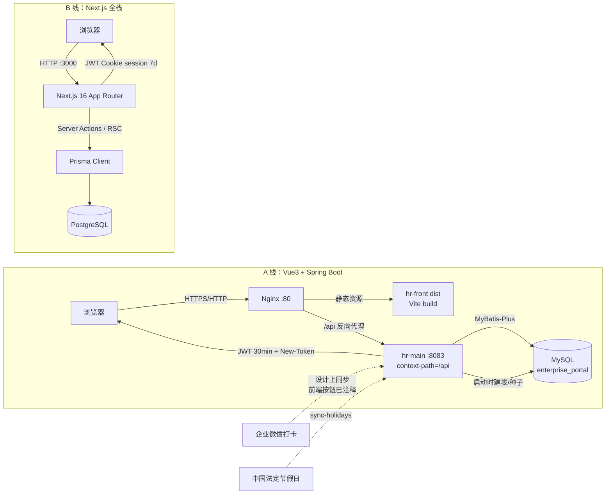
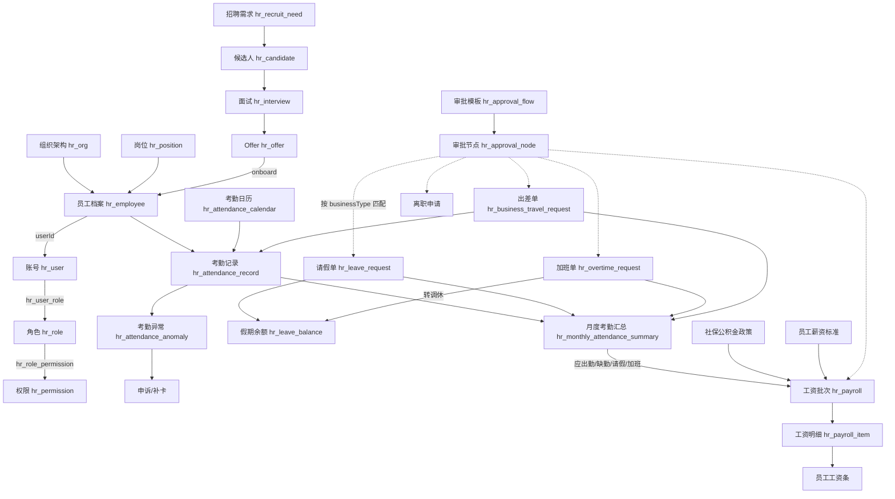
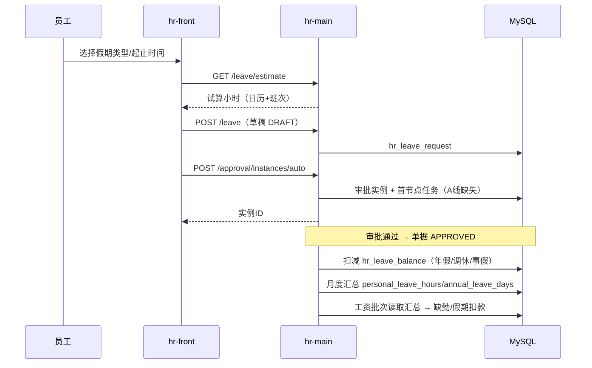
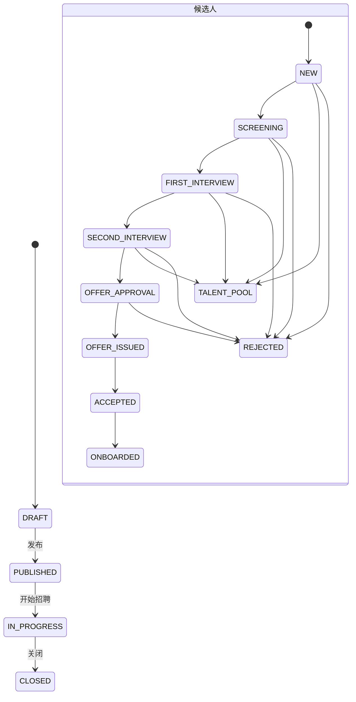

# 系统分析报告：HR 管理系统

> 分析日期：2026-11-10  
> 分析对象：`hr-front.zip`、`hr-main.zip`、`hr-system.zip`  
> 分析方法：system-analysis（全景扫描 → 模块深潜 → 交叉关联补全）  
> 代码基线：`/workspace/_extract/` 下三个已解压工程

---

## 0. 执行摘要

### 0.1 结论先行

| # | 结论 | 影响 |
|---|------|------|
| 1 | 三个压缩包不是一套可直接联调的系统，而是**两条产品线、三个代码基线**：A 线 = `hr-front`（Vue3 管理端）+ `hr-main`（Spring Boot 后端）；B 线 = `hr-system`（Next.js 全栈，独立 PostgreSQL 库）。 | 不能把三个包当成「前端 + 后端 + 新版」直接拼成一个部署单元。 |
| 2 | `hr-front` 与 `hr-main` 的**接口契约大面积错位**：前端调用 145+ 个 URL 字面量（另有大量 `${BASE}` 拼接路径），后端仅声明 216 个去重路径；审批引擎、员工自助门户、文件中心、消息中心、薪资批次、绩效周期、定时任务、企业设置等 **15+ 组关键路径**在后端无任何声明（逐字面量比对有 76 个未命中，含少量因变量拼接/基路径造成的误报）。 | 审批中心、审批详情、工资条、绩效、消息、入职、离职等页面在 `hr-main` 上会直接 404。 |
| 3 | `hr-main` 的**权限码体系与前端不一致**：数据库初始化的是 `EMPLOYEE_LIST / ATTENDANCE_RECORD / PAYROLL_LIST` 等旧码，前端路由与菜单校验的是 `hr:employee:view / hr:attendance:calendar:view / hr:salary:view` 等新码。 | 非超管账号登录后，菜单与路由会被判为无权限，实际只有 `SUPER_ADMIN` 可用。 |
| 4 | `hr-main` 存在**明显的半成品实现**：月度考勤、离职、顾问、PMO、考勤申诉为内存 Mock；薪资/绩效/招聘的核心端点为「返回空数组/返回提示语」；审批只有**模板配置**，没有实例引擎；数据库表在启动时由 `DatabaseInitRunner` 动态建表，无迁移版本管理。 | 演示可用、生产不可用；数据重启即丢失（Mock 部分）。 |
| 5 | **后端没有接口级鉴权**：全工程 `@PreAuthorize` 数量为 0，`SecurityConfig` 只要求「已登录」。 | 任意登录用户可直接调用用户管理、角色授权、薪资等全部 API，存在严重越权风险。 |
| 6 | `hr-system` 是**业务规则最完整的一条线**：真实实现了考勤清洗引擎（阶梯迟到、旷工、缺卡、免费补卡豁免、加班餐补扣减与封顶、调休 FIFO 扣减、3 天申诉期、月度汇总、离职调休 1:1 折算、PMO 三段取值），但权限控制很薄（中间件只保护 `/system`，Server Action 无权限校验）。 | 若目标是「可上线的考勤/PMO 系统」，`hr-system` 是更可信的基线；若目标是「完整 HR 套件」，需要补齐 A 线的后端。 |

### 0.2 三套工程一览

| 工程 | 形态 | 技术栈 | 规模 | 数据存储 | 入口 |
|------|------|--------|------|----------|------|
| `hr-front` | Vue3 管理端 SPA | Vue 3.4 + Vite 5 + Element Plus 2.4 + Pinia + Axios + ECharts + dayjs | 183 文件；76 个 `.vue` 视图，路由引用 52 个；55 个 API 模块文件（36 hr + 10 sys + 7 portal + 2 根） | 无（`/api` 代理） | `src/main.js` → `router/index.js` |
| `hr-main` | Spring Boot 单体后端 | Java 8 + Spring Boot 2.7.18 + Spring Security + MyBatis-Plus 3.5.3.1 + JWT(jjwt) + MySQL + Knife4j + POI/Hutool | 329 文件；270 个 Java；40 个 Controller；46 个实体；216 个端点 | MySQL `enterprise_portal` | `com.enterprise.hr.HrApplication` |
| `hr-system` | Next.js 全栈应用 | Next.js 16.2.7（App Router）+ React 19 + Prisma 6 + PostgreSQL + Tailwind 4 + jose + bcryptjs + exceljs/xlsx | 90 文件；14 个页面；10 个 Server Action 文件；25 个 Prisma 模型 | PostgreSQL | `src/app/layout.tsx` → `src/app/(dashboard)` |

> 版本谱系判定：`hr-system` 的 `doc/操作步骤.md` 明确指向独立仓库 `github.com/ethelliu37-liu/hr-system`，使用本地 Postgres.app；`hr-front` 的 `nginx.conf` 明确把 `/api` 反代到 `backend-hr-main:8083`。因此 A 线与 B 线是**并行演进的两套实现**，不是同一仓库的版本目录。`[待确认: hr-front 实际对接的后端仓库/版本，是否另有比 hr-main 更新的后端未随包提供]`

---

# 1. 全景：HR 管理系统

## 1.1 系统定位

一句话：**面向企业人事/考勤/薪酬/招聘/绩效的一体化 HR 管理平台，同时提供员工自助门户与管理者审批工作台。**

- **给谁用**：HR 管理员（全量档案/考勤/薪资/招聘）、部门经理（本部门审批与团队数据）、普通员工（自助申请、假期、工资条、个人档案）、PMO/项目管理者（顾问饱和度与项目人效）、系统管理员（RBAC、字典、日志、参数）。
- **解决什么问题**：把「人」（员工档案/组织/合同）、「勤」（打卡/排班/请假/加班/出差/补卡/异常申诉）、「钱」（薪资标准/社保公积金/工资批次/工资条）、「人效」（招聘漏斗/绩效/顾问饱和度）收拢到同一套组织与权限模型下，并用统一审批流串联业务单据。
- **核心价值**：以「员工档案 + 组织架构」为主数据底座，以「审批流」为业务总线，以「月度考勤汇总」为薪酬核算输入，形成人事—考勤—薪酬的数据闭环；`hr-system` 进一步把考勤清洗规则产品化（可审计、可申诉、可导出官方 24 字段月表）。

## 1.2 技术架构与部署拓扑



关键配置证据：
- `hr-front/nginx.conf`：`location /api { proxy_pass http://backend-hr-main:8083; }`
- `hr-front/.env`：`VITE_API_BASE_URL=/api`、`VITE_PORT=5174`
- `hr-main/src/main/resources/application-dev.yml`：`server.port=8083`、`server.servlet.context-path=/api`、MySQL `enterprise_portal`
- `hr-system/code/src/middleware.ts`：仅拦截 `/system` 前缀；`src/lib/session.ts`：HttpOnly Cookie `session`，7 天过期

## 1.3 模块划分（业务域视角）

| # | 模块 | 职责一句话 | 前端关键入口（路由/目录） | 后端关键入口（前缀） | 主要数据表/模型 |
|---|------|-----------|---------------------------|----------------------|-----------------|
| 1 | 认证与账号 | 登录、验证码、JWT、改密、锁定、登录日志 | `/login`、`/change-password`、`/profile` | `/auth/**`、`/system/user/**`、`/system/login-log/**` | `hr_user`、`hr_user_role`、`hr_login_log` |
| 2 | 工作台/数据看板 | 员工数、今日出勤、请假、本月入职、出勤趋势、人数趋势、待办 | `/hr/dashboard`、`/home`（未挂路由） | `/dashboard/**`、`/system/dashboard/**` | 聚合查询（员工/考勤/请假） |
| 3 | 基础数据 | 组织树、岗位、项目主数据、项目成员、组织类型、行政区划 | `/hr/basic/org`、`/hr/basic/position`、`/hr/basic/project-info`、`/hr/basic/project-member` | `/system/org/**`、`/position/**`、`/project-info/**`、`/project-member/**`、`/pmt-projects/**`、`/org-type/**`、`/system/region/**` | `hr_org`、`hr_position`、`hr_org_type`、`hr_region` |
| 4 | 人事管理 | 员工档案、我的档案、档案变更审核、入职、合同续期、离职、顾问 | `/hr/employee`、`/hr/employee/changes`、`/portal/profile`、`/hr/personnel/onboarding`、`/hr/personnel/contract-renewal`、`/hr/personnel/resignation` | `/employee/**`、`/resignation/**`、`/consultant/**` | `hr_employee`、`hr_employee_contract`、`hr_employee_education`、`hr_employee_family`、`hr_employee_work_experience` |
| 5 | 考勤管理 | 考勤日历、工作日历、记录、假勤单据、月度汇总、假期额度、补卡/申诉、移动打卡 | `/hr/attendance/calendar`、`/hr/attendance/work-calendar`、`/hr/attendance`、`/hr/attendance/documents`、`/hr/attendance/monthly`、`/hr/leave/balance`、`/portal/apply` | `/attendance/**`、`/attendance/monthly/**`、`/attendance-calendar/**`、`/attendance-anomaly/**`、`/attendance-correction/**`、`/leave/**`、`/overtime/**`、`/business-travel/**`、`/leave-balance/**`、`/mobile/attendance/**` | `hr_attendance_record`、`hr_attendance_calendar`、`hr_attendance_anomaly`、`hr_attendance_correction`、`hr_leave_request`、`hr_overtime_request`、`hr_business_travel_request`、`hr_leave_balance`、`hr_monthly_attendance_summary`、`hr_work_shift`、`hr_employee_shift`、`hr_attendance_rule` |
| 6 | 审批管理 | 待办、单据详情、审批中心、通用表单、审批模板/节点配置 | `/hr/approval`、`/hr/approval/:id`、`/hr/approval-center`、`/hr/settings/approval-flow`、`/hr/settings/approval-forms` | `/hr/approval-flow/**`、`/system/approval-config/**`；**实例/任务/表单接口在后端缺失** | `hr_approval_flow`、`hr_approval_node`、`hr_approval_config` |
| 7 | 招聘管理 | 招聘需求、候选人漏斗、面试、Offer、入职、我的面试 | `/hr/recruit`、`/hr/recruit/candidate/*`、`/hr/interviews/my` | `/recruit/**`；`/selector/business/recruit/**` 缺失 | `hr_recruit_need`、`hr_candidate`、`hr_interview`、`hr_offer` |
| 8 | 薪酬绩效 | 工资批次、工资条、薪资标准、社保公积金政策、绩效周期/计划/评分 | `/hr/salary`、`/hr/salary/batch/:id`、`/hr/settings/salary-config`、`/hr/performance`、`/hr/performance/score/:id` | `/salary/**`、`/salary-config/**`、`/social-security-policy/**`、`/performance/**`；批次与绩效新接口缺失 | `hr_payroll`、`hr_payroll_item`、`hr_salary_plan`、`hr_salary_config`、`hr_social_security_policy`、`hr_perf_cycle`、`hr_perf_plan`、`hr_perf_result` |
| 9 | 系统管理 | 企业参数、用户、角色、权限、字典、定时任务、操作/登录日志 | `/hr/settings/*`、`/system/*`（旧版孤儿） | `/system/user\|role\|permission\|dict\|operation-log\|login-log/**`、`/hr/enterprise-setting`（缺失）、`/system/scheduled-job`（缺失） | `hr_user`、`hr_role`、`hr_permission`、`hr_role_permission`、`hr_dict`、`hr_dict_item`、`hr_operation_log` |
| 10 | 员工自助 | 发起申请、我的考勤、假期库存、我的档案、申请记录、工资条、我的面试、消息 | `/portal/*`、`/hr/messages` | `/portal/**`、`/messages/**`、`/files/**`（均在后端缺失） | 复用考勤/审批/薪资模型 |
| 11 | PMO/项目人效 | 顾问饱和度热力图、现场投入、项目授权、SOW 计划 vs 实际、达标率 | `/hr/pmo`（未挂路由）、`hr-system /system/pmo`、`/system/projects` | `/pmo/**`；`hr-system` Server Actions | `hr_consultant_project_alias`；B 线 `Project*` 4 张表 |
| 12 | B 线考勤清洗 | 打卡/加班/请假/出差/豁免导入、异常申诉、月度汇总、历史流水 | `hr-system /system/calendar/*` | Next.js Server Actions | `Imported*` 5 张表、`MonthlyAttendanceSummary`、`AttendanceAnomaly`、`LeaveQuota*` |

## 1.4 角色 × 模块权限矩阵

### A 线 `hr-main` 初始化角色（`DatabaseInitRunner.initRoles()`）

| 角色码 | 角色名 | 设计可访问模块 | 实际代码中的权限特征 |
|--------|--------|----------------|----------------------|
| `SUPER_ADMIN` | 超级管理员 | 全部 | 前端 `hasPermission` 直接放行；初始化时拥有全部权限记录 |
| `HR_ADMIN` | HR 管理员 | 人事、考勤、薪酬、招聘、绩效、系统管理 | 前端多处硬编码该角色（如离职、工资审核、导出） |
| `HR_MANAGER` | HR 经理 | 人事、考勤、薪酬等 | 仅作为角色码存在，前端未见针对性分支 |
| `DEPT_MANAGER` | 部门经理 | 本部门审批、离职管理 | 前端离职页 `canManage` 包含该角色 |
| `HR_EMPLOYEE` | 普通员工 | 员工自助 | 仅能进入 `/portal/*` 与无权限码页面 |

> 前端还额外判断 `RECRUITER`、`PAYROLL_SPECIALIST`（见 `views/hr/dashboard/index.vue:138-146`、`views/hr/salary/index.vue:487-492`），但后端初始化角色中没有这两个角色，属于**角色码缺口**。

### B 线 `hr-system` 初始化角色（`prisma/seed.ts`）

| 角色码 | 角色名 | 设计职责 | 实际控制点 |
|--------|--------|----------|-----------|
| `SUPER_ADMIN` | 超级管理员 | 全量配置、底层数据、强审计 | 中间件仅对 `/system/roles` 做角色判断 |
| `HR_MANAGER` | HR 负责人 | 全盘导入、人员主责录入、规则校准、报表导出 | 代码中未见基于该角色的拦截 |
| `PMO` | 项目 PMO | 所辖项目顾问查看、月度实际投入填报 | 代码中未见 `projectId` 数据隔离落地逻辑 |
| `EMPLOYEE` | 普通员工 | 个人档案、考勤、调休余额与流水 | 代码中未见员工端页面 |

### 路由级权限矩阵（A 线，按 `meta.permission` 归纳）

| 权限码 | 覆盖路由 | 说明 |
|--------|----------|------|
| `hr:dashboard:view` | `/hr/dashboard` | 看板 |
| `hr:org:view` | `/hr/basic/org` | 组织架构 |
| `hr:position:view` + `roles:['SUPER_ADMIN']` | `/hr/basic/position` | 岗位管理仅超管 |
| `hr:project-info:view` / `hr:project-member:view` | 项目基础信息 / 项目人员 | 只读为主 |
| `hr:employee:view` | 员工档案、入职、合同续期 | 入职/续期复用员工查看权限 |
| `hr:employee:profile-change:view` | 档案变更审核 | 变更审核 |
| `hr:resignation:view` | 离职管理 | 离职 |
| `hr:attendance:calendar:view` / `:config` | 考勤日历 / 工作日历 | 查看与配置分离 |
| `hr:attendance:records:view` | 考勤记录 | 原始打卡 |
| `hr:attendance:documents:view` | 假勤单据 | 请假/加班/出差/补卡统一台账 |
| `hr:attendance:monthly:view` | 月度考勤汇总 | 汇总 |
| `hr:leave:balance:view` | 假期额度管理 | 额度 |
| `hr:salary:view` | 薪酬管理、批次明细 | 薪资 |
| `hr:salary-config:view` | 社保公积金政策 | 参保参数 |
| `hr:recruit:view` / `:add` / `:edit` | 招聘工作台、候选人 | 招聘 |
| `hr:enterprise:view` / `hr:role:view` / `hr:permission:view` | 企业设置/角色/权限 | 系统管理 |
| `hr:approval-flow:view` / `:config` | 审批流程、单据配置 | 流程配置 |
| `hr:dict:view` / `hr:user:view` | 字典/用户 | 系统管理 |
| `hr:log:operation:view` / `hr:log:login:view` | 操作日志/登录日志 | 审计 |
| `hr:job:view` + `roles:['SUPER_ADMIN']` | 定时任务 | 仅超管 |
| 无权限码 | `/hr/approval`、`/hr/approval-center`、`/hr/performance`、`/hr/messages`、`/portal/*` | 登录即可访问，数据范围由后端收敛（设计意图） |

## 1.5 核心数据流骨架（模块间）



**骨架解读**：
- **主数据主轴**：`hr_org → hr_employee → hr_user → hr_role → hr_permission`。组织决定数据范围，员工决定业务归属，账号决定谁能登录，角色/权限决定能看到什么。
- **考勤主轴**：日历（工作日/节假日/调休补班）决定「应出勤」，打卡与假勤单据决定「实际出勤」，异常与申诉决定「扣减是否冲抵」，最终沉淀为月度汇总。
- **薪酬主轴**：月度汇总是核算输入，薪资标准是基数，社保公积金政策是扣缴参数，工资批次是状态机载体，工资明细是员工可见的工资条。
- **招聘主轴**：需求 → 候选人 → 面试 → Offer → 入职，入职动作应回写 `hr_employee` 并联动账号开通。
- **审批总线**：所有业务单据通过 `businessType + businessId` 关联审批实例；但 A 线后端只实现了「模板/节点配置」，实例与任务引擎缺失。

## 1.6 路由/菜单全景（A 线 52 个路由视图 / 57 条路由记录）

| 路由 | 视图 | 权限码/角色 | 一句话功能 |
|------|------|-------------|-----------|
| `/login` | `login/index.vue` | 公开 | 账号密码登录 |
| `/change-password` | `login/ChangePassword.vue` | 登录 | 首次登录/定期改密 |
| `/403`、`/404` | `error/*` | 公开 | 无权限/不存在 |
| `/hr/dashboard` | `hr/dashboard/index.vue` | `hr:dashboard:view` | KPI + 出勤/人数图表 + 待办 |
| `/hr/basic/org` | `hr/basic/org/index.vue` | `hr:org:view` | 组织树维护、成员查看 |
| `/hr/basic/position` | `hr/basic/position/index.vue` | `hr:position:view` + 超管 | 岗位 CRUD |
| `/hr/basic/project-info` | `hr/basic/project-info/index.vue` | `hr:project-info:view` | 项目主数据只读/导出 |
| `/hr/basic/project-member` | `hr/basic/project-member/index.vue` | `hr:project-member:view` | 项目成员只读 |
| `/hr/employee` | `hr/employee/index.vue` | `hr:employee:view` | 员工档案大宽表 CRUD/导入导出 |
| `/hr/employee/changes` | `hr/employee/changes/index.vue` | `hr:employee:profile-change:view` | 员工提交的档案变更审核 |
| `/portal/profile` | `portal/profile/index.vue` | 登录 + 有员工档案 | 我的档案查看/提交变更/材料上传 |
| `/hr/personnel/onboarding` | `hr/personnel/onboarding/index.vue` | `hr:employee:view` | 待入职池 + 直接入职 + 批量导入 |
| `/hr/personnel/contract-renewal` | `hr/personnel/contract-renewal/index.vue` | `hr:employee:view` | 合同到期续签审批 |
| `/hr/personnel/resignation` | `hr/personnel/resignation/index.vue` | `hr:resignation:view` | 离职申请、审批、办结 |
| `/hr/attendance/calendar` | `hr/attendance/calendar/index.vue` | `hr:attendance:calendar:view` | 单人月历、每日明细、异常发起 |
| `/hr/attendance/work-calendar` | `hr/attendance/work-calendar/index.vue` | `hr:attendance:calendar:config` | 全员工工作日历配置/同步节假日 |
| `/hr/attendance` | `hr/attendance/index.vue` | `hr:attendance:records:view` | 考勤记录查询/编辑/导入导出 |
| `/hr/attendance/documents` | `hr/attendance/documents/index.vue` | `hr:attendance:documents:view` | 请假/加班/出差/补卡统一台账 |
| `/hr/attendance/monthly` | `hr/attendance/monthly/index.vue` | `hr:attendance:monthly:view` | 月度汇总查询/重算/导入/导出 |
| `/hr/leave/balance` | `hr/leave/balance/index.vue` | `hr:leave:balance:view` | 假期额度调整/发放/结转/过期 |
| `/portal/apply` | `portal/apply/index.vue` | 登录 + 有员工档案 | 发起请假/加班/补卡/出差 |
| `/portal/applications` | `portal/applications/index.vue` | 登录 + `hr:attendance:applications:view` | 我的申请记录与进度 |
| `/portal/applications/:businessType/:id/submit` | `portal/applications/ApprovalSubmit.vue` | 登录 | 选审批模板并提交 |
| `/portal/leave-balance` | `portal/leave-balance/index.vue` | 登录 | 我的假期库存 |
| `/portal/salary` | `hr/salary/index.vue` | 登录 | 工资条 |
| `/hr/approval` | `hr/approval/index.vue` | 登录 | 我的待办/已办/我发起 |
| `/hr/approval/:id` | `hr/approval/Detail.vue` | 登录 | 审批详情、同意/驳回/转交/加签/撤回/终止/PDF |
| `/hr/request/:businessType/:id` | `hr/approval/Detail.vue` | 登录 | 业务单据详情（复用审批详情） |
| `/hr/approval-center` | `hr/approval-center/index.vue` | 登录 | 通用流程发起与我的流程 |
| `/hr/approval-center/compose/:formId` | `hr/approval-center/compose.vue` | 登录 | 动态表单渲染 + 附件 + 提交 |
| `/hr/recruit` | `hr/recruit/index.vue` | `hr:recruit:view` | 需求/候选人/面试/Offer 四页签 |
| `/hr/recruit/candidate/create\|:id/edit\|:id` | `CandidateEdit.vue`/`CandidateDetail.vue` | `hr:recruit:add\|edit\|view` | 候选人建档/编辑/档案 |
| `/hr/interviews/my` | `hr/recruit/MyInterviews.vue` | 登录 + 有员工档案 | 我作为面试官的面试与评价 |
| `/hr/salary` | `hr/salary/index.vue` | `hr:salary:view` / 登录看自己 | 批次、标准、我的工资条三页签 |
| `/hr/salary/batch/:id` | `hr/salary/BatchDetail.vue` | `hr:salary:view` | 批次明细与导出 |
| `/hr/settings/salary-config` | `hr/settings/salary-config/index.vue` | `hr:salary-config:view` | 社保公积金政策 |
| `/hr/performance` | `hr/performance/index.vue` | 登录（后端收敛） | 周期/计划/结果，自评与主管评分 |
| `/hr/performance/score/:id` | `hr/performance/Score.vue` | 登录 | 评分表单 |
| `/hr/settings/enterprise` | `hr/settings/enterprise/index.vue` | `hr:enterprise:view` | 企业信息、作息、HR 审批人、系统自检 |
| `/hr/settings/user` | `hr/settings/user/index.vue` | `hr:user:view` | 账号 CRUD、角色分配、重置密码、从员工建号 |
| `/hr/settings/role` | `hr/settings/role/index.vue` | `hr:role:view` | 角色 CRUD + 权限树授权 |
| `/hr/settings/permission` | `hr/settings/permission/index.vue` | `hr:permission:view` | 权限点/菜单 CRUD |
| `/hr/settings/biz-dict` | `hr/settings/biz-dict/index.vue` | `hr:dict:view` | 业务字典类型/字典项 |
| `/hr/settings/approval-flow` | `hr/settings/approval-flow/index.vue` | `hr:approval-flow:view` | 审批模板列表、启停、删除 |
| `/hr/settings/approval-flow/create\|:id` | `Edit.vue` | `hr:approval-flow:config` | 模板 + 有序节点 + 审批人类型 |
| `/hr/settings/approval-forms` | `hr/settings/approval-forms/index.vue` | `hr:approval-flow:view` | 表单分类/表单定义（动态表单） |
| `/hr/settings/operation-log` | `hr/settings/operation-log/index.vue` | `hr:log:operation:view` | 操作审计 |
| `/hr/settings/login-log` | `hr/settings/login-log/index.vue` | `hr:log:login:view` | 登录审计 |
| `/hr/settings/scheduled-job` | `hr/settings/scheduled-job/index.vue` | `hr:job:view` + 超管 | 定时任务 CRUD/启停/立即执行/日志 |
| `/hr/messages` | `hr/message/index.vue` | 登录 | 审批待办/结果/业务提醒 |
| `/profile` | `profile/index.vue` | 登录 | 个人中心 |

> 另有 24 个视图**未被路由引用**（详见 2.13 与附录 B），包括整套 `views/system/*` 旧版系统管理页、`hr/pmo`、`hr/overtime`、`hr/leave`、`hr/business-travel`、`hr/personnel/consultant`、`hr/mobile/attendance`、`hr/attendance/import`、`hr/attendance/appeal` 等。

---

# 2. 模块深潜

> 阅读约定：每个模块先给「业务目标」，再给「页面/路由清单」，再对页面做「业务理解 + 数据流转」。数据流转表固定五列：功能点 / 数据来源 / 转换与校验 / 去向 / 关联代码。  
> 代码位置均相对于解压目录：`hr-front/src/...`、`hr-main/src/main/java/...`、`hr-system/code/src/...`。

## 2.1 认证与账号模块

### 业务目标

解决「谁可以进入系统、进入后能看到什么、密码是否需强制修改、异常登录是否可追溯」。不做会导致：无身份边界、越权访问、审计缺失。

### 页面清单

| 路由 | 组件 | 允许角色 | 一句话功能 |
|------|------|----------|-----------|
| `/login` | `views/login/index.vue` | 公开 | 用户名/工号 + 密码登录 |
| `/change-password` | `views/login/ChangePassword.vue` | 已登录 | 首次登录强制改密/主动改密 |
| `/profile` | `views/profile/index.vue` | 已登录 | 个人中心（账号资料、头像等） |

### 逐页深潜

#### 页面：登录（`/login`）

**业务理解**
- 触发场景：员工打开系统、Token 过期被踢回、退出登录后重新进入。
- 可交互元素：用户名/工号输入框、密码框（可切换明文）、登录按钮；左侧品牌区展示系统能力。
- 核心流程：输入账号密码 → 前端校验非空 → `POST /auth/login` → 成功写入 Pinia + localStorage → 拉取用户信息/权限 → 按落地页规则跳转；失败按错误码提示（账号锁定/密码错误/账号禁用）。
- 边界条件：`needChangePassword=true` 时强制跳 `/change-password`；账号被禁用/锁定给出剩余分钟提示；Token 过期由响应拦截器统一踢回登录页。
- 注意：该登录页**没有接入图形验证码**（模板与 `api/auth.js` 均无 captcha 字段），而后端仍保留验证码校验且在未传参时直接放行。

**数据流转**

| # | 功能点 | 数据来源 | 转换/校验 | 去向 | 关联代码 |
|---|--------|----------|-----------|------|----------|
| 1 | 表单校验 | 用户输入 | 用户名/密码非空 | 阻止空提交 | `views/login/index.vue:110-160` |
| 2 | 登录请求 | `POST /api/auth/login` | 后端 BCrypt 校验、失败计数、锁定 30 分钟 | 返回 `token/userId/roles/permissions/needChangePassword` | `AuthController.java:32-78`；`UserServiceImpl.java:76-151` |
| 3 | 验证码校验 | `captchaKey/captchaCode` | 前端未接入；后端在**未传两个参数时直接判定通过**（开发便利逻辑） | 校验分支 | `UserServiceImpl.java:87`；`views/login/index.vue` 模板 |
| 4 | Token 生成 | 用户 ID/用户名/部门/角色/权限 | JWT HS256，默认 1800 秒 | 响应体 + 前端 Pinia | `AuthController.java:56-62`；`application-dev.yml:58-64` |
| 5 | 写登录日志 | 用户名、IP、UA、结果、耗时 | 成功/失败/锁定/验证码错误分别落库 | `hr_login_log` | `UserServiceImpl.java:78-150` |
| 6 | 落地页决策 | 权限集合 + `employeeId` | 看板 → 招聘 → 薪酬 → 考勤 → 发起申请 → 个人中心 | `router.replace` | `utils/landing.js:1-8` |
| 7 | Token 注入 | Pinia `token` | 非白名单 URL 加 `Authorization: Bearer` | 所有后续请求 | `utils/request.js:42-55` |
| 8 | 401 处理 | 响应 code 401/1004/1005 或 HTTP 401 | 清空用户态、跳登录、3 秒防抖 | 登录页 | `utils/request.js:84-95, 97-122` |

#### 页面：修改密码（`/change-password`）

**业务理解**：首次登录（`passwordLastUpdateTime` 为空）或用户主动修改。提交旧密码 + 新密码；成功后通常要求重新登录。

**数据流转**

| # | 功能点 | 数据来源 | 转换/校验 | 去向 | 关联代码 |
|---|--------|----------|-----------|------|----------|
| 1 | 旧密码校验 | 表单 | 非空、长度规则 | `POST /auth/change-password` | `AuthController.java:119-131` |
| 2 | 新密码加密 | 明文新密码 | BCrypt 编码 + 更新 `password_last_update_time` | `hr_user` | `UserServiceImpl.changePassword()` |
| 3 | 强制改密拦截 | `/auth/info` 返回 `needChangePassword` | 路由守卫优先于业务页 | 跳 `/change-password` | `router/index.js:439-446, 491-494` |

#### 页面：个人中心（`/profile`）

**业务理解**：登录用户的账号级资料维护（姓名、邮箱、电话、头像），与「员工档案」分离：个人中心改的是 `hr_user`，员工档案改的是 `hr_employee`。

**数据流转**

| # | 功能点 | 数据来源 | 转换/校验 | 去向 | 关联代码 |
|---|--------|----------|-----------|------|----------|
| 1 | 读取资料 | `GET /auth/info` | 合并角色/权限/部门名 | 页面表单 | `AuthController.java:86-103` |
| 2 | 保存资料 | 表单 | 邮箱/手机号格式 | `PUT /auth/profile` → `hr_user` | `AuthController.java:105-117` |
| 3 | 头像 | 上传/URL | 文件中心（前端设计） | `avatarUrl` | `views/profile/index.vue:67+` |

### 认证链路（跨层）

| 层 | 机制 | 证据 | 风险 |
|----|------|------|------|
| 传输 | HTTP（内网）/可配 HTTPS | `nginx.conf` 仅 80 端口 | 明文传输风险 |
| 认证 | JWT HS256，30 分钟 | `JwtTokenUtil`、`application-dev.yml` | 密钥有默认值 |
| 续签 | 剩余寿命 < 50% 时响应头下发 `New-Token` | `JwtAuthenticationFilter.java:108-123` | 前端只更新内存，未持久化刷新策略 |
| 登出 | `POST /auth/logout` 直接返回成功 | `AuthController.java:80-84` | 无服务端黑名单，Token 仍有效 |
| 前端守卫 | Token → 拉权限（3 秒 TTL）→ 角色 → 权限码 → 403 | `router/index.js:424-511` | 权限变更最多 3 秒生效 |
| 菜单 | `HR_MENU_GROUPS` 按权限过滤；`requiresEmployee` 控制自助入口 | `config/hrMenu.js:5-135`；`layouts/index.vue:161-175` | 菜单与路由两处配置需同步 |
| 按钮 | `v-permission` 指令直接移除 DOM | `directives/permission.js` | 仅 UI 层 |
| 后端 | `anyRequest().authenticated()` | `config/SecurityConfig.java:71-93` | **无接口级授权** |

### 跨模块依赖

| 依赖谁 | 以什么方式 | 被谁依赖 |
|--------|-----------|---------|
| 组织/员工 | `hr_user.employee_id → hr_employee.id` | 所有业务的数据范围与「我的」页面 |
| 角色/权限 | 登录时聚合 `hr_user_role → hr_role_permission → hr_permission` | 路由守卫、菜单、按钮、落地页 |
| 登录日志 | 每次登录写 `hr_login_log` | 系统管理-登录日志 |

---

## 2.2 工作台 / 数据看板模块

### 业务目标

让管理者一进系统就看到「人、勤、入离职、待办」的关键数字与趋势，快速定位异常；让普通员工有可落地的自助入口。

### 页面清单

| 路由 | 组件 | 允许角色 | 一句话功能 |
|------|------|----------|-----------|
| `/hr/dashboard` | `views/hr/dashboard/index.vue` | `hr:dashboard:view` | KPI 卡片 + 出勤堆叠图 + 人数趋势 + 最近入职 + 待办 |
| `/home`（未挂路由） | `views/home/index.vue` | — | 旧版首页/登录后落地页（孤儿） |

### 逐页深潜

#### 页面：数据看板（`/hr/dashboard`）

**业务理解**
- 触发场景：HR/管理者每日上班第一站；也是登录后默认落地页（有看板权限时）。
- 可交互元素：问候语与角色标签、4 张 KPI 卡（员工总数/今日出勤/请假人数/本月入职）、出勤周期切换（周/月）、人数周期切换（6 个月/12 个月）、ECharts 图表、最近入职列表、待办审批列表。
- 核心流程：并发拉 `stats / attendance / headcount-trend / recent-hires / pending-approvals` → 渲染；任一图表接口失败时降级为空图，不阻塞整页。
- 边界条件：接口失败时 KPI 归零并展示 `loadError`；出勤率不显示涨跌箭头（避免把比例误读为环比）。

**数据流转**

| # | 功能点 | 数据来源 | 转换/校验 | 去向 | 关联代码 |
|---|--------|----------|-----------|------|----------|
| 1 | KPI 汇总 | `GET /dashboard/stats` | `totalEmployees/todayAttendance/todayLeave/monthlyHires/attendanceRate/hireGrowth` | 4 张卡片 | `views/hr/dashboard/index.vue:172-193` |
| 2 | 出勤趋势 | `GET /dashboard/attendance?period=week\|month` | 按日期聚合正常/迟到/早退/缺勤 | ECharts 堆叠柱 | `:195-224` |
| 3 | 人数趋势 | `GET /dashboard/headcount-trend?period=6m\|12m` | 总人数/入职/离职三条序列 | ECharts 折线 | `:226-244` |
| 4 | 最近入职 | `GET /dashboard/recent-hires` | 取最近 N 条 | 列表 | `:246+` |
| 5 | 待办审批 | `GET /dashboard/pending-approvals` | `businessName()` 转中文类型 | 列表 + 跳审批详情 | `:168-170` + `utils/businessRecord.js` |
| 6 | 角色标签 | Pinia `roles` | 超管/HR/招聘/薪资/部门/员工 | 问候区 | `:138-146` |

> 后端 `DashboardServiceImpl` 的 `stats` 是真实聚合（员工数、今日打卡数、当前请假数、本月入职、出勤率）；`attendance`/`headcount-trend`/`recent-hires`/`pending-approvals` 在 `DashboardController` 中存在，但实现依赖的审批实例数据在 A 线缺失，待办可能恒为空。

#### 页面：旧版首页（`/home`，孤儿）

**业务理解**：早期登录落地页，展示快捷入口与最近登录日志。当前路由未引用，属于历史遗留。

### 跨模块依赖

| 依赖谁 | 以什么方式 | 被谁依赖 |
|--------|-----------|---------|
| 员工模块 | 员工总数/本月入职/最近入职 | 看板 |
| 考勤模块 | 今日打卡、请假人数、出勤趋势 | 看板 |
| 审批模块 | 待办数量与列表 | 看板 |
| 招聘/薪资 | 角色标签与快捷入口 | 看板 |

---

## 2.3 员工自助门户模块

### 业务目标

把「员工本人要办的事」从管理后台剥离：发起假勤申请、查看排班与打卡、查假期余额、看工资条、维护个人档案、跟踪申请进度、接收审批消息。降低 HR 事务性咨询量。

### 页面清单

| 路由 | 组件 | 允许角色 | 一句话功能 |
|------|------|----------|-----------|
| `/portal/apply` | `portal/apply/index.vue` | 登录 + 有员工档案 | 请假/加班/补卡/出差申请宫格与表单 |
| `/portal/apply/correction` | `portal/apply/CorrectionApply.vue` | 登录 | 独立补卡申请（隐藏路由） |
| `/portal/applications` | `portal/applications/index.vue` | 登录 | 我的考勤申请记录与状态 |
| `/portal/applications/:businessType/:id/submit` | `ApprovalSubmit.vue` | 登录 | 选择审批模板并提交 |
| `/portal/leave-balance` | `portal/leave-balance/index.vue` | 登录 | 我的年假/调休/其他额度与流水 |
| `/portal/attendance` | 重定向到 `/hr/attendance/calendar` | 登录 | 我的排班（旧入口） |
| `/portal/punches` | 重定向到 `/hr/attendance/calendar` | 登录 | 签卡记录（旧入口） |
| `/portal/salary` | `hr/salary/index.vue` | 登录 | 我的工资条 |
| `/portal/profile` | `portal/profile/index.vue` | 登录 + 有员工档案 | 我的档案、材料上传、变更申请 |
| `/hr/messages` | `hr/message/index.vue` | 登录 | 消息中心 |
| `/hr/interviews/my` | `hr/recruit/MyInterviews.vue` | 登录 + 有员工档案 | 我的面试与评价 |

### 逐页深潜

#### 页面：发起申请（`/portal/apply`）

**业务理解**
- 触发场景：员工需要请假、加班、补卡、出差时进入；是考勤类单据的统一入口。
- 可交互元素：常用项目（按使用频率）、全部项目宫格（按 `bizType` 着色）、申请弹窗（按类型动态渲染字段）、时长自动试算、附件、提交按钮。
- 核心流程：`GET /portal/apply/catalog` 拿可用单据类型 → 选择类型 → 填时间/原因 → 选择起止时间时调用试算接口 → `POST /leave|/overtime|/attendance-correction|/business-travel` 创建草稿 → `POST /approval/instances/auto` 自动按默认审批链提交。
- 边界条件：请假时长由工作日历与班次自动计算、不可手改；加班禁止选过去日期；补卡区分上班卡/下班卡；出差交通方式多选且「其他」需补充说明；提交失败保留表单。

**数据流转**

| # | 功能点 | 数据来源 | 转换/校验 | 去向 | 关联代码 |
|---|--------|----------|-----------|------|----------|
| 1 | 单据目录 | `GET /portal/apply/catalog` | 拆分为 `common/all`；按 `bizType` 映射图标/颜色 | 宫格 | `views/portal/apply/index.vue:388` |
| 2 | 请假时长试算 | `GET /leave/estimate?startTime&endTime` | 工作日历 + 班次 → 小时；前端折合天（/8） | 只读展示 | `:303-309` |
| 3 | 加班时长试算 | `GET /overtime/estimate-hours` | 起止时间 → 小时 | 只读展示 | `:311` |
| 4 | 创建请假 | `POST /leave` | 必填、时间先后、原因 ≤500 | 返回业务 ID | `:334` |
| 5 | 创建加班 | `POST /overtime` | 同上 + 禁止过去日期 | 返回业务 ID | `:342` |
| 6 | 创建补卡 | `POST /attendance-correction` | 日期/类型/时间/原因 | 返回业务 ID | `:350` |
| 7 | 创建出差 | `POST /business-travel` | 类型/交通/出发地/目的地/时间 | 返回业务 ID | `:358` |
| 8 | 自动提审 | `POST /approval/instances/auto` | `businessType + businessId + title + opinion` | 生成审批实例与首节点任务 | `:371`；`utils/approval.js:8-45` |
| 9 | 失败处理 | 响应错误 | `ElMessage` 提示；不关闭弹窗 | 保留用户输入 | 页面 catch 分支 |

> 关键结论：该页面的接口中，`/portal/apply/catalog`、`/leave/estimate`、`/overtime/estimate-hours`、`/approval/instances/auto` 在 `hr-main` 中**均无声明**；`/leave`、`/overtime`、`/business-travel` 的创建端点存在（Controller 基路径上的 `POST`），但 `/attendance-correction` 没有对应 Controller。因此该页在 A 线后端上不可用。

#### 页面：我的考勤申请记录（`/portal/applications`）

**业务理解**：员工查看自己所有假勤单据的进度（审批中/通过/驳回/撤回），并可进入详情或重新提交。

**数据流转**

| # | 功能点 | 数据来源 | 转换/校验 | 去向 | 关联代码 |
|---|--------|----------|-----------|------|----------|
| 1 | 列表 | `GET /portal/applications` | 按类型/状态/时间过滤；状态字典 | 表格 | `views/portal/applications/index.vue:160` |
| 2 | 查看详情 | 路由 `/hr/request/:type/:id` | 单据类型 → 业务详情接口 | 审批详情页 | `views/hr/approval/Detail.vue:437-497` |
| 3 | 重新提交 | `POST /approval/instances/:id/resubmit` | 仅 REJECTED/RETURNED/WITHDRAWN | 原流程重提 | `utils/approval.js:20-40` |

#### 页面：提交审批（`/portal/applications/:businessType/:id/submit`）

**业务理解**：当业务类型不在「自动提审」白名单（如离职、Offer、合同续期、薪资封账）时，员工/HR 需要手动选择审批模板并提交。

**数据流转**

| # | 功能点 | 数据来源 | 转换/校验 | 去向 | 关联代码 |
|---|--------|----------|-----------|------|----------|
| 1 | 模板列表 | `GET /approval/templates` | 过滤当前业务类型可用模板 | 下拉选择 | `ApprovalSubmit.vue:129` |
| 2 | 业务摘要 | `GET /approval/business-summaries` | 展示单据关键信息 | 只读卡片 | `:130` |
| 3 | 附件 | `POST /files/upload` → `POST /approval/instances` | 先传文件拿 fileId，再随实例提交 | 审批附件 | `:163-172` |
| 4 | 提交 | `POST /approval/instances` | 模板/审批人/意见必填 | 实例 + 任务 | `:163` |

#### 页面：我的假期库存（`/portal/leave-balance`）

**业务理解**：员工查看年假、调休、病假等余额与变动流水，理解「为什么还能休 / 为什么被阻断」。

**数据流转**

| # | 功能点 | 数据来源 | 转换/校验 | 去向 | 关联代码 |
|---|--------|----------|-----------|------|----------|
| 1 | 余额 | `GET /portal/leave-balance` | 按假期类型聚合 | 卡片/表格 | `api/hr/portal.js` |
| 2 | 类型字典 | `GET /leave/types` | 字典转标签 | 筛选/图例 | 同上 |
| 3 | 流水 | `GET /leave-balance/my/ledger` | 发放/扣减/过期/调整 | 明细表 | `api/hr/leaveBalance.js` |

#### 页面：我的档案（`/portal/profile`）

**业务理解**：员工维护个人非敏感信息、上传证件/学历等材料；敏感字段（薪资、银行卡）不可自助修改。修改员工档案时生成「档案变更」记录，进入 HR 审核队列。

**数据流转**

| # | 功能点 | 数据来源 | 转换/校验 | 去向 | 关联代码 |
|---|--------|----------|-----------|------|----------|
| 1 | 读取档案 | `GET /employee/me` | 只返回本人、脱敏 | 表单 | `api/hr/employee.js` |
| 2 | 保存变更 | `PUT /employee/me` | 字段级白名单、必填校验 | 生成待审变更记录 | 同上 |
| 3 | 材料上传 | `POST /employee/{id}/materials/{code}` | 文件类型/大小校验 | 文件中心 + 材料台账 | 同上 |
| 4 | 年度确认 | `POST /employee/me/confirm` | 每年一次 | 确认状态 | 同上 |

#### 页面：消息中心（`/hr/messages`）

**业务理解**：审批待办、审批结果、业务提醒的站内信；点击未读消息会标记已读并跳转业务详情。

**数据流转**

| # | 功能点 | 数据来源 | 转换/校验 | 去向 | 关联代码 |
|---|--------|----------|-----------|------|----------|
| 1 | 列表 | `GET /messages` | 已读/未读、类型过滤、分页 | 列表 | `views/hr/message/index.vue:27-60` |
| 2 | 未读数 | `GET /messages/unread-count` | 同步到 Pinia `messages` | 顶栏红点 | `stores/messages.js` |
| 3 | 标记已读 | `PUT /messages/{id}/read` | 单条 | 列表状态 | 同上 |
| 4 | 全部已读 | `PUT /messages/read-all` | 批量 | 列表状态 | 同上 |
| 5 | 跳转 | `businessType=APPROVAL` → `/hr/approval/{businessId}`；否则 `routePath` | 路由白名单校验 | 详情页 | 同上 |

### 跨模块依赖

| 依赖谁 | 以什么方式 | 被谁依赖 |
|--------|-----------|---------|
| 员工档案 | `employeeId` 判断是否展示自助入口 | 门户所有页面 |
| 考勤日历/班次 | 请假/加班时长试算 | 发起申请 |
| 审批引擎 | 自动提审、模板选择、进度回写 | 申请记录、消息 |
| 文件中心 | 附件/材料 | 档案、审批、招聘简历 |
| 假期余额 | 请假前置校验（调休/年假优先） | 请假申请 |

---

## 2.4 基础数据模块

### 业务目标

维护全系统共享的主数据：组织树、岗位、项目、项目成员、组织类型、行政区划。基础数据一旦错误，会向下污染员工、考勤、薪资、审批的数据范围。

### 页面清单

| 路由 | 组件 | 允许角色 | 一句话功能 |
|------|------|----------|-----------|
| `/hr/basic/org` | `hr/basic/org/index.vue` | `hr:org:view` | 组织树 CRUD、成员查看、负责人设置 |
| `/hr/basic/position` | `hr/basic/position/index.vue` | `hr:position:view` + 超管 | 岗位 CRUD、按部门过滤 |
| `/hr/basic/project-info` | `hr/basic/project-info/index.vue` | `hr:project-info:view` | 项目主数据分页、成员、导出 |
| `/hr/basic/project-member` | `hr/basic/project-member/index.vue` | `hr:project-member:view` | 项目人员只读分页 |
| `/hr/basic/org-type`（孤儿） | `hr/basic/org-type/index.vue` | — | 组织类型树/分页 CRUD |
| `/hr/basic/attendance-calendar`（孤儿） | `hr/basic/attendance-calendar/index.vue` | — | 旧版考勤日历维护 |
| `/system/region`（孤儿） | `system/region/index.vue` | — | 行政区划树、初始化中国数据 |

### 逐页深潜

#### 页面：组织架构（`/hr/basic/org`）

**业务理解**：HR 维护公司/部门/中心多级树；支持新增子部门、编辑、停用、删除、查看成员、设置负责人。组织是数据权限的根：审批节点「部门领导」、报表按部门过滤都依赖它。

**数据流转**

| # | 功能点 | 数据来源 | 转换/校验 | 去向 | 关联代码 |
|---|--------|----------|-----------|------|----------|
| 1 | 组织树 | `GET /system/org/tree` | 扁平列表 → 树；按 `parentId` 组装 | `el-tree` | `api/sys/org.js`；`views/hr/basic/org/index.vue` |
| 2 | 新增/编辑 | 表单 | 名称/编码/上级/负责人/排序 | `POST /system/org` / `PUT /system/org` | 同上 |
| 3 | 停用/启用 | 行操作 | 状态 0/1；有在职员工时提示 | `POST /system/org/{id}/status` | 同上 |
| 4 | 删除 | 行操作 | 有子节点/员工时阻止 | `DELETE /system/org/{id}` | 同上 |
| 5 | 成员 | `GET /system/org/{id}/members` | 分页 | 抽屉表格 | 前端调用，后端未声明 |
| 6 | 员工候选 | `GET /system/org/options/employees` | 关键字搜索 | 负责人选择器 | 前端调用，后端未声明 |

#### 页面：岗位管理（`/hr/basic/position`）

**业务理解**：按部门维护岗位（名称、编码、职级、职类、状态），员工档案的「职位」从此处取数；只允许超管操作，避免岗位体系被随意改动。

**数据流转**

| # | 功能点 | 数据来源 | 转换/校验 | 去向 | 关联代码 |
|---|--------|----------|-----------|------|----------|
| 1 | 列表 | `GET /position/page` | 关键字/部门/状态 | 表格 | `api/hr/position.js` |
| 2 | 新增/编辑 | 表单 | 名称/编码唯一、部门必选 | `POST /position` / `PUT /position/{id}` | 同上 |
| 3 | 删除 | 行操作 | 被员工引用时阻止 | `DELETE /position/{id}` | 同上 |

#### 页面：项目基础信息 / 项目人员信息

**业务理解**：从 PMT/项目管理侧同步或只读展示项目与成员，供 HR 在做项目制考勤、顾问饱和度、薪资项目分摊时引用。A 线该模块为只读（无新增/编辑），数据源是外部项目系统或 `pmt-projects` 视图。

**数据流转**

| # | 功能点 | 数据来源 | 转换/校验 | 去向 | 关联代码 |
|---|--------|----------|-----------|------|----------|
| 1 | 项目分页 | `GET /project-info/page` | 关键字/状态/负责人 | 表格 | `api/hr/projectInfo.js` |
| 2 | 项目成员 | `GET /project-info/{id}/members` | 分页 | 抽屉 | 同上 |
| 3 | 项目导出 | `GET /project-info/export` | 当前筛选条件 | Excel | 同上 |
| 4 | 项目人员 | `GET /project-member/page` | 分页 | 表格 | `api/hr/projectMember.js` |
| 5 | PMT 只读 | `GET /pmt-projects/page`、`/{id}/members` | 只读 | 表格 | `api/hr/projectReadOnly.js` |

#### 页面：组织类型（孤儿）

**业务理解**：定义「公司/事业部/中心/部门/班组」等类型，用于组织树图标与统计口径。当前未挂路由，但 API 与页面均存在。

**数据流转**：`GET /org-type/tree|page` → 树/表格；`POST/PUT/DELETE /org-type` → `hr_org_type`。

#### 页面：行政区划（孤儿）

**业务理解**：省/市/区三级数据，用于员工籍贯、社保城市、公积金城市、出差目的地选择。支持初始化中国数据。

**数据流转**：`GET /system/region/tree|children|level/{level}|page`；`POST /system/region/init-china` 批量初始化；`hr_region`。

### 跨模块依赖

| 依赖谁 | 以什么方式 | 被谁依赖 |
|--------|-----------|---------|
| 组织 | `hr_employee.org_id`、审批「部门领导」、数据权限 | 人事、考勤、薪资、招聘、看板 |
| 岗位 | `hr_employee.position_id` | 员工档案、招聘需求、Offer |
| 项目 | 项目成员、顾问饱和度、项目制考勤 | 考勤、PMO、薪资分摊 |
| 行政区划 | 籍贯/社保城市/公积金城市/出差地 | 员工档案、社保政策、出差单 |

---

## 2.5 人事管理模块

### 业务目标

管理员工从「入职前」到「离职后」的全生命周期：档案、合同、材料、变更审核、入职、续签、离职、顾问身份。它是全系统的主数据入口，也是薪酬/考勤/招聘的最终落点。

### 页面清单

| 路由 | 组件 | 允许角色 | 一句话功能 |
|------|------|----------|-----------|
| `/hr/employee` | `hr/employee/index.vue` | `hr:employee:view` | 员工档案大宽表、CRUD、导入导出、材料 |
| `/hr/employee/changes` | `hr/employee/changes/index.vue` | `hr:employee:profile-change:view` | 员工档案变更审核 |
| `/portal/profile` | `portal/profile/index.vue` | 登录 + 有档案 | 我的档案（见 2.3） |
| `/hr/personnel/onboarding` | `hr/personnel/onboarding/index.vue` | `hr:employee:view` | 待入职池、直接入职、批量导入、开通账号 |
| `/hr/personnel/contract-renewal` | `hr/personnel/contract-renewal/index.vue` | `hr:employee:view` | 合同到期清单、续签申请与审批 |
| `/hr/personnel/resignation` | `hr/personnel/resignation/index.vue` | `hr:resignation:view` | 离职申请、审批、交接办结 |
| `hr/personnel/consultant`（孤儿） | `hr/personnel/consultant/index.vue` | — | 顾问池维护（Mock） |

### 逐页深潜

#### 页面：员工档案（`/hr/employee`）

**业务理解**
- 触发场景：HR 建档/改档、查人、批量导入花名册、导出报表、上传材料。
- 可交互元素：可配置列（本地存储列偏好）、关键词/部门/岗位/状态筛选、新增/编辑弹窗（约 60 个字段，按分组折叠）、导入（模板/预览/确认）、导出、材料抽屉、企业微信连通性测试。
- 核心流程：进入即拉部门树与岗位列表 → 分页查询 → 新增/编辑 → 保存后刷新；删除为逻辑删除；导入走「下载模板 → 上传 → 校验 → 落库」。
- 边界条件：工号/身份证唯一；编辑时工号只读；离职状态需填离职日期/原因；部门变更会清空岗位；列偏好只存本地，不跨设备。

**数据流转**

| # | 功能点 | 数据来源 | 转换/校验 | 去向 | 关联代码 |
|---|--------|----------|-----------|------|----------|
| 1 | 列表 | `GET /employee/page` | 关键字/部门/岗位/状态；字典转标签 | 表格（列可配置） | `views/hr/employee/index.vue:121-179` |
| 2 | 部门/岗位选项 | `GET /system/org/tree`、`GET /position/list` | 扁平化/按部门过滤 | 表单选择器 | `:188-201` |
| 3 | 新增/编辑 | 表单 | 工号/姓名/性别/身份证/手机/工作邮箱/部门/岗位/雇佣类型/入职日期必填；身份证/手机/邮箱格式 | `POST /employee` / `PUT /employee/{id}` | `:203-267` |
| 4 | 删除 | 行操作 | 二次确认；逻辑删除 | `DELETE /employee/{id}` | `api/hr/employee.js` |
| 5 | 导入模板 | `GET /employee/import-template` | 生成 xlsx（含填写说明） | 下载 | `HrEmployeeServiceImpl.downloadImportTemplate()` |
| 6 | 导入 | `POST /employee/import-excel` | 文件类型/大小；逐行校验；工号唯一；错误行汇总 | `hr_employee` 批量插入/更新 | `HrEmployeeServiceImpl.importExcel()` |
| 7 | 导出 | `POST /employee/export` | 当前筛选条件；敏感字段是否脱敏待确认 | Excel 流 | `HrEmployeeServiceImpl.exportEmployees()` |
| 8 | 材料 | `GET/POST/DELETE /employee/{id}/materials[/{code}]` | 文件类型/大小 | 文件中心 + 材料台账 | `components/EmployeeMaterials.vue` |
| 9 | 企微测试 | `POST /employee/{id}/wecom/test` | 调用企业微信接口 | 连通性结果 | 前端调用，后端未声明 |

**字段分组（据表单配置）**：基本信息（工号/姓名/性别/出生/身份证/国籍/民族/手机/邮箱/婚姻/政治面貌）、任职信息（部门/职位/职级/工作地点/雇佣类型/入职/参工时间/试用期/转正/状态/免考勤）、合同信息（类型/起止/单位/签署次数）、教育（最高/第一学历）、紧急联系人、社保公积金（城市/电脑号/公积金账号）、银行卡、工作经历 1-3、备注。

#### 页面：档案变更审核（`/hr/employee/changes`）

**业务理解**：员工在「我的档案」提交修改后，生成变更单；HR 逐字段对比新旧值，通过则回写员工档案，驳回则保留原值并通知员工。

**数据流转**

| # | 功能点 | 数据来源 | 转换/校验 | 去向 | 关联代码 |
|---|--------|----------|-----------|------|----------|
| 1 | 待审列表 | `GET /employee/profile-changes` | 状态/关键字/分页 | 表格 | `views/hr/employee/changes/index.vue:106` |
| 2 | 字段对比 | 变更单 `oldValue/newValue` | 逐字段 diff 高亮 | 抽屉 | 同上 |
| 3 | 通过 | `POST /employee/profile-changes/{id}/approve` | 备注可选；事务回写 `hr_employee` | 档案更新 + 消息 | `:155` |
| 4 | 驳回 | `POST /employee/profile-changes/{id}/reject` | 备注必填 | 变更单状态 + 消息 | `:158` |

#### 页面：入职管理（`/hr/personnel/onboarding`）

**业务理解**
- 触发场景：HR 处理「已接受 Offer 待入职」人员，或直接给未走招聘流程的新人建档。
- 可交互元素：待入职列表、入职记录、直接入职按钮、批量导入（精简/完整模板）、入职表单（姓名/性别/工号/身份证/手机/工作邮箱/入职日期/部门/岗位/试用期/合同类型与起止）、开通账号结果弹窗。
- 核心流程：`GET /personnel/onboarding/pending` 拉待入职 → 选择人员 → 补全档案 → `POST /recruit/candidates/{id}/onboard`（招聘来源）或 `POST /employee`（直接入职）→ 后端创建员工并可选开通账号 → 展示初始账号/密码。
- 边界条件：合同到期日不得早于开始日；无固定期限合同隐藏到期日；试用期 0 个月则状态为 ACTIVE，否则 PROBATION。

**数据流转**

| # | 功能点 | 数据来源 | 转换/校验 | 去向 | 关联代码 |
|---|--------|----------|-----------|------|----------|
| 1 | 入职记录 | `GET /personnel/onboarding/records` | 分页 | 表格 | `views/hr/personnel/onboarding/index.vue:201-214` |
| 2 | 待入职 | `GET /personnel/onboarding/pending` | Offer 已接受未入职 | 待办列表 | 同上 |
| 3 | 部门/岗位 | `GET /system/org/tree`、`GET /position/list` | 按部门过滤岗位 | 表单 | `:216-223` |
| 4 | 直接入职 | `POST /employee` | 必填校验 + 合同日期校验 | `hr_employee` | `:262-272` |
| 5 | Offer 入职 | `POST /recruit/candidates/{id}/onboard` | 工号/身份证/手机/邮箱/入职日期/部门/岗位必填 | 员工档案 + 候选人状态 ONBOARDED | `api/hr/recruit.js` |
| 6 | 开通账号 | 入职响应 `account/password` | 展示一次，提示修改密码 | 用户表 | `utils/onboardAccount.js` |
| 7 | 批量导入 | 精简/完整模板 | 行级校验、错误汇总 | 批量建档 | 页面导入组件 |

#### 页面：劳动合同续期审批（`/hr/personnel/contract-renewal`）

**业务理解**：HR 查看合同即将到期员工，发起续签申请（新起止日期/合同类型），走审批后回写员工合同信息并累加签署次数。

**数据流转**

| # | 功能点 | 数据来源 | 转换/校验 | 去向 | 关联代码 |
|---|--------|----------|-----------|------|----------|
| 1 | 续签列表 | `GET /contract-renewal/list` | 关键字 | 表格 | `views/hr/personnel/contract-renewal/index.vue:122` |
| 2 | 到期员工 | `GET /contract-renewal/due-employees` | 合同到期日 ≤ N 天 | 候选列表 | `:136` |
| 3 | 发起续签 | `POST /contract-renewal` | 新合同起止、类型 | 续签单 + 审批 | `:151` |

> `hr-main` 中**没有** `/contract-renewal/**` 控制器，该页在 A 线后端不可用。

#### 页面：离职管理（`/hr/personnel/resignation`）

**业务理解**
- 触发场景：员工主动离职、公司辞退、合同到期不续、退休等。
- 可交互元素：状态筛选（草稿/审批中/通过/驳回/办结/取消）、离职类型、申请日期、预计最后工作日、交接人、离职原因、备注；发起审批、查看详情、编辑草稿、删除草稿、办结（实际离职日期 + 备注）。
- 核心流程：创建离职单（DRAFT）→ 提交审批（PENDING）→ 审批通过（APPROVED）→ HR 办结（COMPLETED，写实际离职日期）→ 员工状态置为 RESIGNED、锁定账号、停用考勤。
- 边界条件：仅本人或 HR/部门经理可编辑；离职日期不得早于申请日期；交接人必填；已办结不可再改。

**数据流转**

| # | 功能点 | 数据来源 | 转换/校验 | 去向 | 关联代码 |
|---|--------|----------|-----------|------|----------|
| 1 | 列表 | `GET /resignation/page` | 状态/类型/关键字；附加审批摘要 | 表格 | `views/hr/personnel/resignation/index.vue:323-332` |
| 2 | 员工选择 | `GET /employee/list?workStatus=ACTIVE` | 在职过滤 | 下拉 | `:333-336` |
| 3 | 创建/更新 | 表单 | 员工/类型/预计离职日/交接人/原因必填 | `POST/PUT /resignation` | `:372-385` |
| 4 | 提交审批 | `POST /approval/instances/auto` 或跳模板选择 | `RESIGNATION` 不在自动白名单 → 跳 `/portal/applications/.../submit` | 审批实例 | `utils/approval.js:5-17` |
| 5 | 办结 | `POST /resignation/{id}/complete` | 实际日期/备注 | 员工状态 RESIGNED + 账号停用 | `:405-419` |
| 6 | 删除 | `DELETE /resignation/{id}` | 仅草稿 | 逻辑删除 | `:397-404` |

> 后端 `ResignationServiceImpl` 使用 `Map<Long, ResignationVO>` 内存 Mock，重启即丢失；`/resignation/{id}/complete` 在后端 Controller 中未声明。

#### 页面：顾问管理（孤儿）

**业务理解**：维护外部/内部顾问池（级别、领域、技能标签、饱和度、默认别名），供 PMO 项目匹配与考勤按顾问别名归集。页面未挂路由，后端为内存 Mock。

### 跨模块依赖

| 依赖谁 | 以什么方式 | 被谁依赖 |
|--------|-----------|---------|
| 组织/岗位 | 员工归属与职位 | 考勤范围、审批「部门领导」、薪资标准 |
| 账号 | 入职后开通 `hr_user`；离职停用 | 登录、权限 |
| 合同 | 到期提醒、续签审批 | 看板预警、HR 工作台 |
| 招聘 | Offer 接受 → 待入职 → 入职 | 招聘漏斗闭环 |
| 考勤/薪资 | 入职日期决定应出勤起点；离职日期决定终点 | 月度汇总、工资核算 |
| 文件中心 | 证件/学历/合同附件 | 档案完整性 |

---

## 2.6 考勤管理模块

### 业务目标

把「排班—打卡—假勤单据—异常—月度汇总」串成可核算的考勤账本：日历定义应出勤，打卡与单据定义实际出勤，异常与申诉定义扣减是否冲抵，月度汇总输出给薪酬。

### 页面清单

| 路由 | 组件 | 允许角色 | 一句话功能 |
|------|------|----------|-----------|
| `/hr/attendance/calendar` | `hr/attendance/calendar/index.vue` | `hr:attendance:calendar:view` | 单人月历、每日明细、发起补卡/申诉 |
| `/hr/attendance/work-calendar` | `hr/attendance/work-calendar/index.vue` | `hr:attendance:calendar:config` | 全员工工作日历配置、同步节假日 |
| `/hr/attendance` | `hr/attendance/index.vue` | `hr:attendance:records:view` | 考勤记录 CRUD/导入/导出 |
| `/hr/attendance/documents` | `hr/attendance/documents/index.vue` | `hr:attendance:documents:view` | 请假/加班/出差/补卡统一台账 |
| `/hr/attendance/monthly` | `hr/attendance/monthly/index.vue` | `hr:attendance:monthly:view` | 月度汇总、重算、导入、导出 |
| `/hr/leave/balance` | `hr/leave/balance/index.vue` | `hr:leave:balance:view` | 假期额度调整/发放/结转/过期/导入 |
| `/hr/attendance/import`（孤儿） | `hr/attendance/import/index.vue` | — | 旧版考勤导入 |
| `/hr/attendance/appeal`（孤儿） | `hr/attendance/appeal/index.vue` | — | 旧版异常申诉 |
| `/hr/overtime`（孤儿） | `hr/overtime/index.vue` | — | 加班单独立页 |
| `/hr/leave`（孤儿） | `hr/leave/index.vue` | — | 请假单独立页 |
| `/hr/business-travel`（孤儿） | `hr/business-travel/index.vue` | — | 出差单独立页 |
| `/hr/mobile/attendance`（孤儿） | `hr/mobile/attendance.vue` | — | 移动端打卡页 |

### 逐页深潜

#### 页面：考勤日历（`/hr/attendance/calendar`）

**业务理解**
- 触发场景：HR 查看某员工某月的排班/打卡/请假/加班全景；员工查看自己的排班与签卡记录。
- 可交互元素：员工搜索选择（远程）、月份切换、本月概况（出勤天数/迟到早退/请假/加班/待处理缺卡）、月历格子（工作日/休息/节假日/调休补班，颜色区分）、点击某日打开明细抽屉、发起补卡/异常申诉、导入考勤、下载模板。
- 核心流程：选择员工 + 月份 → `GET /attendance/workbench/calendar` 拉整月 → 点击日期 → `GET /attendance/workbench/calendar/day` 拉当日打卡/请假/加班/异常 → 可在抽屉内发起补卡或异常申诉 → `POST /attendance/workbench/calendar/exception`。
- 边界条件：无员工档案时提示「当前登录人没有员工档案」；非 HR 只能看自己；缺卡数量大于 0 时高亮并可一键定位第一个缺卡日。

**数据流转**

| # | 功能点 | 数据来源 | 转换/校验 | 去向 | 关联代码 |
|---|--------|----------|-----------|------|----------|
| 1 | 员工搜索 | `GET /selector/employee/list?keyword=` | 仅授权范围内在职员工 | 下拉 | `views/hr/attendance/calendar/index.vue:542-560` |
| 2 | 月历 | `GET /attendance/workbench/calendar?employeeId&month` | 日历类型 + 每日摘要 + 汇总 | 月历格子 | `:575` |
| 3 | 日明细 | `GET /attendance/workbench/calendar/day?employeeId&date` | 打卡/请假/加班/出差/异常合并 | 抽屉 | `:603` |
| 4 | 发起异常/补卡 | `POST /attendance/workbench/calendar/exception` | 类型/原因/凭证必填 | 异常或补卡单 + 审批 | `:638` |
| 5 | 导入考勤 | `POST /attendance/import-preview` → `import-confirm/{batchId}` | 预览冲突、确认覆盖策略 | 批量写入打卡 | `api/hr/attendance.js` |
| 6 | 模板 | `GET /attendance/import-template` | 生成 xlsx | 下载 | 同上 |
| 7 | 同步企微 | `POST /attendance/sync-wecom?month` | **按钮已注释** | 外部打卡 | 页面 52 行 |

> `hr-main` 只声明了 `/attendance/page|list|today|check-in|check-out|import-excel|export` 等，**没有** `/attendance/workbench/**`，该页在 A 线后端不可用。

#### 页面：工作日历（`/hr/attendance/work-calendar`）

**业务理解**：HR 维护全公司日历：工作日、休息日、法定节假日、调休补班。它决定「应出勤天数」与加班是否有效（工作日加班通常不算加班）。

**数据流转**

| # | 功能点 | 数据来源 | 转换/校验 | 去向 | 关联代码 |
|---|--------|----------|-----------|------|----------|
| 1 | 月历 | `GET /attendance-calendar/month?year&month` | 日期 → 类型/描述 | 月历 | `api/hr/attendanceCalendar.js` |
| 2 | 单日/批量设置 | `PUT /attendance-calendar/batch` | 类型枚举；影响范围确认 | `hr_attendance_calendar` | 同上 |
| 3 | 整年重置 | `POST /attendance-calendar/reset-year` | 周一至五工作、周末休息 | 覆盖全年 | 同上 |
| 4 | 批量工作日/休息日 | `POST /attendance-calendar/batch-workdays\|batch-restdays` | 按月批量 | 同上 | 同上 |
| 5 | 同步法定节假日 | `POST /attendance-calendar/sync-holidays` | 只覆盖已公布节假日，不覆盖手工排班 | 同上 | 同上 |
| 6 | 节假日表 | `GET /attendance-calendar/holidays` | 年度 | 展示 | 同上 |

#### 页面：考勤记录（`/hr/attendance`）

**业务理解**：HR 查询/补录/修正原始打卡记录；支持按人、部门、日期、状态筛选；可导入导出；是异常与月度汇总的原始数据源。

**数据流转**

| # | 功能点 | 数据来源 | 转换/校验 | 去向 | 关联代码 |
|---|--------|----------|-----------|------|----------|
| 1 | 分页 | `GET /attendance/page` | 人/部门/日期/状态 | 表格 | `api/hr/attendance.js` |
| 2 | 新增/编辑 | 表单 | 工号+日期唯一；时间先后；状态枚举 | `POST /attendance` / `PUT /attendance/{id}` | 同上 |
| 3 | 删除 | 行操作 | 逻辑删除 | `DELETE /attendance/{id}` | 同上 |
| 4 | 导入 | `POST /attendance/import-excel` | 模板列校验、日期/时间多格式、工号存在性 | 批量 upsert | `HrAttendanceRecordServiceImpl.importExcel()` |
| 5 | 导出 | `POST /attendance/export` | 当前筛选 | Excel | `HrAttendanceRecordServiceImpl.exportRecords()` |
| 6 | 今日打卡 | `GET /attendance/today` | 当前用户 | 卡片 | 同上 |

> 后端 `HrAttendanceRecordServiceImpl` 的导入是真实落库（`工号+日期` 唯一、重复更新），是 A 线实现较完整的模块之一。

#### 页面：假勤单据（`/hr/attendance/documents`）

**业务理解**：HR 在一个台账里查看请假、加班、出差、补卡四类单据，按类型/状态/关键字/日期过滤，可导出，可进入详情；异常申诉入口已隐藏，统一由补卡流程处理（页面注释明确）。

**数据流转**

| # | 功能点 | 数据来源 | 转换/校验 | 去向 | 关联代码 |
|---|--------|----------|-----------|------|----------|
| 1 | 台账 | `GET /leave/page`、`/overtime/page`、`/business-travel/page`、`/attendance-correction/page` 合并 | 类型标签、状态字典、分页 | 表格 | `views/hr/attendance/documents/index.vue:97-190` |
| 2 | 详情 | 路由 `/hr/request/{type}/{refId}` | 类型 → 业务详情接口 | 审批详情 | 同上 |
| 3 | 导出 | 各模块 `POST /export` | 当前筛选 | Excel | 同上 |
| 4 | 统计 | 各模块 `list` 计数 | 按类型计数 | Tab 徽标 | 同上 |

#### 页面：月度考勤汇总（`/hr/attendance/monthly`）

**业务理解**：HR 选择月份范围/部门/关键字，查看每人应出勤、实际出勤、缺勤、迟到早退、请假、加班等；可「重新计算」（按日历、打卡、已审批假勤重跑）、导入、导出。

**数据流转**

| # | 功能点 | 数据来源 | 转换/校验 | 去向 | 关联代码 |
|---|--------|----------|-----------|------|----------|
| 1 | 汇总列表 | `GET /attendance/monthly/summary` | 月份范围/部门/关键字/分页 | 表格 | `views/hr/attendance/monthly/index.vue:116-200` |
| 2 | 重新计算 | `POST /attendance/monthly/recalculate` | 月份范围必选；二次确认 | 重算并 upsert 汇总 | 同上 |
| 3 | 导入 | `POST /attendance/monthly/import` | 模板校验 | 批量 upsert | `MonthlyAttendanceServiceImpl.importExcel()` |
| 4 | 导出 | `GET /attendance/monthly/export` | 当前筛选 | Excel | `api/hr/monthlyAttendance.js` |
| 5 | 空态引导 | 无数据 && 无筛选 | 区分「未汇总」与「无匹配」；按角色提示联系人事 | 空态 | 页面 computed |

> **重要缺口**：`MonthlyAttendanceServiceImpl` 是**内存 Mock**（固定 `2026-06`、18 人随机数），`recalculateMonthly` 空实现，`importExcel` 只计数不落库。该页在 A 线后端上展示的是假数据。

#### 页面：假期额度管理（`/hr/leave/balance`）

**业务理解**：HR 查看员工假期余额与流水；按工龄批量发放年假、上年结转、设置过期日、作废过期额度、手工调整（正数增加/负数扣减）、导入导出。

**数据流转**

| # | 功能点 | 数据来源 | 转换/校验 | 去向 | 关联代码 |
|---|--------|----------|-----------|------|----------|
| 1 | 员工选择 | `GET /selector/employee/list` | 关键字 | 下拉 | `views/hr/leave/balance/index.vue:390` |
| 2 | 余额/流水 | `GET /leave-balance/employee/{id}`、`/employee/{id}/ledger` | 分页、类型过滤 | 双表格 | `:407-410` |
| 3 | 调整 | `POST /leave-balance/adjust` | 员工/类型/变动值/原因必填；扣减不得为负余额 | `hr_leave_balance` + 流水 | `:477` |
| 4 | 发放年假 | `POST /leave-balance/grant-annual?year` | 按社会工龄规则计算天数 | 批量写入 | `:494` |
| 5 | 结转 | `POST /leave-balance/carry-over?fromYear` | 上年度剩余、结转上限 | 批量写入 | `:512` |
| 6 | 过期策略 | `GET /leave-balance/expire-policy`、`POST /set-expire` | 过期日/提醒 | 策略 + 批量设置 | `:529-559` |
| 7 | 作废过期 | `POST /leave-balance/expire` | 扫描过期额度 | 余额扣减 + 流水 | 同上 |
| 8 | 导入/模板 | `GET /import-template`、`POST /import-excel` | 模板校验 | 批量 upsert | `:580-585` |

#### 页面：考勤导入（孤儿）

**业务理解**：旧版独立导入页，支持下载模板、上传、预览、确认、批次查询；当前入口已合并到考勤日历的「导入考勤」，页面保留但未挂路由。

#### 页面：异常申诉（孤儿）

**业务理解**：旧版异常申诉列表与审批页；当前按页面注释「异常申诉入口已隐藏，统一由补卡流程处理」，保留代码但未挂路由。

#### 页面：加班/请假/出差独立页（孤儿）

**业务理解**：三类单据的独立管理页，功能与「假勤单据」重叠；当前统一收口到 `/hr/attendance/documents`，独立页未挂路由。

#### 页面：移动端打卡（孤儿）

**业务理解**：移动端 H5 打卡（上班/下班/今日状态），对应 `POST /mobile/attendance/checkin|checkout`、`GET /status`；未挂路由，可能通过独立入口/二维码访问。

### 考勤规则（A 线 vs B 线）

| 规则 | A 线 `hr-main` | B 线 `hr-system` |
|------|----------------|------------------|
| 工作日判定 | `hr_attendance_calendar`（手工/同步节假日） | `AttendanceCalendar`（WORKDAY/HOLIDAY/MAKEUP/WEEKEND） |
| 迟到扣减 | 记录 `late_minutes`，规则表 `hr_attendance_rule` 存在但注释称「无计算读取」 | 阶梯：09:01-09:05 扣 0.5h；09:06-09:15 扣 1h；09:16+ 扣 4h |
| 缺卡 | 异常表/补卡 | 缺卡 1 次扣 4h；每月最多 4 次「已通过补卡」自动豁免冲抵 |
| 旷工 | 记录 `is_absent` | 0 打卡 → 旷工 1 天扣 8h |
| 加班有效性 | `hr_overtime_request` 记录毛时长/净时长/事后补单标记 | 事前申请拦截 + 工作日无效 + 打卡交集 + 餐补扣减（大连/其他）+ 向下取整 + 单日封顶 8h + 申请时长封顶 |
| 调休 | 设计上 `convert_to_comp` | 周末加班净时长入 `LeaveQuota(COMP_TIME)`，12 个月过期；请假按 FIFO 扣减 |
| 请假前置 | 余额校验（设计） | 事假必须先休完调休与年假；年假必须先休完调休；否则阻断 |
| 申诉期 | 无明确限制 | 3 天，超期阻断 |
| 月度汇总 | Mock | 真实逐日重算并 upsert |

### 跨模块依赖

| 依赖谁 | 以什么方式 | 被谁依赖 |
|--------|-----------|---------|
| 员工/组织 | 考勤范围、部门统计 | 考勤日历、月度汇总 |
| 工作日历 | 应出勤、加班有效性、请假时长 | 申请试算、汇总、薪资 |
| 审批 | 请假/加班/出差/补卡/申诉的通过状态 | 汇总只统计已通过单据 |
| 假期余额 | 请假扣减、调休入池 | 请假前置校验 |
| 薪酬 | 月度汇总 → 缺勤/请假/加班扣款 | 工资批次 |

---

## 2.7 审批管理模块

### 业务目标

用统一模板 + 有序节点 + 多种审批人策略，把请假、加班、出差、补卡、离职、合同续期、Offer、薪资封账/解锁等业务单据串成可追溯的审批链；支持同意、驳回、转交、加签、撤回、终止、重新提交、抄送、PDF 归档。

### 页面清单

| 路由 | 组件 | 允许角色 | 一句话功能 |
|------|------|----------|-----------|
| `/hr/approval` | `hr/approval/index.vue` | 登录 | 我的待办/已办/我发起/抄送我的 |
| `/hr/approval/:id` | `hr/approval/Detail.vue` | 登录 | 审批详情与全量操作 |
| `/hr/request/:businessType/:id` | `hr/approval/Detail.vue` | 登录 | 业务单据详情（复用） |
| `/hr/approval-center` | `hr/approval-center/index.vue` | 登录 | 通用流程发起、我的流程列表 |
| `/hr/approval-center/compose/:formId` | `hr/approval-center/compose.vue` | 登录 | 动态表单渲染 + 附件 + 提交 |
| `/hr/settings/approval-flow` | `hr/settings/approval-flow/index.vue` | `hr:approval-flow:view` | 模板列表、启停、删除 |
| `/hr/settings/approval-flow/create\|:id` | `Edit.vue` | `hr:approval-flow:config` | 模板 + 节点 + 审批人类型配置 |
| `/hr/settings/approval-forms` | `hr/settings/approval-forms/index.vue` | `hr:approval-flow:view` | 表单分类/表单定义 |
| `/system/approval-config`（孤儿） | `system/approval-config/index.vue` | — | 旧版审批配置 |

### 逐页深潜

#### 页面：我的待办（`/hr/approval`）

**业务理解**
- 触发场景：审批人处理待办；申请人查看进度；任何人查看抄送。
- 可交互元素：页签（待我审批/我已审批/我发起的/抄送我的）、分类筛选、关键字、分页、行点击进入详情。
- 核心流程：`GET /approval/instances?category=...` → 表格 → 详情；页签角标通过 `pageSize=1` 只取 total 计算。
- 边界条件：无待办显示空态；已办/我发起按时间倒序；抄送只读。

**数据流转**

| # | 功能点 | 数据来源 | 转换/校验 | 去向 | 关联代码 |
|---|--------|----------|-----------|------|----------|
| 1 | 列表 | `GET /approval/instances` | category/keyword/分页 | 表格 | `views/hr/approval/index.vue:221` |
| 2 | 角标 | `GET /approval/instances?pageSize=1` | 取 total | 页签徽标 | `:232` |
| 3 | 详情 | `GET /approval/instances/{id}` | 实例 + 节点 + 任务 + 业务摘要 | 详情页 | `Detail.vue:447-462` |
| 4 | 附件 | `GET /files?businessType=APPROVAL&businessId=` | 文件列表 | 附件区 | `Detail.vue:457` |

#### 页面：审批详情（`/hr/approval/:id`、`/hr/request/:businessType/:id`）

**业务理解**
- 触发场景：审批人处理任务、申请人查看进度/撤回/终止/重新提交、HR 查看业务单据全貌。
- 可交互元素：流程时间线（节点、审批人、状态、意见、时间）、业务单据字段区、附件预览/下载、操作按钮（同意/驳回/办理完成/转交/加签/撤回/终止/重新提交/下载 PDF）。
- 核心流程：加载实例 + 附件 → 若为业务单据路由则先加载业务详情与摘要 → 定位当前用户当前任务 → 按任务类型展示可执行动作 → 操作后刷新。
- 边界条件：驳回必须填原因；撤回后业务单据恢复可编辑草稿；终止不可恢复；重新提交时已通过的审批人不再审；无当前任务时只读。

**数据流转**

| # | 功能点 | 数据来源 | 转换/校验 | 去向 | 关联代码 |
|---|--------|----------|-----------|------|----------|
| 1 | 实例详情 | `GET /approval/instances/{id}` | 节点/任务/状态映射 | 时间线 | `Detail.vue:447-462` |
| 2 | 业务摘要 | `GET /approval/business-summaries` | 按 `businessType+businessId` 取摘要 | 单据卡片 | `:480-486` |
| 3 | 业务详情 | 各业务 `GET /{type}/{id}` | 类型路由表 | 字段区 | `:437-445` |
| 4 | 同意 | `POST /approval/tasks/{taskId}/approve` | 意见默认「同意」 | 任务完成、流转下一节点 | `:513-533` |
| 5 | 驳回 | `POST /approval/tasks/{taskId}/reject` | 原因必填 | 流程结束、单据 REJECTED | 同上 |
| 6 | 办理完成 | `POST /approval/tasks/{taskId}/complete` | 意见默认「办理完成」 | 任务完成 | 同上 |
| 7 | 转交/加签 | `POST /approval/tasks/{taskId}/transfer\|add-sign` | 目标用户必选 | 任务转交/新增会签 | `:535-555` |
| 8 | 撤回 | `POST /approval/instances/{id}/withdraw` | 仅发起人、流程未结束 | 任务取消、单据回草稿 | `:568-577` |
| 9 | 终止 | `POST /approval/instances/{id}/terminate` | 终止原因必填 | 流程终止、单据回草稿 | `:579-593` |
| 10 | 重新提交 | `POST /approval/instances/{id}/resubmit` | 新理由必填 | 原流程续跑、已通过节点跳过 | `:557-566` |
| 11 | PDF | `GET /approval/instances/{id}/pdf` | Blob 下载 | 归档 | `:595-600` |
| 12 | 附件预览/下载 | `GET /files/{id}/preview\|download` | Blob URL | 新窗口/下载 | `:601-608` |

#### 页面：审批管理中心（`/hr/approval-center`）

**业务理解**：面向「通用审批单」的发起与管理：按分类选择表单 → 新建流程 → 填写动态表单 → 提交；列表展示我发起的通用流程。

**数据流转**

| # | 功能点 | 数据来源 | 转换/校验 | 去向 | 关联代码 |
|---|--------|----------|-----------|------|----------|
| 1 | 表单目录 | `GET /approval-form/catalog` | 分类 + 表单 + 状态 | 分类/表单选择器 | `views/hr/approval-center/index.vue:140` |
| 2 | 我的流程 | `GET /approval-form/instances/mine` | 关键字 | 表格 | 同上 |
| 3 | 打开表单 | 路由 `/hr/approval-center/compose/:formId` | 表单定义 | 动态表单页 | 同上 |

#### 页面：新建流程（`/hr/approval-center/compose/:formId`）

**业务理解**：根据表单定义渲染字段（文本/数字/日期/下拉/附件/人员），提交后生成审批实例。

**数据流转**

| # | 功能点 | 数据来源 | 转换/校验 | 去向 | 关联代码 |
|---|--------|----------|-----------|------|----------|
| 1 | 表单定义 | `GET /approval-form/{id}` | 字段 schema、必填、显隐 | 动态渲染 | `compose.vue:163` |
| 2 | 审批模板 | `GET /approval/templates` | 按表单/业务类型过滤 | 模板选择 | 同上 |
| 3 | 附件 | `POST /files/upload` | 多文件 | fileId 列表 | 同上 |
| 4 | 提交 | `POST /approval-form/{id}/submit` | 字段校验 + 模板 + 附件 | 实例 + 任务 | `:296` |

#### 页面：审批流程配置（`/hr/settings/approval-flow`）

**业务理解**：管理员为每种业务类型（LEAVE/OVERTIME/TRAVEL/CORRECTION/FORM/CONTRACT_RENEWAL/RESIGNATION/OFFER/PAYROLL_LOCK/PAYROLL_UNLOCK）配置模板与有序节点；节点可选审批人类型、会签/或签、角色、指定人员。

**数据流转**

| # | 功能点 | 数据来源 | 转换/校验 | 去向 | 关联代码 |
|---|--------|----------|-----------|------|----------|
| 1 | 模板列表 | `GET /hr/approval-flow/list` | 状态/业务类型 | 表格 | `api/sys/approvalFlow.js` |
| 2 | 新建/编辑 | 表单 | 业务类型/模板名必填；节点名必填；角色节点必须选角色；指定人员节点必须选人 | `POST/PUT /hr/approval-flow` | `Edit.vue:94-184` |
| 3 | 节点排序 | 上移/下移 | 重排 `nodeOrder` | 提交时按索引重排 | `Edit.vue:134-138, 169-177` |
| 4 | 启停 | `POST /hr/approval-flow/{id}/toggle-status` | 状态 0/1 | 模板可用性 | `api/sys/approvalFlow.js` |
| 5 | 删除 | `DELETE /hr/approval-flow/{id}` | 二次确认；逻辑删除 | 模板 + 节点 | 同上 |
| 6 | 按业务类型取模板 | `GET /hr/approval-flow/business-type/{businessType}` | 取启用模板 | 自动提审 | 同上 |

**审批人类型（前端枚举）**：`PRIMARY_PROJECT_MANAGERS`（项目负责人，否则部门领导，会签）、`GLOBAL_HR`（全局 HR）、`DIRECT_MANAGER`（部门领导）、`DEPT_MANAGER`（二级部门领导）、`ROLE`（指定角色）、`SPECIFIC_USERS`（指定人员）、`APPLICANT_SELECT`（申请人自选）。

#### 页面：审批单据配置（`/hr/settings/approval-forms`）

**业务理解**：维护通用审批的「分类」与「表单定义」（字段 schema、排序、状态），供审批中心动态渲染。

**数据流转**

| # | 功能点 | 数据来源 | 转换/校验 | 去向 | 关联代码 |
|---|--------|----------|-----------|------|----------|
| 1 | 分类/表单目录 | `GET /approval-form/catalog?all=true` | 分类树 + 表单 | 左树右表 | `views/hr/settings/approval-forms/index.vue` |
| 2 | 表单详情 | `GET /approval-form/{id}` | 字段 schema | 编辑器 | 同上 |
| 3 | 保存分类 | `POST /approval-form/categories` | 名称/排序 | 分类表 | 同上 |
| 4 | 保存表单 | `POST /approval-form/definitions` | 名称/分类/字段/状态 | 表单定义表 | 同上 |

### 关键缺口

- `hr-main` 只有 `ApprovalFlowController` + `ApprovalConfigController`（模板/节点/配置 CRUD），**没有** `/approval/instances`、`/approval/tasks`、`/approval/templates`、`/approval-form/**`、`/files/**`、`/messages/**`。
- 因此 A 线的审批中心、待办、详情、消息、附件全部无法工作；`utils/approval.js` 的自动提审也会失败。
- 后端 `ApprovalFlowServiceImpl` 只处理模板与节点，`signType`、`approverType` 仅存储，不被任何引擎消费。

### 跨模块依赖

| 依赖谁 | 以什么方式 | 被谁依赖 |
|--------|-----------|---------|
| 员工/组织 | 审批人解析（部门领导/项目负责人/全局 HR） | 所有业务提审 |
| 角色/用户 | 指定角色/指定人员 | 模板节点 |
| 业务单据 | `businessType + businessId` 关联 | 请假/加班/出差/补卡/离职/合同/Offer/薪资 |
| 文件中心 | 附件 | 详情、PDF |
| 消息中心 | 待办/结果通知 | 消息页、顶栏红点 |

---

## 2.8 招聘管理模块

### 业务目标

把「需求—候选人—面试—Offer—入职」做成可度量漏斗：需求编制与审批、候选人阶段流转、面试安排与评价、Offer 审批与发放、接受后一键入职，最终回写员工档案。

### 页面清单

| 路由 | 组件 | 允许角色 | 一句话功能 |
|------|------|----------|-----------|
| `/hr/recruit` | `hr/recruit/index.vue` | `hr:recruit:view` | 需求/候选人/面试/Offer 四页签工作台 |
| `/hr/recruit/candidate/create` | `CandidateEdit.vue` | `hr:recruit:add` | 新建候选人 |
| `/hr/recruit/candidate/:id/edit` | `CandidateEdit.vue` | `hr:recruit:edit` | 编辑候选人 |
| `/hr/recruit/candidate/:id` | `CandidateDetail.vue` | `hr:recruit:view` | 候选人档案（简历、面试、Offer） |
| `/hr/interviews/my` | `MyInterviews.vue` | 登录 + 有员工档案 | 我的面试与评价 |

### 逐页深潜

#### 页面：招聘工作台（`/hr/recruit`）

**业务理解**
- 触发场景：HR/招聘专员维护招聘需求、推进候选人、安排面试、处理 Offer。
- 可交互元素：5 张统计卡（开放需求/候选人/待面试/待处理 Offer/本月入职）、四页签、需求表单、候选人表单（含简历上传）、阶段流转弹窗（目标阶段/负责人/说明）、面试安排（时间/面试官/方式/地点/时长）、面试评价（结果/评分/意见）、Offer 表单（部门/岗位/月薪/类型/入职日/试用期）、入职表单、Offer PDF。
- 核心流程：
  - 需求：DRAFT → 发布 `POST /recruit/publish/{id}` → IN_PROGRESS → 关闭 `POST /recruit/close/{id}`。
  - 候选人：NEW → SCREENING → FIRST_INTERVIEW → SECOND_INTERVIEW → OFFER_APPROVAL → OFFER_ISSUED → ACCEPTED → ONBOARDED；旁路 TALENT_POOL/REJECTED。阶段流转必须选目标阶段、负责人、说明。
  - 面试：安排 → SCHEDULED → 面试官提交 PASSED/REJECTED；支持「我的面试」入口。
  - Offer：保存草稿 → 提交审批（`submitApproval('OFFER', ...)`）→ 审批通过 → 发放 → 候选人接受/拒绝 → 入职。
- 边界条件：需求人数 1-999；月薪 0.01-1,000,000；试用期 0-12；工号/身份证/手机/邮箱格式；无固定期限合同隐藏到期日；入职成功展示初始账号。

**数据流转**

| # | 功能点 | 数据来源 | 转换/校验 | 去向 | 关联代码 |
|---|--------|----------|-----------|------|----------|
| 1 | 统计卡 | `GET /recruit/stats` | 5 个指标 | 卡片 | `views/hr/recruit/index.vue:902-904` |
| 2 | 需求列表 | `GET /recruit/page` | 关键字/状态/紧急度 | 表格 | `:905-908` |
| 3 | 需求保存 | `POST /recruit` / `PUT /recruit/{id}` | 名称/部门/岗位/人数/紧急度/地点/说明必填 | `hr_recruit_need` | `:958-967` |
| 4 | 发布/关闭/删除 | `POST /recruit/publish\|close/{id}`、`DELETE /recruit/{id}` | 状态机约束 | 需求状态 | `:968-991` |
| 5 | 候选人列表 | `GET /recruit/candidates` | 关键字/状态 | 表格 | `:909-911` |
| 6 | 候选人保存 | `POST/PUT /recruit/candidates` | 需求/姓名/手机必填；邮箱/工作年限格式 | `hr_candidate` | `:995-1009` |
| 7 | 简历上传 | `POST /files/upload` → `POST /recruit/candidates/{id}/resumes` | 文件类型/大小 | 文件中心 + 简历关联 | `:1001-1004` |
| 8 | 阶段流转 | `POST /recruit/candidates/{id}/transition` | 目标阶段必须在允许集合；负责人/说明必填 | 候选人状态 + 流转记录 | `:783-790, 1010-1025` |
| 9 | 面试安排 | `POST /recruit/interviews` | 时间/面试官必填；轮次按阶段 | `hr_interview` | `:1026-1045` |
| 10 | 面试评价 | `PUT /recruit/interviews/{id}` | 结果/评分 0-100/意见必填 | 面试状态 + 候选人阶段 | `:1046-1057` |
| 11 | Offer 保存 | `POST/PUT /recruit/offers` | 部门/岗位/月薪/类型/入职日/试用期 | `hr_offer` | `:1082-1095` |
| 12 | Offer 提审 | `POST /approval/instances/auto` 或模板页 | `OFFER` 不在自动白名单 → 跳模板选择 | 审批实例 | `utils/approval.js:5-17` |
| 13 | 发放/响应 | `POST /recruit/offers/{id}/issue\|response` | 状态机 ISSUED→ACCEPTED/REJECTED | Offer + 候选人 | `:1100-1119` |
| 14 | 入职 | `POST /recruit/candidates/{id}/onboard` | 工号/部门/岗位/身份证/手机/邮箱/入职日必填 | 员工档案 + 候选人 ONBOARDED | `:1147-1161` |
| 15 | Offer PDF | `GET /recruit/offers/{id}/pdf` | Blob | 下载 | `:1162-1170` |

#### 页面：候选人档案 / 编辑

**业务理解**：候选人 360° 视图：基本信息、简历附件、面试记录、Offer 记录、阶段流转历史；编辑页负责建档/改档与简历上传。

**数据流转**

| # | 功能点 | 数据来源 | 转换/校验 | 去向 | 关联代码 |
|---|--------|----------|-----------|------|----------|
| 1 | 详情 | `GET /recruit/candidates/{id}` | 关联面试/Offer/简历 | 详情页 | `api/hr/recruit.js` |
| 2 | 保存 | `POST/PUT /recruit/candidates` | 必填/格式 | `hr_candidate` | 同上 |
| 3 | 简历 | `POST /files/upload` + `POST /recruit/candidates/{id}/resumes` | 文件校验 | 文件中心 | 同上 |
| 4 | 预览/下载 | `GET /files/{id}/preview\|download` | Blob | 新窗口/下载 | 同上 |

#### 页面：我的面试（`/hr/interviews/my`）

**业务理解**：面试官查看分配给自己的面试，提交评价；与招聘工作台的面试页签共享数据，但只展示本人。

**数据流转**：`GET /recruit/interviews/my` → 列表；`PUT /recruit/interviews/{id}` → 评价（结果/评分/意见）→ 候选人阶段推进。

### 关键缺口

- `hr-main` 的 `RecruitController` 只对「招聘需求」做了真实 CRUD；`/recruit/candidates|interviews|offers` 均返回空数组；`/recruit/publish|close` 未声明；`candidate transition/onboard`、`offer issue/response`、`stats` 中的候选人/面试/Offer 指标均为 0。
- 因此招聘工作台在 A 线后端上只能维护需求，候选人/面试/Offer/入职链路不可用。

### 跨模块依赖

| 依赖谁 | 以什么方式 | 被谁依赖 |
|--------|-----------|---------|
| 组织/岗位 | 需求部门/岗位、Offer 部门/岗位 | 招聘需求、Offer、入职 |
| 员工 | 面试官、入职后的员工档案 | 面试安排、入职 |
| 审批 | Offer 审批、入职审批（可选） | Offer 发放 |
| 文件 | 简历、Offer PDF | 候选人档案 |
| 账号 | 入职后开通 | 员工自助 |

---

## 2.9 薪酬绩效模块

### 业务目标

薪酬：把「薪资标准 + 月度考勤 + 社保公积金政策」算成工资批次与工资条，并经过复核、HR 审核、封账审批、发布的可控流程。  
绩效：按周期/计划组织员工自评与主管评分，形成结果与等级，供调薪/奖金参考。

### 页面清单

| 路由 | 组件 | 允许角色 | 一句话功能 |
|------|------|----------|-----------|
| `/hr/salary` | `hr/salary/index.vue` | `hr:salary:view` / 员工看自己 | 批次/薪资标准/我的工资条三页签 |
| `/hr/salary/batch/:id` | `hr/salary/BatchDetail.vue` | `hr:salary:view` | 批次明细、汇总、导出 |
| `/hr/settings/salary-config` | `hr/settings/salary-config/index.vue` | `hr:salary-config:view` | 社保公积金政策 |
| `/hr/performance` | `hr/performance/index.vue` | 登录（后端收敛） | 周期/计划/结果三页签 |
| `/hr/performance/score/:id` | `hr/performance/Score.vue` | 登录 | 自评/主管评分 |

### 逐页深潜

#### 页面：薪酬管理（`/hr/salary`）

**业务理解**
- 触发场景：薪资专员生成月度工资、复核、HR 审核、发起封账审批、发布工资条；员工查看自己的工资条。
- 可交互元素：
  - 批次页签：月份筛选、生成工资、批次列表（状态、人数、应发/个税/实发合计）、查看明细、重新核算、复核、HR 审核、封账审批、发布、解锁、导出。
  - 薪资标准页签：员工薪资标准列表、新增/编辑（基本工资/岗位工资/绩效工资/津贴/社保基数/公积金基数/生效日/失效日）。
  - 我的工资条页签：月份、应发/实发、下载 PDF。
- 核心流程（状态机）：
  `CALCULATED（已计算）→ REVIEWED（薪资已复核）→ HR_APPROVED（HR已审核）→ PENDING_APPROVAL（封账审批中）→ LOCKED（已封账）→ 发布工资条`；
  解锁：`LOCKED → UNLOCK_DRAFT（解锁待提交）→ UNLOCK_PENDING（解锁审批中）→ LOCKED`。
- 边界条件：非薪资专员不可生成/重算；非 HR_ADMIN 不可 HR 审核；封账/解锁必须走审批；已发布批次不可直接改。

**数据流转**

| # | 功能点 | 数据来源 | 转换/校验 | 去向 | 关联代码 |
|---|--------|----------|-----------|------|----------|
| 1 | 批次列表 | `GET /salary/payrolls?month=` | 状态映射、金额格式化 | 表格 | `views/hr/salary/index.vue:534-542` |
| 2 | 生成工资 | `POST /salary/generate {month}` | 月份必选；二次确认 | 创建批次 + 计算明细 | `:554-565` |
| 3 | 批次明细 | `GET /salary/payrolls/{id}` | 汇总 + 明细 | 详情/独立页 | `:566-572` |
| 4 | 重新核算 | `POST /salary/payrolls/{id}/recalculate {comment}` | 原因必填；覆盖当前明细 | 明细重算 + 状态回 CALCULATED | `:573-582` |
| 5 | 复核 | `POST /salary/payrolls/{id}/review` | 说明 | REVIEWED | `:583-590` |
| 6 | HR 审核 | `POST /salary/payrolls/{id}/hr-audit` | 意见 | HR_APPROVED | `:591-598` |
| 7 | 封账审批 | `submitApproval('PAYROLL_LOCK', ...)` | 走审批模板 | PENDING_APPROVAL → LOCKED | `:599-602`；`utils/approval.js` |
| 8 | 发布 | `POST /salary/payrolls/{id}/publish` | 二次确认；仅 LOCKED | 工资条对员工可见 | `:603-610` |
| 9 | 解锁 | `POST /payrolls/{id}/unlock-draft` + 审批 | 二次确认 | UNLOCK_DRAFT → 审批 | `:611-615` |
| 10 | 导出 | `GET /salary/payrolls/{id}/export` | Blob | Excel | `:616-618` |
| 11 | 薪资标准 | `GET /salary/employee-standards`、`POST` | 员工/生效日必填；金额 ≥0 | `hr_salary_plan` | `:543-545, 642-648` |
| 12 | 我的工资条 | `GET /salary/my` | 当前用户 | 列表 | `:546-548` |
| 13 | 工资条 PDF | `GET /salary/payslips/{itemId}/pdf` | Blob | 下载 | `:649-654` |

> **重要缺口**：`hr-main` 的 `SalaryController` 只有「薪资方案」CRUD；`/salary/generate` 只返回提示语，`/salary/my` 返回空数组，`/salary/payrolls/**`、`/salary/employee-standards`、`/salary/payslips/**` 全部未声明。薪酬页在 A 线后端上不可用。

#### 页面：工资批次明细（`/hr/salary/batch/:id`）

**业务理解**：展示批次汇总（人数/应发/个税/实发）与逐人明细（基本工资/岗位工资/绩效工资/应发/个人社保/个人公积金/个税/实发），支持导出。

**数据流转**：`GET /salary/payrolls/{id}` → 汇总卡 + 明细表；`GET /salary/payrolls/{id}/export` → Excel。

#### 页面：社保公积金政策（`/hr/settings/salary-config`）

**业务理解**：维护社保/公积金缴费基数上下限、单位/个人比例、生效年度；工资核算按「当前实际取到的那一条」计算。页面还提供「政策生效校验」，避免核算取错年度。

**数据流转**

| # | 功能点 | 数据来源 | 转换/校验 | 去向 | 关联代码 |
|---|--------|----------|-----------|------|----------|
| 1 | 政策列表 | `GET /social-security-policy/page` | 年度/城市/状态 | 表格 | `api/hr/socialSecurityPolicy.js` |
| 2 | 当前生效 | `GET /social-security-policy/effective?year` | 取生效记录 | 提示条 | 同上 |
| 3 | 新增/编辑 | `POST/PUT /social-security-policy` | 基数/比例范围、年度唯一 | `hr_social_security_policy` | 同上 |
| 4 | 删除 | `DELETE /social-security-policy/{id}` | 被批次引用时阻止 | 逻辑删除 | 同上 |

#### 页面：绩效奖金（`/hr/performance`）

**业务理解**
- 触发场景：HR 建考核周期与计划；员工自评；主管评分；HR 归档。
- 可交互元素：周期页签（年度/季度/月度、起止日期）、计划页签（计划名/周期/组织/启动/归档）、结果页签（员工/自评/主管评分/最终分/等级/状态）、评分弹窗/独立页。
- 核心流程：建周期（DRAFT）→ 建计划 → 启动（生成员工考核任务）→ 员工自评（SELF_REVIEW）→ 主管评分（MANAGER_REVIEW）→ 完成（COMPLETED）→ 归档。
- 边界条件：启动后考核范围不可改；归档需所有人完成；评分 0-100，评语必填 ≤1000 字。

**数据流转**

| # | 功能点 | 数据来源 | 转换/校验 | 去向 | 关联代码 |
|---|--------|----------|-----------|------|----------|
| 1 | 周期列表 | `GET /performance/cycles?year=` | 年度过滤 | 表格 | `views/hr/performance/index.vue:403-407` |
| 2 | 周期保存 | `POST/PUT /performance/cycles` | 名称/类型/起止必填 | `hr_perf_cycle` | `:431-441` |
| 3 | 计划列表 | `GET /performance/plans` | 状态 | 表格 | `:408-410` |
| 4 | 计划保存 | `POST/PUT /performance/plans` | 名称/周期必填 | `hr_perf_plan` | `:452-458` |
| 5 | 启动 | `POST /performance/plans/{id}/launch` | 二次确认；生成任务 | 计划 ACTIVE + 结果记录 | `:459-468` |
| 6 | 归档 | `POST /performance/plans/{id}/close` | 全部完成才可归档 | 计划 COMPLETED | `:469-479` |
| 7 | 结果列表 | `GET /performance/results?planId=` | 计划/组织/状态 | 表格 | `:411-415` |
| 8 | 自评 | `POST /performance/results/{id}/self-score` | 分数/评语必填 | SELF_REVIEW → MANAGER_REVIEW | `:490-500`；`Score.vue` |
| 9 | 主管评分 | `POST /performance/results/{id}/manager-score` | 分数/评语必填；可参考自评分 | 最终分/等级/COMPLETED | 同上 |

> **重要缺口**：`hr-main` 的 `PerformanceController` 只有周期 CRUD；`/performance/plans|results` 返回空数组；`cycles/plans/results/self-score/manager-score` 均未声明。绩效页在 A 线后端上不可用。

### 薪酬核算的输入/输出（设计口径）

| 输入 | 来源 | 用途 |
|------|------|------|
| 应出勤天数 | 工作日历 | 缺勤扣款基数 |
| 实际出勤天数 | 月度汇总 | 出勤工资 |
| 事假小时/病假天数/年假/调休/婚假/产假/丧假/居家/出差 | 月度汇总 | 假期扣款/带薪规则 |
| 迟到早退缺卡扣减小时/旷工天数 | 月度汇总 | 缺勤扣款 |
| 周末加班小时/法定节假日加班小时 | 月度汇总 | 调休结转/加班费 |
| 基本/岗位/绩效工资、津贴 | 薪资标准 | 应发 |
| 社保/公积金基数与比例 | 社保公积金政策 | 个人/单位扣缴 |
| 个税阈值/税率 | 薪酬配置 | 个税 |

### 跨模块依赖

| 依赖谁 | 以什么方式 | 被谁依赖 |
|--------|-----------|---------|
| 考勤月度汇总 | 缺勤/请假/加班/出差 | 工资核算 |
| 员工档案 | 薪资标准、参保城市、银行卡 | 工资条发放 |
| 社保政策 | 缴费基数/比例 | 工资核算 |
| 审批 | 封账/解锁审批 | 批次状态 |
| 文件 | 工资条 PDF/导出 | 员工下载 |

---

## 2.10 系统管理模块

### 业务目标

提供 RBAC 权限体系、组织/岗位/字典等基础配置、企业级参数（作息、HR 审批人）、定时任务与审计日志，保证系统可配置、可审计、可运维。

### 页面清单

| 路由 | 组件 | 允许角色 | 一句话功能 |
|------|------|----------|-----------|
| `/hr/settings/enterprise` | `hr/settings/enterprise/index.vue` | `hr:enterprise:view` | 企业信息、作息、迟到/早退阈值、全局 HR 审批人、系统自检 |
| `/hr/settings/user` | `hr/settings/user/index.vue` | `hr:user:view` | 账号 CRUD、角色分配、重置密码、从员工建号、导入导出 |
| `/hr/settings/role` | `hr/settings/role/index.vue` | `hr:role:view` | 角色 CRUD + 权限树授权 |
| `/hr/settings/permission` | `hr/settings/permission/index.vue` | `hr:permission:view` | 权限点/菜单 CRUD |
| `/hr/settings/biz-dict` | `hr/settings/biz-dict/index.vue` | `hr:dict:view` | 业务字典类型/字典项 |
| `/hr/settings/approval-flow` | 见 2.7 | `hr:approval-flow:view` | 审批模板 |
| `/hr/settings/approval-forms` | 见 2.7 | `hr:approval-flow:view` | 审批单据 |
| `/hr/settings/scheduled-job` | `hr/settings/scheduled-job/index.vue` | `hr:job:view` + 超管 | 定时任务 CRUD/启停/立即执行/日志 |
| `/hr/settings/operation-log` | `hr/settings/operation-log/index.vue` | `hr:log:operation:view` | 操作审计 |
| `/hr/settings/login-log` | `hr/settings/login-log/index.vue` | `hr:log:login:view` | 登录审计 |
| `/system/*`（孤儿） | `system/user\|role\|permission\|dict\|org\|region\|login-log\|operation-log\|approval-config` | — | 旧版系统管理页（功能与 hr/settings 重叠） |

### 逐页深潜

#### 页面：企业设置（`/hr/settings/enterprise`）

**业务理解**
- 触发场景：首次上线配置企业信息与作息；调整迟到/早退阈值；指定全局 HR 审批人；系统自检修复。
- 可交互元素：左侧锚点导航（企业身份/联系方式/作息时间/审批人/系统自检）、企业全称/简称/系统名/联系人/电话/邮箱/地址、上班/下班/午休起止/每日工时/迟到阈值/早退阈值、全局 HR 审批人多选、自检项（缺组织/缺岗位/缺审批模板/缺薪资政策等）与「一键修复」。
- 核心流程：`GET /hr/enterprise-setting` → 表单 → 保存 `PUT /hr/enterprise-setting` → 重新自检；保存前强制要求至少一名全局 HR 审批人（否则员工无法提交假勤单）。
- 边界条件：下班时间必须晚于上班时间；手机/邮箱格式；阈值 0-120 分钟；设置未加载完成禁止保存。

**数据流转**

| # | 功能点 | 数据来源 | 转换/校验 | 去向 | 关联代码 |
|---|--------|----------|-----------|------|----------|
| 1 | 读取设置 | `GET /hr/enterprise-setting` | 默认值兜底 | 表单 | `views/hr/settings/enterprise/index.vue:78-110` |
| 2 | 保存 | `PUT /hr/enterprise-setting` | 企业名/系统名/作息必填；下班>上班；HR 审批人至少 1 人 | 企业设置表 | 同上 |
| 3 | 系统自检 | `GET /system-readiness` | 检查组织/岗位/审批模板/薪资政策/考勤日历 | 自检列表 | 同上 |
| 4 | 一键修复 | `POST /system-readiness/fix/{key}` | 按 key 执行修复 | 重新自检 | 同上 |
| 5 | 审批人选择 | `GET /selector/user` 等 | 关键字 | 多选 | `UserSelector.vue` |

#### 页面：用户管理（`/hr/settings/user`）

**业务理解**：管理登录账号（用户名、姓名、部门、角色、状态），支持从员工档案批量建号、重置密码、启停、导入导出。

**数据流转**

| # | 功能点 | 数据来源 | 转换/校验 | 去向 | 关联代码 |
|---|--------|----------|-----------|------|----------|
| 1 | 列表 | `GET /system/user/page` | 关键字/部门/状态 | 表格 | `api/sys/user.js` |
| 2 | 新增/编辑 | 表单 | 用户名唯一、姓名/部门/角色必填 | `POST/PUT /system/user` | 同上 |
| 3 | 角色分配 | `GET /system/user/with-roles/{id}`、`POST /assign-roles/{id}` | 至少一个角色 | `hr_user_role` | 同上 |
| 4 | 重置密码 | `PUT /system/user/{id}/reset-password` | 新密码强度 | `hr_user.password_hash` | 同上 |
| 5 | 启停 | `POST /system/user/change-status/{id}` | 状态 0/1 | 登录拦截 | 同上 |
| 6 | 从员工建号 | `POST /system/user/create-from-employee` | 员工必须无账号 | 创建 `hr_user` + 绑定 `employee_id` | 同上 |
| 7 | 批量建号 | `POST /system/user/batch-create-from-employees` | 跳过已有账号 | 批量创建 | 前端调用，后端未声明 |
| 8 | 导入/导出 | `/system/user/import-template\|import-excel\|export` | 模板校验 | 批量 | 前端调用，后端未声明 |

#### 页面：角色管理（`/hr/settings/role`）

**业务理解**：角色是权限的集合；给角色勾选权限树（菜单/按钮/API），再把角色分配给用户。

**数据流转**

| # | 功能点 | 数据来源 | 转换/校验 | 去向 | 关联代码 |
|---|--------|----------|-----------|------|----------|
| 1 | 角色列表 | `GET /system/role/page` | 关键字/状态 | 表格 | `api/sys/role.js` |
| 2 | 角色保存 | `POST/PUT /system/role` | 编码唯一、名称必填 | `hr_role` | 同上 |
| 3 | 权限树 | `GET /system/permission/tree` | 树形 | 勾选 | 同上 |
| 4 | 已授权限 | `GET /system/role/permission-ids/{id}` | 回显勾选 | 树 | 同上 |
| 5 | 保存授权 | `POST /system/role/assign-permissions/{id}` | 先删后插 | `hr_role_permission` | 同上 |

#### 页面：权限管理（`/hr/settings/permission`）

**业务理解**：维护权限点（模块/菜单/按钮/API），支持父子层级、排序、状态；权限码是前后端鉴权的共同语言。

**数据流转**：`GET /system/permission/tree|list` → 树/表；`POST/PUT/DELETE /system/permission` → `hr_permission`。

#### 页面：业务字典（`/hr/settings/biz-dict`）

**业务理解**：维护业务枚举（请假类型、加班类型、婚姻状况、学历、合同类型、招聘紧急度、面试方式、Offer 类型等），前端通过 `useDict(code)` 统一转标签，避免硬编码。

**数据流转**

| # | 功能点 | 数据来源 | 转换/校验 | 去向 | 关联代码 |
|---|--------|----------|-----------|------|----------|
| 1 | 字典类型 | `GET /system/dict/types` | 系统类型/关键字 | 左树 | `api/sys/dict.js` |
| 2 | 字典项 | `GET /system/dict/items/type/{typeCode}` | 排序/状态 | 右表 | 同上 |
| 3 | 新增/编辑/删除 | `POST/PUT/DELETE /system/dict[/types\|/items]` | 编码唯一、值唯一 | `hr_dict`/`hr_dict_item` | 同上 |
| 4 | 前端取字典 | `GET /system/dict/type-by-code/{code}` 或 `all-items` | 缓存 + 转 map | `useDict` | `utils/dict.js` |

#### 页面：定时任务（`/hr/settings/scheduled-job`）

**业务理解**：配置周期性任务（如月度考勤重算、假期发放、合同到期提醒、消息推送），支持启停、立即执行、查看执行日志。

**数据流转**：`GET /system/scheduled-job`、`/handlers`、`/{id}/logs`、`POST/PUT/DELETE`、`/toggle-status`、`/run`。**后端无此控制器**；`hr-main` 全工程也没有 `@Scheduled`/`@EnableScheduling`。

#### 页面：操作日志 / 登录日志

**业务理解**：操作日志记录「谁在什么时间对哪个模块做了什么、耗时、结果、IP」；登录日志记录每次登录的成功/失败原因。用于安全审计与问题排查。

**数据流转**

| # | 功能点 | 数据来源 | 转换/校验 | 去向 | 关联代码 |
|---|--------|----------|-----------|------|----------|
| 1 | 操作日志 | `GET/POST /system/operation-log/page` | 模块/操作人/时间/结果 | 表格 | `api/sys/log.js` |
| 2 | 登录日志 | `GET/POST /system/login-log/page` | 用户名/IP/结果/时间 | 表格 | 同上 |
| 3 | 切面写入 | `@OperationLog` 注解 | 方法执行前后耗时、参数、结果 | `hr_operation_log` | `aspect/OperationLogAspect.java` |

> 操作日志覆盖有限：全后端仅 11 个 Controller 使用了 `@OperationLog`。

### 跨模块依赖

| 依赖谁 | 以什么方式 | 被谁依赖 |
|--------|-----------|---------|
| 用户/角色/权限 | 登录、菜单、按钮、接口 | 全系统 |
| 字典 | 枚举标签 | 所有表单/列表 |
| 企业设置 | 作息、阈值、HR 审批人 | 考勤计算、自动提审 |
| 定时任务 | 周期作业 | 考勤/薪酬/提醒 |
| 日志 | 审计 | 安全合规 |

---

## 2.11 PMO / 项目人效模块

### 业务目标

回答「顾问投入到哪些项目、投入多少天、相对 SOW/基线是否达标」，支撑项目交付毛利与人员饱和度管理。

### 页面清单

| 路由/入口 | 组件 | 允许角色 | 一句话功能 |
|-----------|------|----------|-----------|
| `hr/pmo`（A 线未挂路由） | `hr/pmo/index.vue` | — | 饱和度热力图、现场投入、项目授权三页签（含 Mock 兜底） |
| `hr-system /system/pmo` | `PmoClient.tsx` | 登录 | 顾问基线、项目映射、SOW/实际、达标率 |
| `hr-system /system/projects` | `ProjectsClient.tsx` | 登录 | 项目主数据、顾问分配、SOW 月度计划 |

### 逐页深潜

#### 页面：PMO 工作台（A 线 `/hr/pmo`）

**业务理解**
- 触发场景：PMO 查看顾问饱和度、项目现场投入、项目授权使用情况。
- 可交互元素：月份/业务线/级别筛选、饱和度热力图（按周/颜色分级）、现场投入表格、项目授权表格。
- 核心流程：`GET /pmo/saturation`、`GET /pmo/consultant-attendance`、`GET /pmo/authorization/projects`；接口失败时使用**前端硬编码 Mock**（顾问名单、随机饱和度、项目授权样例）兜底。
- 边界条件：无数据时展示 Mock 会误导用户；页面未挂路由，实际不可达。

**数据流转**

| # | 功能点 | 数据来源 | 转换/校验 | 去向 | 关联代码 |
|---|--------|----------|-----------|------|----------|
| 1 | 饱和度 | `GET /pmo/saturation?year&month&bizLine&level` | 热力图配色（≥100/85/70/50/<50） | 热力图 | `views/hr/pmo/index.vue:371-393` |
| 2 | 现场投入 | `GET /pmo/consultant-attendance` | 分页、项目筛选 | 表格 | `:405-425` |
| 3 | 项目授权 | `GET /pmo/authorization/projects` | 项目/客户/PM/基线/已用 | 表格 | `:437+` |
| 4 | Mock 兜底 | 前端 `generateHeatmapData()` 等 | 随机数 | 直接展示 | `:347-435` |

#### 页面：项目交付人效（`hr-system /system/pmo`）

**业务理解**
- 维护顾问年度基线天数（默认 120 天）。
- 维护项目-顾问映射（顾问代称）。
- 逐月录入 SOW 计划天数与实际输出天数。
- 生成人效报告：过去月份取实际、当前月取 `max(SOW, 实际)`、未来月份取 SOW；达标率 = 全年实际 / 基线。

**数据流转**

| # | 功能点 | 数据来源 | 转换/校验 | 去向 | 关联代码 |
|---|--------|----------|-----------|------|----------|
| 1 | 基线 | `ConsultantBaseline` | 年度唯一、天数≥0 | 表格/编辑 | `actions/pmo.ts:16-70` |
| 2 | 映射 | `ProjectConsultantMapping` | 项目+员工唯一 | 表格 | `:71-126` |
| 3 | 月度数据 | `ProjectSowPlan`/`ProjectActualOutput` | 月格式 `YYYY-MM`、天数≥0 | 表格 | `:127-218` |
| 4 | 人效报告 | 三段取值 | 过去=实际；当前=max；未来=SOW；达标率 | 报表 | `:219-320` |

#### 页面：项目主数据（`hr-system /system/projects`）

**业务理解**：维护项目编号/名称/签约/起止；给项目分配顾问并设置 SOW 月度计划；查看项目顾问与实际输出。

**数据流转**：`getProjects` / `createOrUpdateProject` / `deleteProject` / `getProjectConsultantsAndSow` / `allocateConsultantWithSow`（`actions/project.ts:16-177`）。

### 跨模块依赖

| 依赖谁 | 以什么方式 | 被谁依赖 |
|--------|-----------|---------|
| 员工 | 顾问身份、部门、离职 | 项目映射、人效 |
| 项目 | 项目主数据、SOW | 考勤项目归集、薪资分摊 |
| 考勤 | 现场投入天数 | 人效实际值 |
| 薪资 | 项目分摊/毛利（设计） | 经营分析 |

---

## 2.12 `hr-system` 独立子系统（B 线）

### 业务目标

用一套「导入 → 清洗 → 申诉 → 汇总 → 导出」的闭环，替代人工 Excel 考勤统计；同时管理员工花名册、离职折算、项目/PMO 人效。它的价值在于**规则可执行、结果可审计**。

### 页面清单（14 个 `page.tsx`）

| 路由 | 组件 | 功能 |
|------|------|------|
| `/login` | `login/page.tsx` | 账号密码登录（bcrypt 校验，写 HttpOnly Cookie） |
| `/` | `app/page.tsx` | 根路径重定向 |
| `/system` | `(dashboard)/system/page.tsx` | 控制台：在职/离职/免考勤、试用期预警、合同到期预警 |
| `/system/roles` | `system/roles/page.tsx` | 角色与权限列表（仅超管可进） |
| `/system/employees` | `employees/page.tsx` + `EmployeeClient/Form/ResignForm` | 花名册、建档/改档、离职办理、批量导入、1:1 折算入口 |
| `/system/employees/config` | `employees/config/ConfigClient.tsx` | 自定义字段（TEXT/NUMBER/DATE/SELECT） |
| `/system/employees/compensation` | `employees/compensation/page.tsx` | 离职调休 1:1 工资折算报表 |
| `/system/calendar` | `calendar/CalendarClient.tsx` | 排班日历（WORKDAY/HOLIDAY/MAKEUP/REST）、同步中国节假日 |
| `/system/calendar/import` | `calendar/import/ImportClient.tsx` | 打卡/加班/请假/出差/豁免/历史额度导入 |
| `/system/calendar/import/history` | `import/history/HistoryClient.tsx` | 导入历史流水、额度明细、手工补录 |
| `/system/calendar/summary` | `calendar/summary/SummaryClient.tsx` | 月度考勤表（24 字段）生成与 Excel 导出 |
| `/system/calendar/appeals` | `calendar/appeals/AppealsClient.tsx` | 异常申诉（员工发起、主管审批） |
| `/system/pmo` | `pmo/page.tsx` + `PmoClient` | 顾问基线/项目映射/SOW/实际/达标率 |
| `/system/projects` | `projects/ProjectsClient.tsx` | 项目主数据与顾问分配 |

### 核心业务规则（可执行）

#### 规则 1：加班清洗（`lib/attendanceEngine.ts:73-201`）

1. **事前申请绝对拦截**：`startTime < applyTime` → 判定事后补单，`netHours=0`，warning `LATE_APPLY`。
2. **跨天拆分**：按自然日拆分区间（`splitDateRangeByDay`）。
3. **工作日拦截**：日历类型为 `WORKDAY`（或默认周一至五）→ 加班无效，`netHours=0`，warning `WEEKDAY`。
4. **打卡交集**：取申请区间与实际打卡区间的交集；无打卡/未覆盖 → `netHours=0`，warning `MISSING_CLOCK`。
5. **餐补扣减**：午餐（大连 11:30-13:00，其他 12:00-13:30）、晚餐（18:00-19:00）与有效区间重合部分扣除。
6. **取整与封顶**：向下取整；单日封顶 8h；不超过审批单申请总时长（`CAP`）。
7. **入池**：仅「非节假日且有效」的周末加班入 `LeaveQuota(COMP_TIME)`，过期日 = 加班日 + 1 年 - 1 天；同时累加 `LeaveBalance.compensatory`。

#### 规则 2：请假前置（`attendanceEngine.ts:204-255`）

- 事假：若存在未过期调休余额 → 阻断；若年假余额 > 0 → 阻断。
- 年假：若存在未过期调休余额 → 阻断。
- 目的：强制「先调休、再年假、最后事假」的消耗顺序。

#### 规则 3：月度清洗（`actions/attendance.ts:437-837`）

1. 入职前不计；离职后不计；离职于本月之前/入职于本月之后 → 删除当月汇总。
2. 清理当月 `NONE/PENDING` 异常后重跑；`APPROVED/REJECTED` 保留。
3. 应出勤 = 在职期间周一至五天数；有效在职班次 = 周一至五非 REST + 周末 MAKEUP。
4. 免考勤、出差、请假当日不判异常。
5. 异常规则：
   - 0 打卡 → `ABSENT` 扣 8h；
   - 1 次打卡 → `MISSED_CARD` 扣 4h；
   - 2 次打卡 → 阶梯迟到：09:01-09:05 扣 0.5h；09:06-09:15 扣 1h；09:16+ 扣 4h。
6. 免费补卡豁免：已通过补卡单与该月 `MISSED_CARD` 按日期升序冲抵，最多 4 次/月，`deductHours=0`。
7. 汇总请假：事假小时、病假/年假/调休/婚假/产假/产检/丧假/居家天数。
8. 未到岗天数：仅当月入职或当月离职员工计算 `应出勤 - 有效在职班次`，其余为 0。
9. 实际出勤 = 应出勤 - 未到岗 - 旷工 - 事假小时/8 - 病假天数。
10. 加班台账：节假日加班计 `overtimePayHours`，非工作日加班计 `weekendOvertimeHours`。

#### 规则 4：申诉（`actions/attendance.ts:918-1004`）

- 员工发起：距异常日期 > 3 天 → 阻断；写 `PENDING + reason + voucher`。
- 主管通过：`deductHours=0`，写 `managerComment`，**自动重跑该员工当月汇总**。
- 主管拒绝：写 `REJECTED + comment`，不重跑。

#### 规则 5：离职折算（`actions/employee.ts:140-209`）

- 事务内：读员工 + 假账本 → 计算调休小时 → 写 `extInfo`（离职类型/原因/材料/折算小时/结算状态）→ 员工 `RESIGNED` → 调休余额清零 → 写 `EmployeeSnapshot` 全量快照。

#### 规则 6：PMO 三段取值（`actions/pmo.ts:219-320`）

- 过去月份 = 实际；当前月 = `max(SOW, 实际)`；未来月份 = SOW。
- 达标率 = 全年实际累计 / 年度基线 × 100%。

### 页面数据流转（重点页）

#### 页面：考勤数据导入（`/system/calendar/import`）

| # | 功能点 | 数据来源 | 转换/校验 | 去向 | 关联代码 |
|---|--------|----------|-----------|------|----------|
| 1 | 上传 Excel | 用户文件 | 前端 xlsx 解析；列映射；真伪校验（空模板拒绝） | 预览 | `ImportClient.tsx` |
| 2 | 导入打卡 | `importClockingRecords` | 同月份先删后插；日期解析（Excel 序列号/中文星期） | `ImportedClocking` | `actions/attendance.ts:37-80` |
| 3 | 导入加班 | `importOvertimeRecords` | 调清洗引擎；按 `审批号-日期` upsert；未通过则净时长 0；周末入调休池 | `ImportedOvertime` + `LeaveQuota` | `:83-202` |
| 4 | 导入请假 | `importLeaveRecords` | 按审批号 upsert；调休类型 FIFO 扣额度并写 usage | `ImportedLeave` + `LeaveQuotaUsage` | `:205-303` |
| 5 | 导入出差 | `importTravelRecords` | 审批号 upsert | `ImportedTravel` | `:345-394` |
| 6 | 导入豁免 | `importExemptionRecords` | 审批号唯一 | `ImportedExemption` | `:395-436` |
| 7 | 历史额度 | `importHistoricalOvertimeRecords` | 按工号找员工；写调休额度 | `LeaveQuota` | `:306-344` |

#### 页面：月度考勤汇总（`/system/calendar/summary`）

| # | 功能点 | 数据来源 | 转换/校验 | 去向 | 关联代码 |
|---|--------|----------|-----------|------|----------|
| 1 | 生成汇总 | `generateMonthlySummary(month)` | 逐员工跑清洗引擎 | `MonthlyAttendanceSummary` | `actions/attendance.ts:840-874` |
| 2 | 单人重跑 | `generateMonthlySummaryForEmployee` | 申诉通过后自动调用 | 单条 upsert | `:877-901` |
| 3 | 列表 | `getMonthlySummaryList` | 按月/工号排序 | 表格 | `:904-914` |
| 4 | 导出 | 客户端 exceljs | 24 字段官方模板；标题「链宇HR系统 YYYY-MM 月度考勤表」 | Excel | `SummaryClient.tsx:31-195` |

#### 页面：异常申诉（`/system/calendar/appeals`）

| # | 功能点 | 数据来源 | 转换/校验 | 去向 | 关联代码 |
|---|--------|----------|-----------|------|----------|
| 1 | 待审列表 | `getPendingAppeals` | 按日期升序 | 表格 | `attendance.ts:993-1004` |
| 2 | 员工发起 | `submitAnomalyAppeal` | 3 天限制、原因/凭证 | `AttendanceAnomaly` PENDING | `:918-946` |
| 3 | 通过 | `approveAnomalyAppeal` | 扣减清零 + 重跑汇总 | 汇总更新 | `:949-971` |
| 4 | 拒绝 | `rejectAnomalyAppeal` | 保留扣减 | 状态 REJECTED | `:974-990` |

### 与 A 线的差异

| 维度 | A 线 | B 线 |
|------|------|------|
| 范围 | 全 HR 套件（人事/考勤/薪酬/绩效/招聘/系统） | 考勤 + 员工 + PMO + 项目 |
| 数据源 | 用户在系统内录入/审批 | Excel 批量导入为主（打卡/加班/请假/出差/豁免） |
| 规则 | 规则表存在但未参与计算 | 规则硬编码在引擎中，真实执行 |
| 薪酬 | 有页面无实现 | 仅离职调休折算报表，无工资核算 |
| 权限 | RBAC 表完整但后端不校验 | 仅中间件保护 `/system`，无细粒度 |
| 部署 | Nginx + Spring Boot + MySQL | 单 Next.js + PostgreSQL（Dockerfile/compose） |

---

## 2.13 孤儿页面与死代码清单（A 线）

以下 24 个视图存在但**未被 `router/index.js` 引用**，无法通过路由访问：

| # | 视图 | 原设计功能 | 现状/影响 |
|---|------|-----------|-----------|
| 1 | `views/home/index.vue` | 旧版首页/快捷入口 | 被 `/hr/dashboard` 取代 |
| 2 | `views/hr/attendance/appeal/index.vue` | 异常申诉列表/审批 | 入口隐藏，统一走补卡 |
| 3 | `views/hr/attendance/import/index.vue` | 考勤导入独立页 | 合并到考勤日历弹窗 |
| 4 | `views/hr/basic/attendance-calendar/index.vue` | 旧版考勤日历 | 被 `/hr/attendance/work-calendar` 取代 |
| 5 | `views/hr/basic/org-type/index.vue` | 组织类型 | API 仍存在，页面不可达 |
| 6 | `views/hr/business-travel/index.vue` | 出差单独立页 | 统一到假勤单据 |
| 7 | `views/hr/leave/index.vue` | 请假单独立页 | 统一到假勤单据 |
| 8 | `views/hr/overtime/index.vue` | 加班单独立页 | 统一到假勤单据 |
| 9 | `views/hr/master-data/index.vue` | 主数据总览 | 被基础数据菜单取代 |
| 10 | `views/hr/mobile/attendance.vue` | 移动端打卡 | 无入口 |
| 11 | `views/hr/personnel/consultant/index.vue` | 顾问池 | 无入口，后端 Mock |
| 12 | `views/hr/pmo/index.vue` | PMO 工作台 | 无入口，且 Mock 兜底 |
| 13 | `views/hr/settings/attendance-rule/index.vue` | 考勤规则 | 路由已重定向到企业设置 |
| 14 | `views/portal/attendance/index.vue` | 我的考勤 | 路由已重定向到考勤日历 |
| 15 | `views/portal/punches/index.vue` | 签卡记录 | 路由已重定向到考勤日历 |
| 16 | `views/system/approval-config/index.vue` | 旧版审批配置 | 被 hr/settings/approval-flow 取代 |
| 17 | `views/system/dict/index.vue` | 旧版字典 | 被 biz-dict 取代 |
| 18 | `views/system/login-log/index.vue` | 旧版登录日志 | 被 hr/settings/login-log 取代 |
| 19 | `views/system/operation-log/index.vue` | 旧版操作日志 | 被 hr/settings/operation-log 取代 |
| 20 | `views/system/org/index.vue` | 旧版组织 | 被 hr/basic/org 取代 |
| 21 | `views/system/permission/index.vue` | 旧版权限 | 被 hr/settings/permission 取代 |
| 22 | `views/system/region/index.vue` | 行政区划 | 无入口 |
| 23 | `views/system/role/index.vue` | 旧版角色 | 被 hr/settings/role 取代 |
| 24 | `views/system/user/index.vue` | 旧版用户 | 被 hr/settings/user 取代 |

**影响**：
- 维护成本翻倍：同一功能存在 `system/*` 与 `hr/settings/*` 两套实现，API 别名大量重复（`api/portal/*` 与 `api/sys/*` 也是双份）。
- 认知负担：新成员无法判断哪套是「现行」。
- 潜在风险：旧页面可能仍调用已废弃接口，若被误挂路由会引入新的契约问题。

---

# 3. 交叉关联补全

## 3.1 完整数据模型汇总

### A 线 `hr-main`（46 个实体，MySQL，无外键约束、逻辑删除）

#### 3.1.1 系统与权限域（11）

| 实体 | 对应表 | 关键字段 | 关联其他实体 |
|------|--------|----------|-------------|
| `HrUser` | `hr_user` | id, employee_id, username, password_hash, real_name, dept_id, status, login_fail_count, lock_time, password_last_update_time | → `HrEmployee`（1:1 逻辑）、→ `HrOrg` |
| `HrRole` | `hr_role` | role_code, role_name, description, sort_order, status | ↔ `HrUser`（N:N）、↔ `HrPermission`（N:N） |
| `HrUserRole` | `hr_user_role` | user_id, role_id | 关联表 |
| `HrPermission` | `hr_permission` | parent_id, permission_code, permission_name, permission_type(MENU/BUTTON/API), path, component, sort_order | 自关联树；↔ `HrRole` |
| `HrRolePermission` | `hr_role_permission` | role_id, permission_id | 关联表 |
| `HrDict` | `hr_dict` | dict_code, dict_name, system_type | → `HrDictItem`（1:N） |
| `HrDictItem` | `hr_dict_item` | dict_id, item_value, item_label, sort_order, status | ← `HrDict` |
| `HrLoginLog` | `hr_login_log` | username, user_id, client_ip, user_agent, login_result, fail_reason, response_time_ms | → `HrUser` |
| `HrOperationLog` | `hr_operation_log` | module, operation, method, params, result, duration_ms, ip | → `HrUser` |
| `HrOrg` | `hr_org` | parent_id, org_code, org_name, org_type_id, leader_id, sort_order, status | 自关联树；← `HrEmployee` |
| `HrRegion` | `hr_region` | parent_id, code, name, level | 自关联树 |

#### 3.1.2 组织与员工域（8）

| 实体 | 对应表 | 关键字段 | 关联 |
|------|--------|----------|------|
| `HrOrgType` | `hr_org_type` | type_code, type_name, parent_id | ← `HrOrg` |
| `HrPosition` | `hr_position` | org_id, position_code, position_name, position_level, status | → `HrOrg`；← `HrEmployee` |
| `HrEmployee` | `hr_employee` | id, user_id, job_number, employee_name, gender, id_card, birthday, mobile, email, work_email, org_id, position_id, employment_type, entry_date, probation_months, regular_date, contract_*, work_status, resign_date, exempt_attendance, is_consultant, consultant_* | → `HrUser`、`HrOrg`、`HrPosition`；← 考勤/假勤/薪资/绩效 |
| `HrEmployeeContract` | `hr_employee_contract` | employee_id, contract_no, type, start/end, sign_times, status | → `HrEmployee` |
| `HrEmployeeEducation` | `hr_employee_education` | employee_id, school, major, degree, start/end | → `HrEmployee` |
| `HrEmployeeFamily` | `hr_employee_family` | employee_id, name, relation, phone | → `HrEmployee` |
| `HrEmployeeWorkExperience` | `hr_employee_work_experience` | employee_id, company, position, period | → `HrEmployee` |
| `HrEmployeeShift` | `hr_employee_shift` | employee_id, shift_id, start/end date | → `HrEmployee`、`HrWorkShift` |

#### 3.1.3 考勤域（11）

| 实体 | 对应表 | 关键字段 | 关联 |
|------|--------|----------|------|
| `HrAttendanceRecord` | `hr_attendance_record` | employee_id, job_number, attendance_date, check_in/out_time, status, late/early/absent_hours, work/normal/overtime/leave/travel_hours, is_* 标记, source | → `HrEmployee`；唯一键（工号+日期，导入约束） |
| `HrAttendanceCalendar` | `hr_attendance_calendar` | date, day_type(WORKDAY/HOLIDAY/MAKEUP/WEEKEND), description | 全局日历 |
| `HrAttendanceAnomaly` | `hr_attendance_anomaly` | employee_id, date, type(LATE/MISSED_CARD/ABSENT), deduct_hours, appeal_status, appeal_reason, voucher, manager_comment | → `HrEmployee`；唯一（employee+date+type） |
| `HrAttendanceCorrection` | `hr_attendance_correction` | employee_id, correction_date, type(CHECK_IN/OUT), correction_time, reason, status | → `HrEmployee` |
| `HrLeaveRequest` | `hr_leave_request` | approval_no, employee_id, leave_type, start/end, duration_days/hours, reason, approval_status, current_approver_id | → `HrEmployee` |
| `HrOvertimeRequest` | `hr_overtime_request` | approval_no, employee_id, overtime_type, start/end, apply_time, gross/net_hours, is_late_apply, warning_flag, approval_status, convert_to_comp | → `HrEmployee` |
| `HrBusinessTravelRequest` | `hr_business_travel_request` | approval_no, employee_id, dept/project, start/end, duration_days, destination, type, transport, costs, approval_status | → `HrEmployee`、`HrOrg`；存在重复/遗留字段（request_no/travel_no/applicant_name/days/status/apply_date） |
| `HrLeaveBalance` | `hr_leave_balance` | employee_id, leave_type, total/used/remaining, expire_date | → `HrEmployee` |
| `HrMonthlyAttendanceSummary` | `hr_monthly_attendance_summary` | month, job_number, should/actual/absent_days, personal_leave_hours, sick/annual/comp_leave_days, late_early_count/deduct_hours, absenteeism_days, overtime_pay_hours, weekend_overtime_hours | → `HrEmployee`（逻辑）；唯一（month+job_number） |
| `HrWorkShift` | `hr_work_shift` | shift_name, start/end, rest_start/end, work_hours | ← `HrEmployeeShift` |
| `HrAttendanceRule` | `hr_attendance_rule` | rule_name, late/early thresholds, absent rules, status | **无任何计算读取**（前端注释明确） |

#### 3.1.4 薪酬与绩效域（8）

| 实体 | 对应表 | 关键字段 | 关联 |
|------|--------|----------|------|
| `HrSalaryPlan` | `hr_salary_plan` | employee_id, effective/expire, base/post/performance_salary, allowance, social/housing_base | → `HrEmployee` |
| `HrSalaryConfig` | `hr_salary_config` | config_name, social/housing base & rate, tax_threshold, effective_date | 全局 |
| `HrSocialSecurityPolicy` | `hr_social_security_policy` | year, city, base_min/max, rates, effective | 全局 |
| `HrPayroll` | `hr_payroll` | payroll_no, month, name, status, total_employees/gross/net/tax, pay_time | → `HrPayrollItem`（1:N） |
| `HrPayrollItem` | `hr_payroll_item` | payroll_id, employee_id, base/post/performance, gross, social, housing, tax, net | ← `HrPayroll`；→ `HrEmployee` |
| `HrPerfCycle` / `HrPerfPlan` / `HrPerfResult` | `hr_perf_cycle` / `hr_perf_plan` / `hr_perf_result` | 周期/计划/结果；结果含 self_score/manager_score/final/grade/status | 计划 → 周期；结果 → 计划+员工 |

#### 3.1.5 招聘域（4）与审批/PMO（4）

| 实体 | 对应表 | 关键字段 | 关联 |
|------|--------|----------|------|
| `HrRecruitNeed` | `hr_recruit_need` | need_no, title, dept/position, headcount, urgency, status | → `HrOrg`、`HrPosition` |
| `HrCandidate` | `hr_candidate` | candidate_no, name, phone, email, education, work_years, source, status, resume_url | → `HrRecruitNeed`（设计） |
| `HrInterview` | `hr_interview` | candidate_id, round, time, interviewer_ids, type, result, score, feedback | → `HrCandidate` |
| `HrOffer` | `hr_offer` | candidate_id, dept/position, amount, type, entry_date, probation, status, offer_no | → `HrCandidate` |
| `HrApprovalFlow` | `hr_approval_flow` | business_type, flow_name, status | → `HrApprovalNode`（1:N） |
| `HrApprovalNode` | `hr_approval_node` | flow_id, node_order, node_name, approver_type, role_id, user_ids, sign_type | ← `HrApprovalFlow` |
| `HrApprovalConfig` | `hr_approval_config` | business_type, config_json, status | 旧版配置 |
| `HrConsultantProjectAlias` | `hr_consultant_project_alias` | consultant_id, project_id, alias | → 顾问/项目 |

> A 线**没有**审批实例表（instance）、任务表（task）、表单定义表、文件表、消息表。这是审批/门户/文件/消息整块能力缺失的根因。

### B 线 `hr-system`（25 个 Prisma 模型，PostgreSQL）

| 域 | 模型 | 关键字段/关系 |
|----|------|---------------|
| 权限 | `User` / `Role` / `Permission` / `RolePermission` | User.roleId → Role；Role↔Permission 多对多；User.projectId 用于 PMO 隔离（未落地） |
| 员工 | `Employee` / `EmployeeSnapshot` / `CustomField` | Employee.userId → User；extInfo JSONB 动态字段；Snapshot 存离职全量快照 |
| 假期 | `LeaveBalance` / `LeaveQuota` / `LeaveQuotaUsage` | 余额汇总 vs 额度池（FIFO、过期）；Usage 记录抵扣流水 |
| 日历 | `AttendanceCalendar` | date 唯一；type=WORKDAY/HOLIDAY/MAKEUP/WEEKEND |
| 导入 | `ImportedClocking` / `ImportedOvertime` / `ImportedLeave` / `ImportedTravel` / `ImportedExemption` | 审批号唯一；原始数据与清洗结果分离 |
| 考勤 | `AttendanceRecord` / `AttendanceAnomaly` / `MakeUpCardApproval` / `MonthlyAttendanceSummary` | Anomaly 唯一（employee+date+type）；Summary 唯一（month+jobNumber） |
| PMO | `ConsultantBaseline` / `Project` / `ProjectConsultantMapping` / `ProjectSowPlan` / `ProjectActualOutput` | 基线唯一（employee+year）；映射唯一（project+employee）；SOW/Actual 唯一（project+employee+month） |

### 两线模型对照（关键差异）

| 能力 | A 线 | B 线 |
|------|------|------|
| 员工扩展字段 | 固定 70+ 列 | `extInfo` JSONB + `CustomField` 定义 |
| 假期 | `hr_leave_balance` 单表 | `LeaveBalance` + `LeaveQuota` + `LeaveQuotaUsage` 三层 |
| 导入原始数据 | 直接写业务表 | `Imported*` 原始层与业务层分离 |
| 异常/申诉 | `hr_attendance_anomaly`（有表，服务 Mock） | `AttendanceAnomaly`（真实读写） |
| 月度汇总 | `hr_monthly_attendance_summary`（Mock 数据） | `MonthlyAttendanceSummary`（真实清洗） |
| 审批 | 模板/节点（无实例） | 无审批模型 |
| 薪资 | `hr_payroll`/`hr_payroll_item`（无计算） | 无薪资模型 |
| 文件 | 无表 | 无表（本地/对象存储待定） |

## 3.2 跨模块数据流长链路

### 链路 A：请假「申请 → 审批 → 额度 → 月度 → 薪资」



**断点**：A 线没有审批实例引擎、没有 `/leave/estimate`、没有余额扣减联动；`hr_leave_request` 只有审批状态字段，未见额度扣减事务。B 线在**导入请假单**时做 FIFO 扣减，但没有在线申请入口。

### 链路 B：加班「申请 → 审批 → 调休池 → 请假 → 离职折算」

1. 员工提交加班（工作日/周末/节假日类型、起止时间）。
2. 审批通过后，按类型处理：
   - 工作日加班：通常不计加班费/调休（B 线直接判定无效）。
   - 周末加班：净时长进入调休池（B 线：`LeaveQuota(COMP_TIME)`，12 个月过期）。
   - 法定节假日：计加班费（B 线：`overtimePayHours`）。
3. 员工请调休：B 线按 `expireAt` 升序 FIFO 扣减，写 `LeaveQuotaUsage`；A 线设计上应扣 `hr_leave_balance`。
4. 离职：B 线把剩余调休 1:1 折算为工资（写 `extInfo.settledCompensatoryHours`，清空余额，写快照）；A 线无实现。

**断点**：A 线 `HrOvertimeRequest` 有 `gross/net/convert_to_comp` 字段，但无服务计算；B 线重复导入会重复创建额度（见 3.6）。

### 链路 C：招聘「需求 → 候选人 → 面试 → Offer → 入职 → 账号」



**断点**：A 线后端只实现需求 CRUD，候选人/面试/Offer/入职均为空数组或未声明；B 线没有招聘模块。

### 链路 D：打卡「导入 → 清洗 → 异常 → 申诉 → 汇总」

1. 导入打卡（`ImportedClocking` / `hr_attendance_record`）。
2. 清洗：按日历、入职/离职、免考勤、出差、请假逐日判定。
3. 生成异常：
   - 0 打卡 → 旷工扣 8h；
   - 1 打卡 → 缺卡扣 4h；
   - 2 打卡 → 阶梯迟到扣 0.5/1/4h。
4. 员工 3 天内申诉 → `PENDING`。
5. 主管通过 → 扣减清零 + 重跑该员工当月汇总；拒绝 → 保留扣减。
6. 月度汇总 upsert → 导出 24 字段考勤表 → 薪酬输入。

**断点**：A 线异常服务为 Mock，月度汇总为 Mock；B 线链路完整，但重算会删除 `PENDING` 异常（见 3.6）。

### 链路 E：薪资「标准 + 考勤 + 政策 → 批次 → 审核 → 封账 → 发布」

1. 维护员工薪资标准（基本/岗位/绩效/津贴/社保基数/公积金基数）。
2. 维护社保公积金政策（年度、城市、基数上下限、比例）。
3. 读取月度考勤汇总（应出勤/实际/缺勤/请假/加班/出差）。
4. 生成批次：逐人计算应发、个人社保/公积金、个税、实发。
5. 状态机：CALCULATED → REVIEWED → HR_APPROVED → PENDING_APPROVAL → LOCKED。
6. 发布工资条 → 员工查看/下载 PDF。
7. 解锁：LOCKED → UNLOCK_DRAFT → UNLOCK_PENDING → 审批通过 → LOCKED。

**断点**：A 线 `SalaryController` 只有方案 CRUD，生成接口只返回提示语；B 线无薪资模型。整条链路目前只有**前端交互与状态文案**，没有可执行核算。

## 3.3 权限链路总览

```mermaid
flowchart TD
  A[POST /auth/login] --> B{BCrypt 校验}
  B -->|失败| C[失败计数+1 / 5次锁30分钟 / 写登录日志]
  B -->|成功| D[聚合 roles + permissions]
  D --> E[JWT: userId/username/orgId/roles/permissions<br/>HS256 30min]
  E --> F[前端 Pinia + localStorage]
  F --> G[router.beforeEach]
  G --> H{token?}
  H -->|否| I[/login?redirect]
  H -->|是| J[GET /auth/info 刷新权限<br/>3秒 TTL]
  J --> K{needChangePassword?}
  K -->|是| L[/change-password]
  K -->|否| M{meta.roles?}
  M -->|不满足| N[/403]
  M -->|满足| O{meta.permission?}
  O -->|无| P[放行]
  O -->|有| Q{hasPermission?}
  Q -->|否| N
  Q -->|是| P
  P --> R[菜单 filterMenus]
  R --> S[v-permission 按钮级]
  S --> T[后端 JwtAuthenticationFilter]
  T --> U{SecurityConfig}
  U -->|anyRequest().authenticated| V[Controller]
  V --> W[Service/DB]
```

**结论**：
- 校验层次：传输 → JWT 认证 → 前端路由 → 菜单 → 按钮 → 后端「仅认证」。**最关键的接口级授权缺失**。
- 权限码在两端不一致（A 线）：后端种子 `EMPLOYEE_LIST/ATTENDANCE_RECORD/PAYROLL_LIST`，前端使用 `hr:employee:view/hr:attendance:calendar:view/hr:salary:view`。若生产库未迁移，非超管用户会被前端判为无权限。
- B 线：中间件只校验 `/system/**` 是否登录，且只有 `/system/roles` 判断 `SUPER_ADMIN`；Server Action 无任何角色校验。`User.projectId` 的 PMO 数据隔离没有在查询中落地。

## 3.4 状态机汇总

| 对象 | 状态流转 | 触发点 | 证据 |
|------|----------|--------|------|
| 业务单据（通用） | DRAFT → PENDING → APPROVED / REJECTED；可 CANCELLED / WITHDRAWN / RETURNED / TERMINATED | 创建、提审、审批、撤回、终止 | 前端状态文案 `documents/index.vue`；`Detail.vue` |
| 离职单 | DRAFT → PENDING → APPROVED → COMPLETED；REJECTED/CANCELLED | 创建、提审、审批、办结 | `resignation/index.vue:269-276` |
| 招聘需求 | DRAFT → PUBLISHED → IN_PROGRESS → CLOSED | 保存、发布、关闭 | `recruit/index.vue:812-818` |
| 候选人 | NEW → SCREENING → FIRST_INTERVIEW → SECOND_INTERVIEW → OFFER_APPROVAL → OFFER_ISSUED → ACCEPTED → ONBOARDED；TALENT_POOL / REJECTED | 阶段流转 | `recruit/index.vue:771-790` |
| 面试 | SCHEDULED → PASSED / REJECTED / CANCELLED | 安排、评价 | `recruit/index.vue:819-825` |
| Offer | DRAFT → PENDING → APPROVED / REJECTED → ISSUED → ACCEPTED | 保存、提审、发放、响应 | `recruit/index.vue:826-834` |
| 工资批次 | CALCULATED → REVIEWED → HR_APPROVED → PENDING_APPROVAL → LOCKED；解锁 UNLOCK_DRAFT → UNLOCK_PENDING → LOCKED | 生成、复核、审核、封账、发布、解锁 | `salary/index.vue:514-533` |
| 绩效 | DRAFT → ACTIVE → SELF_REVIEW → MANAGER_REVIEW → COMPLETED | 建计划、启动、自评、主管评分、归档 | `performance/index.vue:388-402` |
| 考勤异常 | NONE → PENDING → APPROVED / REJECTED | 员工申诉、主管审批 | `AttendanceAnomaly.appealStatus`；`attendance.ts:918-1004` |
| 月度汇总 | 不存在 → upsert（每月每工号一条） | 重算/申诉通过 | `attendance.ts:777-836` |

## 3.5 定时任务、异步与外部集成

| 能力 | 设计 | 现状 | 证据 |
|------|------|------|------|
| 定时任务 | 前端有完整管理页（CRUD/启停/立即执行/日志） | 后端无 Controller、无 `@Scheduled`、无 `@EnableScheduling` | `api/hr/scheduledJob.js`；全后端 grep 为 0 |
| 企业微信打卡同步 | 前端 `attendanceSyncWecom(month)`；日历页按钮已注释 | 后端无 `/attendance/sync-wecom`；无企微 SDK/配置 | `api/hr/attendance.js`；`calendar/index.vue:52` |
| 法定节假日同步 | `POST /attendance-calendar/sync-holidays` | 后端有 `AttendanceCalendarController.syncHolidays` | `AttendanceCalendarController.java` |
| 月度考勤重算 | 前端按钮 + 定时任务设想 | A 线空实现；B 线由用户手动触发 Server Action | `MonthlyAttendanceServiceImpl.recalculateMonthly()`；`attendance.ts:840` |
| 合同到期提醒 | 前端合同续期页 + 看板预警 | A 线无定时任务；B 线控制台实时计算（合同 30 天内到期） | `hr-system/system/page.tsx:16-27` |
| 试用期转正提醒 | B 线控制台实时计算（转正前 1 个月） | 仅页面展示，无通知 | `system/page.tsx:29-56` |
| 消息推送 | 站内信（审批待办/结果） | A 线无消息表/接口；B 线无消息模块 | `api/hr/message.js` |
| 文件存储 | 简历/附件/材料/PDF | A 线无文件表/接口；B 线无文件模型 | `api/hr/file.js` |
| Excel 导入导出 | 员工/考勤/请假/加班/出差/月度/余额/工资 | A 线员工/考勤/请假/加班/出差/月度有实现（月度导入假实现）；B 线导入完整、导出月表完整 | 各 Service + `SummaryClient.tsx` |

## 3.6 数据一致性与边界条件

| # | 风险点 | 具体表现 | 证据 | 影响 |
|---|--------|----------|------|------|
| 1 | 打卡导入按月删除范围取「第一行月份」 | 多月份文件只清理第一个月，其余月份旧数据不删，导致重复 | `attendance.ts:61-72` | 汇总重复计算 |
| 2 | 加班重复导入重复入池 | `ImportedOvertime` 按 `审批号-日期` upsert，但每次都 `leaveQuota.create`，未清理旧额度 | `attendance.ts:157-190` | 调休额度虚增 |
| 3 | 重算删除 `PENDING` 异常 | `deleteMany appealStatus in [NONE, PENDING]` 会删除申诉中的记录 | `attendance.ts:474-481` | 员工申诉丢失 |
| 4 | 申诉通过后重跑 | 只重跑该员工该月，其他员工不受影响（正确） | `attendance.ts:949-971` | — |
| 5 | 离职调休折算只写扩展字段 | 未生成财务流水/应付明细；报表只读 `extInfo` | `employee.ts:159-199`；`compensation/page.tsx` | 财务无法对账 |
| 6 | `LeaveBalance.compensatory` 与 `LeaveQuota` 双写 | 部分路径只改余额、不改额度池，或反之 | `attendance.ts:186-190`；`history.ts:265+` | 余额与流水不一致 |
| 7 | A 线月度考勤 Mock | 固定 2026-06、随机数，重算空实现 | `MonthlyAttendanceServiceImpl.java:40-111` | 演示数据被误当真实数据 |
| 8 | A 线无外键/迁移 | 启动时 `CREATE TABLE IF NOT EXISTS`，异常吞掉 | `DatabaseInitRunner.java:22-80` | 结构漂移、升级不可控 |
| 9 | 逻辑删除与唯一键冲突 | `hr_employee.job_number`/`id_card` 唯一，逻辑删除后再次导入同工号可能冲突 | 实体 + 导入逻辑 | 无法重新启用离职员工 |
| 10 | 时间类型不统一 | `HrBusinessTravelRequest` 同时有 `startDate/endDate` 与 `startTime/endTime`、`status/approvalStatus`、`requestNo/travelNo` | `HrBusinessTravelRequest.java` | 字段歧义、前后端映射易错 |
| 11 | 金额精度 | 前端 `toLocaleString` 展示，后端 `BigDecimal`；但薪资计算未实现 | 前端/实体 | 精度规则未验证 |
| 12 | 并发审批 | A 线无实例/任务表，无法做乐观锁/幂等 | — | 重复审批/并发风险 |

---

# 4. 盲区与疑点（[待确认] 清单）

| # | 待确认项 | 为什么不确定 | 需要什么信息才能补上 |
|---|----------|--------------|----------------------|
| 1 | `hr-front` 实际对接的后端是哪个版本/仓库？ | 前端 145+ URL 与 `hr-main` 216 端点大量不匹配（审批/门户/文件/消息/薪资/绩效/定时任务/企业设置） | 生产环境后端仓库、OpenAPI/Knife4j 导出、Nginx 上游配置 |
| 2 | 生产库 `hr_permission` 是否已迁移为 `hr:*` 权限码？ | 初始化种子是 `EMPLOYEE_LIST` 等旧码，前端校验 `hr:employee:view` 等新码 | `hr_permission` 表导出、角色授权关系导出 |
| 3 | 审批实例/任务/表单引擎由哪个服务实现？ | `hr-main` 只有模板/节点；前端假设完整引擎 | 审批服务代码或接口文档；`hr_approval_instance/task` 表结构 |
| 4 | 企业微信打卡同步是否启用？ | 前端按钮被注释，后端无接口；`wecomUserId` 字段存在 | 企微自建应用配置、同步口径（全量/增量、迟到判定） |
| 5 | 薪资核算规则（社保/公积金/个税/缺勤扣款）口径 | A 线薪资未实现，仅有政策表与页面 | 薪酬制度文档、税率表、社保城市规则、计算公式样例 |
| 6 | 年假发放规则（按社会工龄/司龄）与结转上限 | 前端有“按工龄发放/结转”，后端无实现 | HR 制度、工龄口径、结转上限、过期策略 |
| 7 | 劳动合同续期接口归属 | 前端调用 `/contract-renewal/**`，后端无控制器 | 续期服务代码或接口定义 |
| 8 | 员工档案敏感字段是否加密/脱敏 | 身份证、银行卡、社保号、公积金账号在实体中为明文字段 | 安全合规要求、脱敏规则、加密方案 |
| 9 | `hr-system` 与 `hr-front` 的产品关系 | 两套独立实现、独立库、独立角色体系 | 产品路线图：替换/并存/合并？哪套是目标态？ |
| 10 | 部署与域名 | 仅有 nginx.conf/docker-compose 片段 | 生产拓扑、域名、HTTPS、备份策略、监控告警 |
| 11 | PMO 饱和度/项目授权的数据来源 | A 线页面 Mock 兜底；B 线用项目/SOW/实际三表 | 项目系统（PMT）接口、顾问基线口径、业务线/级别字典 |
| 12 | 审批人类型 `PRIMARY_PROJECT_MANAGERS` 的解析规则 | 模板只存枚举，无引擎消费 | 审批引擎代码；项目负责人/部门领导优先级规则 |

---

# 5. 风险清单与改进建议

## 5.1 风险分级

### P0（阻断上线/高危）

| # | 风险 | 证据 | 建议 |
|---|------|------|------|
| 1 | 前后端接口契约大面积不匹配，核心页面 404 | 见 1.4/2.7/2.9 与附录 A；审批/门户/文件/消息/薪资/绩效/定时任务/企业设置均无后端声明 | 先锁定「目标后端」，用 OpenAPI 做契约测试（Schemathesis/Prism），按页面清单逐项对齐；短期内可用 BFF 适配层兜底 |
| 2 | 后端无接口级鉴权，任意登录用户可调用全部 API | `@PreAuthorize` 数量 0；`SecurityConfig.anyRequest().authenticated()` | 引入 `@PreAuthorize("hasAuthority('hr:xxx:yyy')")` 或网关级 RBAC；对用户/角色/薪资/日志接口优先加 |
| 3 | 权限码体系不一致，非超管不可用 | `DatabaseInitRunner.initPermissions()` 旧码 vs 前端 `hr:*` | 统一权限码规范（建议 `hr:<domain>:<action>`），写迁移脚本 + 回归测试 |
| 4 | 配置文件明文密钥/默认口令 | `application-dev.yml` JWT secret 默认值、DB 口令；`DatabaseInitRunner` admin/123456 | 改为环境变量/密钥管理；首次登录强制改密；移除默认口令 |
| 5 | 验证码可绕过 | `UserServiceImpl.java:87`：未传 captcha 参数即通过 | 生产环境强制验证码；或删除该分支，改为仅测试 profile 启用 |
| 6 | 核心业务为 Mock/空实现 | 月度考勤、离职、顾问、PMO、考勤申诉内存 Mock；薪资/绩效/招聘核心接口空返回 | 明确「演示版/生产版」边界；生产版必须替换为真实实现并加集成测试 |

### P1（功能/数据风险）

| # | 风险 | 证据 | 建议 |
|---|------|------|------|
| 7 | B 线权限过薄 | 中间件只保护 `/system`；Server Action 无校验 | 在每个 Action 内做 `requireRole/requirePermission`；补 `projectId` 数据隔离 |
| 8 | B 线重复导入导致额度虚增 | `attendance.ts:157-190` 每次 create 额度 | 入池前按 `(employeeId, sourceDate, approvalNumber)` 幂等；或先删旧额度再建 |
| 9 | B 线重算删除申诉中异常 | `attendance.ts:474-481` | 保留 `PENDING`，只删 `NONE`；或重算后恢复 PENDING |
| 10 | 多月份打卡导入清理范围错误 | `attendance.ts:61-72` | 按文件内所有月份分组清理，或按 `(jobNumber,date)` upsert |
| 11 | 离职折算无财务流水 | 只写 `extInfo` | 生成 `PayrollItem`/应付明细，状态可审计 |
| 12 | 24 个孤儿页面 + 双份系统管理实现 | 见 2.13 | 删除或归档旧 `system/*`；保留单一入口，减少维护面 |
| 13 | A 线运行时建表、异常吞掉 | `DatabaseInitRunner` 每张表 try/catch | 引入 Flyway/Liquibase；启动失败即失败，不静默 |
| 14 | 无自动化测试 | A 线无 `src/test`；B 线仅 `test_*.ts` 脚本 | 补契约测试、考勤规则单测（边界：跨天、餐补、封顶、申诉期）、权限测试 |

### P2（体验/运维）

| # | 风险 | 建议 |
|---|------|------|
| 15 | 登出无服务端失效 | 增加 Token 黑名单/短期 access + refresh |
| 16 | 操作日志覆盖仅 11 个 Controller | 对写操作统一加 `@OperationLog` |
| 17 | 前端权限 3 秒 TTL + 本地持久化 | 权限变更后主动刷新；敏感操作二次校验 |
| 18 | PMO 页面 Mock 兜底误导 | 无数据时展示空态与「数据未接入」提示，不用随机数 |
| 19 | 移动端打卡无入口 | 明确入口（企业微信/独立 H5）或下线 |
| 20 | 日期/时区处理分散 | 统一 `Asia/Shanghai`、`LocalDate` vs `LocalDateTime` 规范 |

## 5.2 建议的实施顺序

1. **定性**：先确认「目标态是哪条线」——完整 HR 套件（A 线）还是考勤/PMO 工具（B 线）。这决定后续所有投入。
2. **契约对齐**（若选 A 线）：以 `hr-front` 的 API 模块为清单，逐个补齐后端；优先审批引擎（实例/任务/模板/表单）、文件、消息、员工自助、薪资批次、绩效周期。
3. **权限统一**：统一权限码、后端加 `@PreAuthorize`、补数据迁移脚本、做越权回归测试。
4. **数据可信**：替换 Mock（月度考勤/离职/顾问/PMO/申诉），把 B 线的清洗规则移植到 A 线或直接以 B 线为考勤底座。
5. **薪酬闭环**：实现「月度汇总 + 薪资标准 + 社保政策 → 批次 → 审核 → 封账 → 工资条」，补个税与缺勤扣款规则测试。
6. **工程治理**：Flyway 迁移、删除孤儿页面、统一 API 别名、补测试与 CI、密钥外置、日志/监控/备份。
7. **B 线加固**（若保留）：Action 级鉴权、数据隔离、导入幂等、申诉保留、财务流水。

---

# 附录 A：`hr-main` 端点清单（按 Controller）

> 统计口径：方法级 Mapping 281 个，去重路径 216 个。下表为方法级数量，便于判断模块厚度。

| Controller | 方法数 | 主要路径 | 实现成熟度 |
|------------|--------|----------|-----------|
| `AuthController` | 5 | `/auth/login\|logout\|info\|profile\|change-password` | 真实 |
| `CaptchaController` | 2 | `/auth/captcha\|captcha-key` | 真实（内存） |
| `EmployeeController` | 17 | `/employee/page\|list\|all\|tree\|{id}\|export\|import-*` | 真实（CRUD/导入导出） |
| `EmployeeSelectorController` | 2 | `/selector/employee/list\|page` | 真实 |
| `AttendanceController` | 16 | `/attendance/check-in\|check-out\|page\|list\|today\|{id}\|export\|import-*` | 真实（记录/导入） |
| `AttendanceCalendarController` | 5 | `/attendance-calendar/month\|batch\|sync-holidays\|batch-workdays\|batch-restdays` | 真实 |
| `AttendanceRuleController` | 6 | `/attendance-rule/page\|list\|{id}` | 表存在但无计算 |
| `AttendanceAppealController` | 5 | `/attendance-anomaly/page\|{id}/appeal\|pending-approval\|approve\|reject` | **Mock** |
| `MonthlyAttendanceController` | 4 | `/attendance/monthly/summary\|recalculate\|import-template\|import` | **Mock** |
| `LeaveController` | 17 | `/leave/page\|list\|my\|pending\|{id}/approve\|reject\|export\|import-*` | 真实 |
| `OvertimeController` | 17 | `/overtime/page\|list\|my\|pending\|{id}/approve\|reject\|export\|import-*` | 真实 |
| `BusinessTravelController` | 11 | `/business-travel/page\|list\|{id}\|export\|import-*` | 真实 |
| `WorkShiftController` | 7 | `/work-shift/page\|list\|{id}` | 真实 |
| `SalaryController` | 11 | `/salary/stats\|monthly-stats\|page\|list\|my\|generate\|{id}` | **半成品**（生成/我的为空） |
| `SalaryConfigController` | 6 | `/salary-config/page\|list\|{id}` | 真实 |
| `PerformanceController` | 10 | `/performance/stats\|page\|list\|plans\|results\|{id}` | **半成品**（plans/results 空） |
| `RecruitController` | 11 | `/recruit/stats\|page\|list\|candidates\|interviews\|offers\|{id}` | **半成品**（候选人/面试/Offer 空） |
| `ResignationController` | 5 | `/resignation/page\|{id}` | **Mock** |
| `ConsultantController` | 5 | `/consultant/page\|{id}` | **Mock** |
| `ConsultantProjectAliasController` | 3 | `/consultant/alias/list\|{id}` | 真实 |
| `ConsultantAttendanceController` | 1 | `/pmo/consultant-attendance` | **Mock** |
| `PmoController` | 6 | `/pmo/saturation\|onsite\|authorization\|consultants` | **Mock** |
| `OrgTypeController` | 6 | `/org-type/tree\|page\|{id}` | 真实 |
| `PositionController` | 7 | `/position/page\|list\|{id}` | 真实 |
| `ProjectInfoController` | 3 | `/project-info/page\|{id}/members\|export` | 只读 |
| `ProjectMemberController` | 1 | `/project-member/page` | 只读 |
| `ProjectReadOnlyController` | 2 | `/pmt-projects/page\|{id}/members` | 只读 |
| `DashboardController` | 5 | `/dashboard/stats\|attendance\|headcount-trend\|recent-hires\|pending-approvals` | 部分真实 |
| `MobileAttendanceController` | 3 | `/mobile/attendance/checkin\|checkout\|status` | 真实 |
| `system/UserController` | 15 | `/system/user/page\|list\|{id}\|assign-roles\|reset-password\|...` | 真实 |
| `system/RoleController` | 9 | `/system/role/page\|list\|{id}\|permissions\|assign-permissions` | 真实 |
| `system/PermissionController` | 6 | `/system/permission/tree\|list\|{id}` | 真实 |
| `system/OrgController` | 7 | `/system/org/tree\|list\|{id}\|status` | 真实 |
| `system/DictController` | 22 | `/system/dict/types\|items\|type-by-code\|all-items\|...` | 真实 |
| `system/RegionController` | 9 | `/system/region/tree\|children\|level\|page\|init-china` | 真实 |
| `system/LoginLogController` | 1 | `/system/login-log/page` | 真实 |
| `system/OperationLogController` | 1 | `/system/operation-log/page` | 真实 |
| `system/ApprovalConfigController` | 5 | `/system/approval-config/page\|{id}` | 真实（旧配置） |
| `system/ApprovalFlowController` | 7 | `/hr/approval-flow/list\|{id}\|business-type\|toggle-status` | 真实（仅模板） |

## 附录 A.2：前端调用但后端未声明的关键路径（节选）

| 前缀 | 缺失路径（节选） | 影响页面 |
|------|------------------|----------|
| `/approval/**` | `instances`、`instances/auto`、`instances/{id}`、`tasks/{id}/approve\|reject\|complete\|transfer\|add-sign`、`templates`、`business-summaries`、`instances/{id}/pdf\|withdraw\|terminate\|resubmit\|cc` | 审批待办、详情、所有提审 |
| `/approval-form/**` | `catalog`、`categories`、`definitions`、`{id}`、`{id}/submit`、`instances/mine` | 审批中心、单据配置 |
| `/files/**` | `upload`、`list`、`{id}/preview\|download\|link` | 简历、附件、材料、PDF |
| `/messages/**` | `list`、`unread-count`、`{id}/read`、`read-all` | 消息中心 |
| `/portal/**` | `apply/catalog`、`attendance/calendar\|day\|punches`、`leave-balance`、`applications` | 员工自助全部 |
| `/attendance/workbench/**` | `calendar`、`calendar/day`、`calendar/exception` | 考勤日历 |
| `/salary/**` | `payrolls`、`payrolls/{id}`、`review\|recalculate\|hr-audit\|publish\|unlock-draft\|export`、`employee-standards`、`payslips/{id}/pdf` | 薪酬管理、工资条 |
| `/performance/**` | `cycles`、`plans`、`plans/{id}/launch\|close`、`results`、`results/{id}/self-score\|manager-score` | 绩效 |
| `/recruit/**` | `candidates/{id}/transition`、`resumes`、`onboard`、`offers/{id}/issue\|response\|pdf`、`interviews/my` | 招聘漏斗 |
| `/contract-renewal/**` | `list`、`due-employees`、`{id}` | 合同续期 |
| `/personnel/onboarding/**` | `records`、`pending` | 入职管理 |
| `/leave/**` | `types`、`estimate` | 发起申请 |
| `/hr/enterprise-setting`、`/system-readiness/**` | GET/PUT、`fix/{key}` | 企业设置 |
| `/system/scheduled-job/**` | list、handlers、logs、CRUD、toggle、run | 定时任务 |
| `/selector/business/**` | recruit/orgs|positions、salary/employees | 招聘/薪资选择器 |
| `/system/user/**` | `batch-create-from-employees`、`import-*`、`export`、`role-options`、`list/all` | 用户管理 |
| `/system/org/**` | `members`、`options/employees`、`page` | 组织架构 |
| `/system/permission/**`、`/system/role/**` | `page`、`list/all` | 权限/角色 |

---

# 附录 B：证据索引（关键文件）

| 主题 | 文件 | 关键位置 |
|------|------|----------|
| 前端路由与守卫 | `hr-front/src/router/index.js` | 6-395 路由；402-433 权限函数；435-511 守卫 |
| 菜单唯一配置 | `hr-front/src/config/hrMenu.js` | 5-135 |
| 请求拦截/错误处理 | `hr-front/src/utils/request.js` | 34-123 |
| 用户态/权限判断 | `hr-front/src/stores/user.js` | state/getters/actions |
| 落地页规则 | `hr-front/src/utils/landing.js` | 1-8 |
| 按钮级权限 | `hr-front/src/directives/permission.js` | 全文 |
| 网关与反代 | `hr-front/nginx.conf` | `location /api` |
| 前端环境 | `hr-front/.env*` | `VITE_API_BASE_URL=/api`、端口 5174 |
| 后端安全配置 | `hr-main/.../config/SecurityConfig.java` | 71-93 |
| JWT 过滤器/续签 | `hr-main/.../security/JwtAuthenticationFilter.java` | 42-133 |
| 登录/锁定/验证码 | `hr-main/.../service/impl/UserServiceImpl.java` | 76-151（验证码绕过 87；锁定 121-135） |
| 登录接口 | `hr-main/.../controller/AuthController.java` | 32-131 |
| 建表与种子 | `hr-main/.../runner/DatabaseInitRunner.java` | 22-80；角色 1270+；权限 1300+ |
| 应用配置 | `hr-main/src/main/resources/application-dev.yml` | 4-73 |
| 月度考勤 Mock | `hr-main/.../service/impl/MonthlyAttendanceServiceImpl.java` | 40-111 |
| 薪资半成品 | `hr-main/.../controller/SalaryController.java` | 27-106 |
| 绩效半成品 | `hr-main/.../controller/PerformanceController.java` | 26-96 |
| 招聘半成品 | `hr-main/.../controller/RecruitController.java` | 26-90 |
| 审批模板服务 | `hr-main/.../service/impl/ApprovalFlowServiceImpl.java` | 44-195 |
| 操作日志切面 | `hr-main/.../aspect/OperationLogAspect.java` | 全文 |
| B 线鉴权中间件 | `hr-system/code/src/middleware.ts` | 5-36 |
| B 线会话 | `hr-system/code/src/lib/session.ts` | 1-44 |
| B 线加班规则 | `hr-system/code/src/lib/attendanceEngine.ts` | 73-201 |
| B 线请假前置 | 同上 | 204-255 |
| B 线月度清洗 | `hr-system/code/src/actions/attendance.ts` | 437-837 |
| B 线申诉 | 同上 | 918-1004 |
| B 线导入 | 同上 | 37-436 |
| B 线离职折算 | `hr-system/code/src/actions/employee.ts` | 140-209 |
| B 线 PMO 报告 | `hr-system/code/src/actions/pmo.ts` | 219-320 |
| B 线数据模型 | `hr-system/code/prisma/schema.prisma` | 全文 409 行 / 25 模型 |
| B 线角色种子 | `hr-system/code/prisma/seed.ts` | 8-39 |
| 前端登录页 | `hr-front/src/views/login/index.vue` | 110-160 |
| 发起申请 | `hr-front/src/views/portal/apply/index.vue` | 303-371 |
| 考勤日历 | `hr-front/src/views/hr/attendance/calendar/index.vue` | 542-638 |
| 审批详情 | `hr-front/src/views/hr/approval/Detail.vue` | 447-607 |
| 审批流程编辑 | `hr-front/src/views/hr/settings/approval-flow/Edit.vue` | 94-184 |
| 薪酬管理 | `hr-front/src/views/hr/salary/index.vue` | 475-661 |
| 招聘工作台 | `hr-front/src/views/hr/recruit/index.vue` | 711-1252 |
| 员工档案 | `hr-front/src/views/hr/employee/index.vue` | 87-267 |
| 离职管理 | `hr-front/src/views/hr/personnel/resignation/index.vue` | 242-419 |
| 入职管理 | `hr-front/src/views/hr/personnel/onboarding/index.vue` | 133-272 |
| 绩效 | `hr-front/src/views/hr/performance/index.vue` | 340-500 |
| PMO（Mock） | `hr-front/src/views/hr/pmo/index.vue` | 258-437 |
| 企业设置 | `hr-front/src/views/hr/settings/enterprise/index.vue` | 78-110 |
| 消息中心 | `hr-front/src/views/hr/message/index.vue` | 27-60 |

---

# 附录 C：分析口径与限制

1. **静态分析**：本次仅基于源码，不访问运行态；未执行构建、未连接数据库、未调用接口。
2. **端点统计**：方法级 Mapping 281 个；去重路径 216 个；前端 URL 字面量 145 个（另有 `${BASE}` 模板拼接路径未完全计入，实际调用面更大）。
3. **“真实/半成品/Mock”判定**：
   - 真实：Service 读写数据库或完整内存校验；
   - 半成品：Controller 返回固定空集合/提示语，或 Service 为空壳；
   - Mock：内存 `Map`/硬编码/随机数。
4. **未验证项**：编译是否通过、SQL 是否可在目标 MySQL 执行、前端页面是否可正常运行、Vite/Next 构建产物是否可部署——均需实际运行验证。
5. **敏感信息**：报告中不复制任何密钥、口令、数据库密码原文，仅指出存在位置与风险。

---

*报告结束。*


