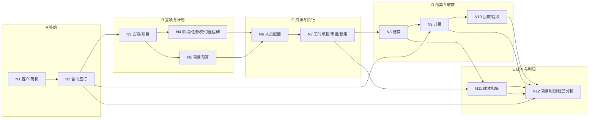

# 结论

> [!summary] 一句话结论
> 四套系统（HR / CRM / PMT / FS）的问题，不是"选整合还是选重建"，而是**先用整合把主数据和口径统一，再用重建把算不出利润的环节补上**。建议走「**整合打底、重建收口**」：一期不做全量推翻，也绝不允许长期停留在接口拼接。

---

## 0. 三个判断（先看这里）

**判断一：主数据不是 IT 资产清单，是经营口径。**
谁掌握客户编码、合同号、项目号，谁就决定了收入、成本、利润怎么归集。主数据治理的本质是**划定四个数据 Owner 的权责边界**，不是建几张表。表建得再漂亮，没有 Owner 签字，三个月后一定会重新分裂。

**判断二：链路 1 的真实缺口不在"流程"，在"成本与利润"。**
四套系统里，客户、商机、合同、项目、工时、结算、开票、回款的**流程骨架基本都有**；真正从 0 到 1 的是 N4 任务/WBS、N6 技能与可用工时、N8 结算金额、N11 完整用工成本/EAC、N12 项目 P&L——这五项正好构成"算利润"的完整链条，而四套系统没有任何一套跑通过。所以**只做系统整合，交不出项目利润**。

**判断三：两个方案不是二选一，是先后顺序。**
"整合版"的阶段 0–2（盘底、主数据、试点链路）与"重建版"的 W0–W2（蓝图、平台底座、主数据）是同一件事的两种叫法。真正的分歧只有一个：**主数据统一之后，是继续用四套系统接接口，还是按域换掉它们。** 我的答案是后者，但必须先完成前者。

---

## 1. 主数据模型

### 1.1 判定口径

一张表算不算主数据，按四条同时满足来判：

1. 被 **2 个及以上业务环节**引用（不是某个模块的私有表）；
2. 有**稳定、可对外**的业务编码（人能读、能写在合同和发票上）；
3. **生命周期长于单据**（客户活着、合同执行完，主数据还在）；
4. 变更需要**审批或备案**（不能谁都能改）。

按此口径，当前判定主数据 **24 项（字典为主子两表）**。它们只是底座，不是全部——链路 1 还涉及约 40 张业务与财务事实表，那些不进主数据治理范围，否则治理一定失焦。

### 1.2 主数据清单与业务域

| # | 表名 | 中文名 | 用途 | 业务域 |
|---|---|---|---|---|
| 1 | `md_company` | 法人主体表 | 公司、纳税主体、开票与银行信息 | 组织域 |
| 2 | `md_org` | 组织架构表 | 集团—公司—部门—产品线组织树 | 组织域 |
| 3 | `md_position` | 岗位表 | 岗位、职类、职级 | 组织域 |
| 4 | `md_employee` | 员工主数据表 | 员工基本信息、任职信息、顾问信息 | 人员域 |
| 5 | `md_employee_private` | 员工敏感信息表 | 身份证、银行卡、社保、公积金 | 人员域 |
| 6 | `md_employee_contract` | 劳动合同表 | 员工劳动合同 | 人员域 |
| 7 | `md_employee_cost_rate` | 人员成本费率表 | 按生效日期记录人员成本单价 | 人员域 |
| 8 | `md_user` | 系统用户表 | 登录账号，与员工一对一 | 平台域 |
| 9 | `md_customer` | 客户主数据表 | 客户基本信息、财税信息、信用与账期 | 客户域 |
| 10 | `md_customer_contact` | 客户联系人表 | 客户联系人 | 客户域 |
| 11 | `md_customer_address` | 客户地址表 | 注册地址、开票地址、收货地址 | 客户域 |
| 12 | `crm_customer_profile` | 客户营销扩展表 | 客户营销 360 字段（可选） | 客户域 |
| 13 | `md_project` | 项目主数据表 | 项目基本信息、预算与成本汇总 | 项目交付域 |
| 14 | `md_project_member` | 项目成员表 | 项目成员、角色、投入比例 | 项目交付域 |
| 15 | `md_project_member_period` | 项目成员投入段表 | 成员计划/实际投入时间段 | 项目交付域 |
| 16 | `md_project_contract` | 项目合同关系表 | 项目与合同的多对多关系 | 项目交付域 |
| 17 | `md_contract` | 合同主表 | 合同基本信息、金额、状态、条款 | 合同商务域 |
| 18 | `md_contract_milestone` | 合同里程碑表 | 收付款计划、开票与回款 | 合同商务域 |
| 19 | `md_contract_line` | 合同明细表 | 合同产品/物料明细 | 合同商务域 |
| 20 | `md_contract_payment_unit` | 合同付款单位表 | 合同付款阶段/付款单位 | 合同商务域 |
| 21 | `md_product` | 产品/物料主数据表 | 产品、服务、物料 | 产品域 |
| 22 | `md_tax_rate` | 税率主数据表 | 合同类型对应的税率历史 | 财务域 |
| 23 | `md_id_mapping` | 主数据 ID 映射表 | 旧系统 ID 与新主数据 ID 对照 | 平台域 |
| 24 | `md_dict` / `md_dict_item` | 数据字典表 / 字典项表 | 全局枚举与编码 | 平台域 |

### 1.3 业务域与数据 Owner

业务域不能只写在表上，必须落到人。建议按下表一次性定死，避免后期扯皮：

| 业务域 | 覆盖范围 | 数据 Owner | 典型争议 |
|---|---|---|---|
| 组织域 | 法人、组织树、岗位 | HRD | 产品线与成本中心是否同构 |
| 人员域 | 员工、敏感信息、劳动合同、成本费率 | HRD（成本口径财务会签） | 顾问/外包是否纳入员工主数据 |
| 客户域 | 客户、联系人、地址、营销扩展 | 销售负责人 | 一客多码、集团客户与付款单位不一致 |
| 合同商务域 | 合同、里程碑、合同行、付款单位 | 销售负责人（财务会签） | 框架合同与子合同、变更版本 |
| 项目交付域 | 项目、成员、投入段、项目-合同关系 | 交付负责人 / PMO | 合同与项目 N:N 时的主合同认定 |
| 产品域 | 产品 / 服务 / 物料 | 产品负责人 | 服务类产品是否单独建码 |
| 财务域 | 税率（二期扩展科目、期间） | CFO | 税率按合同类型还是按客户 |
| 平台域 | 用户、字典、ID 映射 | IT 负责人 | 旧系统 ID 保留多久 |

### 1.4 两条现在就要定的规则

- **编码唯一范围**：客户按"法人 + 统一社会信用代码"唯一，合同按"合同号 + 子合同号"唯一，项目按"项目编码"全局唯一。范围不定，去重就永远做不完。
- **合并与停用**：主数据只允许"停用 + 指向合并目标"，不允许物理删除。否则历史单据的追溯链会在第一年就断掉。

---

## 2. 业务链路

### 2.1 适用场景

**项目型 / 咨询型 / 交付型公司**：收入靠"人 × 工时"，一份合同要穿过销售、交付、财务三个部门才能变成钱；老板想知道"这个项目到底赚不赚钱"，但数据分散在四套系统里。

### 2.2 预期解决什么问题

| # | 问题 | 现状 | 链路跑通后 |
|---|---|---|---|
| 1 | 一数一源 | 客户/合同/项目在四套系统各有一份，编码不同 | 一套主数据，一个 ID 贯穿到底 |
| 2 | 全链可追溯 | 从合同查不到工时，从工时查不到结算 | 任意单据可上溯到合同、下追到回款 |
| 3 | 金额对平 | 合同、里程碑、结算、开票、回款各算各的 | 五个金额口径一致，差异 ≤ 0.5% |
| 4 | 项目利润 | 只有零散看板，算不出项目毛利 | 收入 − 人工 − 费用 − EAC = 项目利润 |
| 5 | 人效可度量 | 有考勤人数，没有可计费工时与利用率 | 利用率、人均产出可按组织/客户看 |

### 2.3 链路图（12 节点 / 5 阶段）

### 2.4 五个阶段与交接物

| 阶段 | 节点 | 交接物 | 关键主键 |
|---|---|---|---|
| A 签约 | N1 客户/商机 → N2 合同签订 | 合同签订交接单 | `customer_id`、`opportunity_id` |
| B 立项与计划 | N3 立项/项目 → N4 交付 / N5 预算 | 立项交接单、项目计划包 | `contract_id`、`project_id` |
| C 资源与执行 | N6 人员配置 → N7 工时 | 资源需求单、成员/期间 | `task_id`、`budget_hours`、`employee_id` |
| D 结算与收款 | N8 结算 → N9 开票 → N10 回款 | 结算交接单、开票交接单、回款核销单 | `timesheet_item_id`、`settlement_order_id`、`invoice_id` |
| E 成本与利润 | N11 成本归集 → N12 利润分析 | 成本归集包、经营分析包 | `timesheet_item_id`、`period_id`、`subject_id` |

### 2.5 从头到尾发生了什么

1. **签约**：销售建客户档案、推商机，商机赢单后转成合同，合同上拆出收款里程碑（预付、到货、验收、质保），这一刻"未来能收多少钱"就定死了。
2. **立项与计划**：合同转项目，指定项目经理，把交付范围拆成阶段、任务（WBS）和交付里程碑，同时把合同额拆成人力、采购、费用、外包四类预算。
3. **资源与执行**：按任务和预算工时配人，记录每个人的进场/离场期间、投入比例、成本单价和结算单价；员工按周、按任务填工时，审批通过后锁定，锁定后不可改。
4. **结算与收款**：锁定且可结算的工时转成结算单，结算单或合同里程碑转成发票，客户付款后按发票核销，形成应收余额和逾期。
5. **成本与利润**：工时按人月成本分摊成人工成本，费用与采购按项目归集，算出已发生成本；再用 EAC（预计总成本）倒推项目利润和毛利率，按项目、组织、客户三个维度复盘。

一句话：**这是一条由 6 个主键接力完成的链路**——`customer_id → contract_id → project_id → task_id → employee_id → timesheet_item_id → settlement_order_id → invoice_id → receipt_id`。每个节点只负责产生、加工、传递其中一段，断点永远出在"该传的键没传、该写的金额没写、该有的状态没校验"。

### 2.6 三个必须动系统的断点

| 断点 | 现状证据 | 后果 |
|---|---|---|
| 两套里程碑混用 | 收款里程碑与交付里程碑没有分表 | 财务看"钱"，交付看"事"，验收了不等于能开票 |
| 工时 → 结算 → 开票断开 | PMT 结算批次总额恒为 0；发票只挂里程碑，不挂结算单 | 按人天结算的项目无法自动开票，只能手工补 |
| 成本 → 利润断开 | 无完整用工成本、无按工时分摊、无 EAC | 项目利润只能靠拍脑袋，毛利率无法复盘 |

> [!warning] 这不是"流程优化"能解决的
> 前两个断点是表结构和字段缺失，第三个断点是**能力缺失**（42 项 A 类全新功能里有 19 项集中在 N11/N12）。流程再顺，没有这些表和逻辑，利润依然算不出来。

---

## 3. 搭建思路

### 3.1 两个方案到底在争什么

| 维度 | 方案 A：整合 | 方案 B：重建 |
|---|---|---|
| 做法 | 保留四套系统，建统一主数据 + 接口打通 + 旧系统只读 | 新建一套平台，按业务域逐块替换四套系统 |
| 交付物 | `md_*` 主数据、兼容视图、接口/ETL、统一报表 | 平台底座 + 各业务域应用 + 数据迁移 + 旧系统退役 |
| 主要收益 | 风险低、见效快、不打断业务 | 模型统一、无历史包袱、长期维护成本低 |
| 主要代价 | 多系统长期并存，接口矩阵与技术债固化 | 投入大、周期长、迁移与变革风险高 |
| 能交付 | B 类整合（15）、C 类改造（17）、D 类复用（9 组） | A/B/C/D 全部 |
| 交不出 | **42 项 A 类全新能力，尤其是成本与利润** | —— |
| 终局 | 四套系统 + 一个主数据中台，长期运维四套 | 一套系统，旧系统全部退役 |

### 3.2 判断依据（来自知识库的证据，不是偏好）

- 四套系统共 **173 张表、1164 条接口**，但链路 1 的 12 个节点里，**42 项是全新能力、15 项是跨系统整合、17 项是改造统一、只有 9 组可以直接复用**。
- 也就是说：**74 项需要新建、整合或改造，只有 9 组能搬。** "整合"能解决那 15 + 17 项，解决不了那 42 项；而那 42 项恰好是"算利润"的链条。
- 更关键的是，几处"看起来有"的能力实际是空壳：PMT 结算批次总额恒为 0、项目人工成本字段无写入、HR 工资条与批量生成工资是空实现、PMT 审批引擎只接工时。**这类"有表无逻辑"不能靠接口打通，只能重写。**
- 反过来，一次性推翻四套系统同样不成立：客户、合同、项目、工时、结算、考勤、预算都在连续运行，**大爆炸切换的风险是业务停摆，不是技术风险**。

**所以：纯整合交付不了 CEO 要的"项目利润"，纯重建承受不了业务中断。两者都不该单独选。**

### 3.3 建议路线：整合打底，重建收口

#### 阶段一：整合打底（立标准，不换系统）

目的不是"永久保留四套系统"，而是用最低成本拿到两样东西：**主数据的唯一性** 和 **真实的链路断点清单**。

1. **盘底**：四套系统的表清单、数据量、编码冲突、重复率、空值率、金额单位、状态枚举、比例口径。
2. **主数据**：24 项主数据落地；旧表视图化；写入口统一收口到 `md_*`；旧 ID 存入 `md_id_mapping`。
3. **试点**：选 1 个客户、1 个合同、1 个项目、2–3 名员工、2 周工时、1 个结算批次、1 张发票、1 笔回款，跑通 A→E 全链。

**退出标准**：主数据唯一率 ≥ 99.5%；试点链路 100% 可追溯；合同/里程碑/结算/开票/回款金额差异 ≤ 0.5%；四个数据 Owner 签字。

#### 阶段二：重建收口（换载体，按域替换）

以阶段一验证过的主数据模型为地基，按域重建、双轨并行、逐域切换、旧域退役：

**平台底座（IAM / 权限 / 审批 / 审计）→ 主数据 → CRM + 合同 → 项目 + 工时 + 结算 → HR + 考勤 → FS + 预算 + 经营 → 门户 + 旧系统退役**

每个域的动作固定为四步：**双轨并行 → 金额对平 → 旧域只读 → 下线**；每个域都必须有独立回滚方案。

#### 进入阶段二的三道门禁（必须同时满足）

| # | 门禁 | 量化标准 | 签字人 |
|---|---|---|---|
| 1 | 主数据可信 | 唯一率 ≥ 99.5%，无新增重复 | 四位数据 Owner |
| 2 | 试点对平 | 全链金额差异 ≤ 0.5% | CFO |
| 3 | 流程稳定 | 关键业务流程不再大幅变化 | 业务负责人 |

门禁不过，就停在阶段一继续治理——**这是允许的，甚至是明智的**；但必须承认此时"项目利润"仍然算不准，不要用一份好看的报表假装整合已经完成。

### 3.4 什么情况下我会改变这个建议

| 情形 | 判断 | 理由 |
|---|---|---|
| 四套系统实际只有 1–2 套在用、用户很少 | 跳过两阶段，直接单点替换 | 并存成本已经不存在，重建的收益不足以覆盖迁移成本 |
| 预算或团队不支持阶段二 | 停在阶段一，只做 MDM + 接口 | 但要写清楚"利润仍不可算"的边界，避免误判为已完成 |
| 历史数据不可信、清洗不到 99.5% | 阶段二改为"新老分治" | 只迁未结业务，历史数据只读归档，不追求全量迁移 |
| 业务规则仍在剧烈变化 | 先改流程，再定系统 | 在流沙上盖楼，重建一次会再重建第二次 |

### 3.5 五条不做

1. **不做大爆炸切换**——一次切完等于把技术风险变成经营风险。
2. **不在主数据冻结前开发业务功能**——地基没打完就砌墙，后面一定返工。
3. **不为"大一统"上微服务/中台**——首期模块化单体足够，别用架构复杂度换存在感。
4. **不把半成品纳入首期**——PMT 财务前端、HR 薪酬计算这类空壳模块，先不接。
5. **不让 IT 单独背这个项目**——CEO 任整合委员会组长，四个数据 Owner 签字，否则跨部门争议永远推不动。

### 3.6 下一步五件事

| # | 动作 | 负责人 | 产出 |
|---|---|---|---|
| 1 | 成立整合委员会，指定四个数据 Owner | CEO | 任命与授权 |
| 2 | 四套系统数据盘点（表、量、重复、编码冲突） | IT + 各 Owner | 数据盘点报告 |
| 3 | 冻结 24 项主数据表结构与编码规则 | HRD / 销售 / 交付 / CFO 会签 | 主数据标准 V1 |
| 4 | 选一条试点合同，跑通 A→E 全链 | PMO | 试点全链路报告 + 对账报告 |
| 5 | 按三道门禁决策是否进入阶段二 | 整合委员会 | 阶段二立项决议 |

---

## 4. 证据边界（这份结论的适用条件）

- **依据**：四套系统源码与数据字典（173 张表）、接口清单（1164 条）、链路 1 设计（12 节点 / 5 阶段）、新增功能清单（42 A / 15 B / 17 C / 9 D）、主数据表结构设计（24 项）、整合版与重建版两份路线图。
- **"源码未见" ≠ "业务不存在"**：项目阶段/任务、技能、可用工时可能存在于 Excel、企业微信或线下 SOP 中。本结论只证明"四套系统内没有实现"。
- **"有表无逻辑"按新增计**：如 PMT 结算总额恒为 0、项目人工成本字段无写入、工资条空实现。这类问题需要补逻辑，不是补接口。
- **利润类结论依赖财务口径**：收入确认按开票、里程碑还是完工百分比，必须先由 CFO 定死，否则 N12 的利润数字仍然会有三套答案。
- **二期边界**：供应商/采购/应付、多币种、合同变更版本、收入确认自动化暂不在首期，但表结构需预留字段，避免二次改造。

---

> **最终结论：先整合，解决"数对不上"；再重建，解决"利润算不出"。**
> 整合是手段，重建是终局。把它们当成二选一，才是这份方案里最大的风险。
